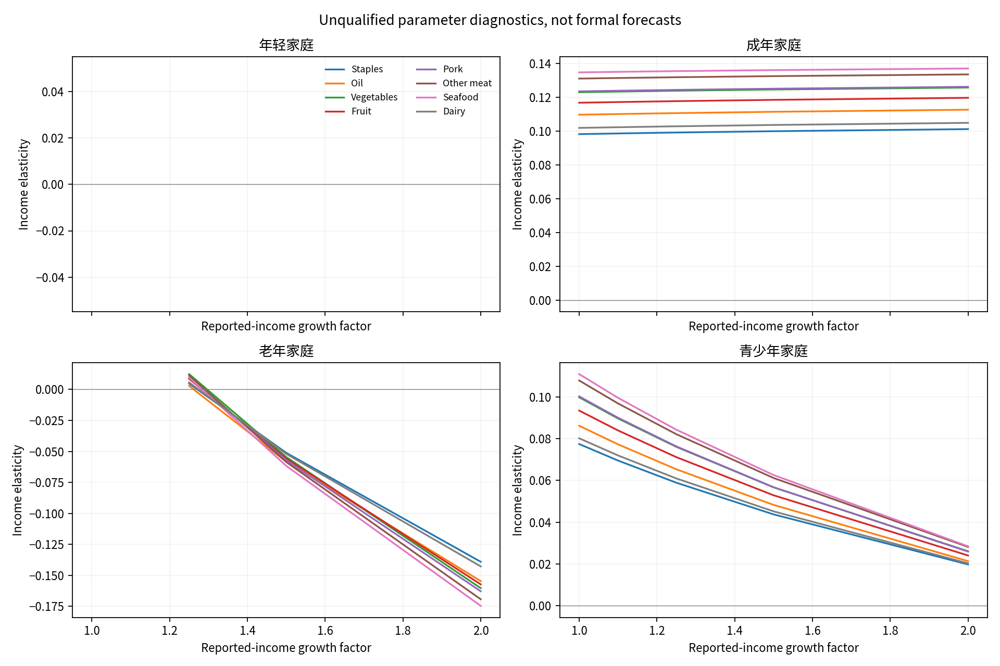
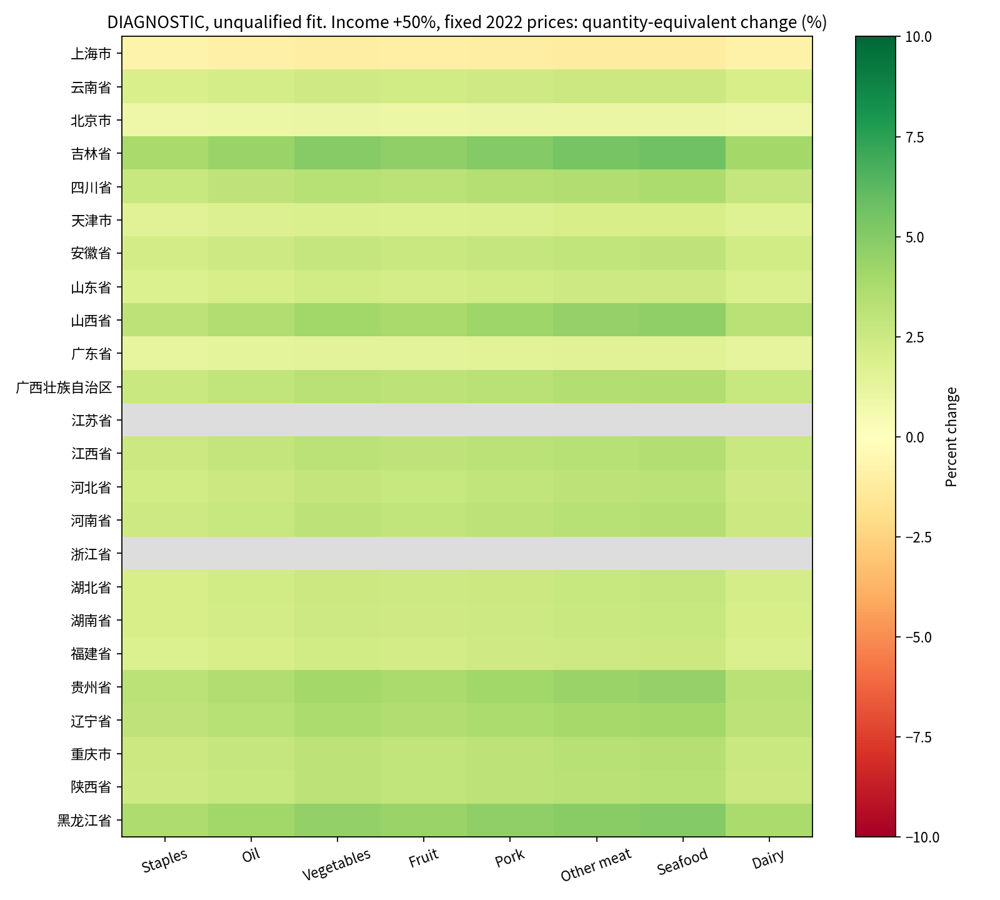
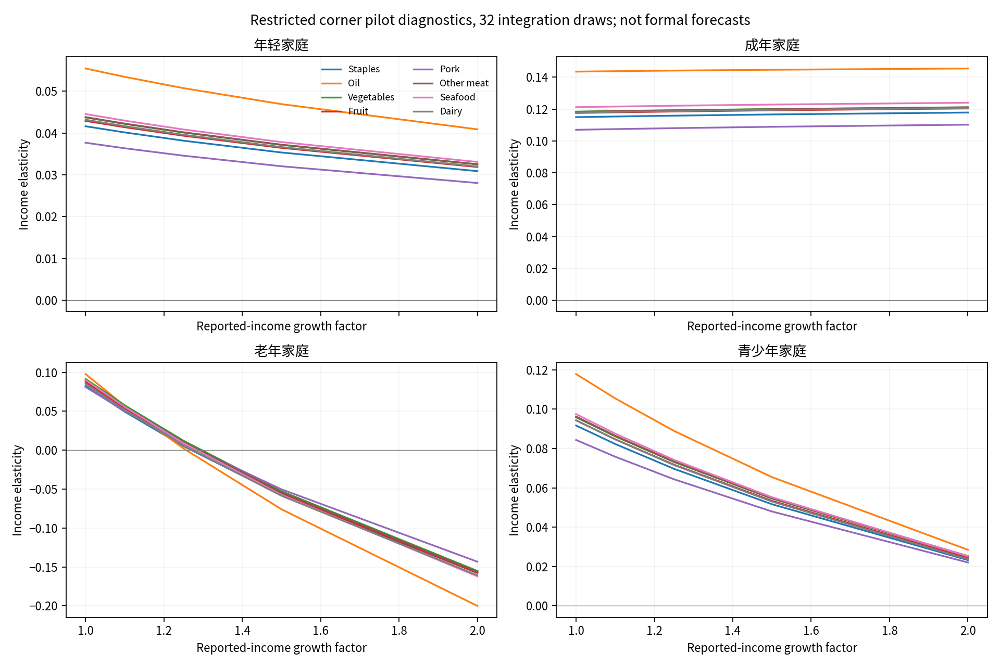
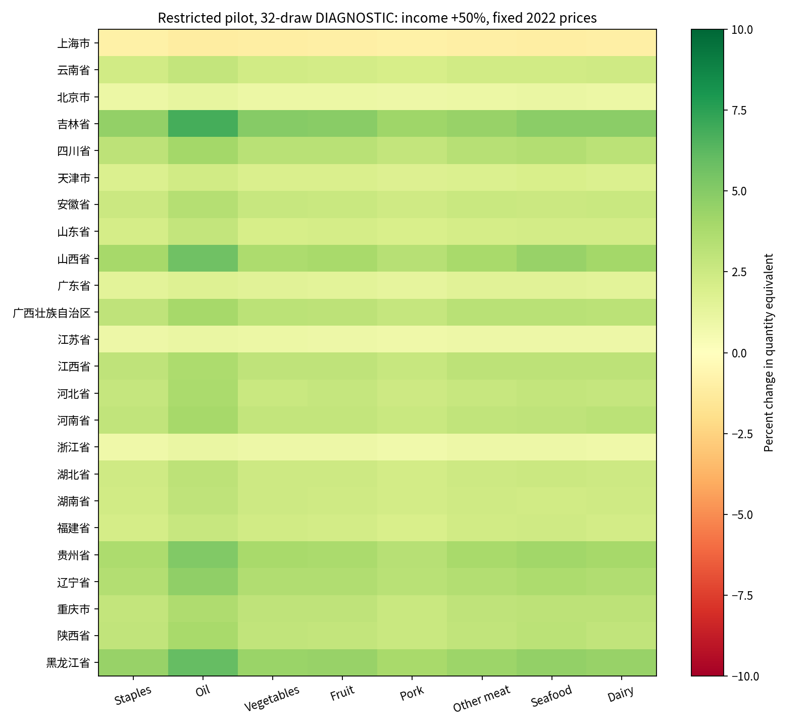

# 央视数据 MAIDADS 实证结果

本报告仅使用本次 Stata/Mata 输出，不沿用农户调查或旧 EASI 弹性。没有 bootstrap；最终食品弹性不提供伪造的标准误、p 值或置信区间。

## 主要结论与未完成项

当前真实数据的原生完整自由 MAIDADS/AIDADS 没有通过资格检查，不能将以下负价格弹性或情景解释为正式估计结论。

AIDS、QUAIDS 的八类主规格达到数值驻点，但主食补偿自价格弹性仍为正。人口口径和汇总敏感性不是按显著性或符号选择样本。

warm8 虽然代表点弹性温和，最低预算前沿附近的部分食品支出弹性最大达到约4.9×10^15，均值也被拉到约3.35×10^11；所有极值保留。这本身就使该候选的弹性分布不适合作正式结论。

2022 时间留出中，省份历史季度份额基准比 AIDS/QUAIDS 的份额预测更准确；当前 pooled 规格不能证明已经识别可靠的因果价格响应。

零购买扩展是完整季度记录上的受限随机偏好试估，不是全样本完整自由 MAIDADS。支持点近似的平均预算低估约13%，其外部验证不能当作全体家庭验证。

受限角点也未达到正式实证标准：同θ从16增加到256积分draw使目标值上升约9.4%；支持点2022留出中水果份额/购买率明显低估、猪肉份额明显高估。不能因为自价格由效用结构保证为负就认定拟合合格。

受限角点的2022支持点留出中，7个独立份额方程有6个RMSE劣于常数训练均值，8类购买概率有6个Brier劣于该基准；其曲线不能作为已经通过样本外验证的需求预测。

没有坚果独立价格、准确人口或确认的收入报告周期；十类体系和准确人均年/月收入不能从现有信息中凭空补全。

## 1. 样本与测量

| metric | value |
| --- | --- |
| raw_rows | 10420107 |
| rows_in_exact_duplicate_groups_kept | 689776 |
| rows_volume_zero | 8033926 |
| positive_spend_zero_volume | 8031806 |
| rows_price_missing | 8033908 |
| positive_price_unitvalue_disagreement | 3682 |
| nonpositive_or_missing_spend_rows | 5295 |
| household_months_changed_type | 2391 |
| household_months_changed_income_band | 10652 |
| household_months_changed_size_band | 3527 |
| household_months_citytier_unmatched | 0 |
| household_months_any_transaction | 584838 |
| household_months_active_21items | 584835 |
| household_months_positive_nut_only | 1167 |
| household_months_positive_covered_budget | 583668 |
| households_any_transactions | 27653 |
| quarter_8_zero_covered_budget | 81 |
| quarter_8_positive_covered_budget | 203337 |
| quarter_8_positive_complete_window | 185908 |
| quarter_8_cells | 14676 |
| quarter_8_median_cell_n | 8 |
| quarter_8_cells_n_one_retained | 1911 |
| year_8_zero_covered_budget | 21 |
| year_8_positive_covered_budget | 58150 |
| year_8_positive_complete_window | 37903 |
| year_8_cells | 3730 |
| year_8_median_cell_n | 9 |
| year_8_cells_n_one_retained | 462 |
| quarter_9_zero_covered_budget | 81 |
| quarter_9_positive_covered_budget | 203337 |
| quarter_9_positive_complete_window | 185908 |
| quarter_9_cells | 14676 |
| quarter_9_median_cell_n | 8 |
| quarter_9_cells_n_one_retained | 1911 |
| year_9_zero_covered_budget | 21 |
| year_9_positive_covered_budget | 58150 |
| year_9_positive_complete_window | 37903 |
| year_9_cells | 3730 |
| year_9_median_cell_n | 9 |
| year_9_cells_n_one_retained | 462 |

零购买按正支出定义，不把记录数量为零当作零购买。价格为独立外部类别监测价格的固定篮子指数；数量是参考价格下的购买量等价值，不是公斤。八类不包含坚果，不能用食用油价格给坚果补一个第十类。

样本没有已验证的收入报告周期、准确家庭人口及人口权重。家庭形态仅为年轻、成年、老年、青少年四种原始标签，不是核家庭/扩展家庭。

| g8 | spend | priced_spend | priced_share |
| --- | --- | --- | --- |
| 1 | 2.16173e+07 | 1.94018e+07 | 0.897511 |
| 2 | 2.05953e+07 | 2.05953e+07 | 1 |
| 3 | 3.24594e+07 | 3.24594e+07 | 1 |
| 4 | 4.12218e+07 | 4.12218e+07 | 1 |
| 5 | 3.69804e+07 | 3.69804e+07 | 1 |
| 6 | 4.35573e+07 | 4.35573e+07 | 1 |
| 7 | 2.78734e+07 | 2.78734e+07 | 1 |
| 8 | 4.26017e+07 | 2.64141e+07 | 0.620025 |

**人口口径敏感性**

| frequency | sample | metric | value |
| --- | --- | --- | --- |
| quarter | all_positive | windows | 203337 |
| quarter | all_positive | m_mean | 212.414 |
| quarter | all_positive | m_min | 0.231667 |
| quarter | all_positive | m_p1 | 11.25 |
| quarter | all_positive | m_p50 | 152.689 |
| quarter | all_positive | m_p99 | 999.329 |
| quarter | all_positive | m_max | 4577.34 |
| quarter | all_positive | m_lastsize_mean | 212.765 |
| quarter | all_positive | m_lastsize_min | 0.231667 |
| quarter | all_positive | m_lastsize_p1 | 11.25 |
| quarter | all_positive | m_lastsize_p50 | 152.857 |
| quarter | all_positive | m_lastsize_p99 | 1001.75 |
| quarter | all_positive | m_lastsize_max | 4577.34 |
| quarter | all_positive | relative_m_change_mean | 0.000483579 |
| quarter | all_positive | relative_m_change_min | -0.679201 |
| quarter | all_positive | relative_m_change_p1 | -0.131975 |
| quarter | all_positive | relative_m_change_p50 | 0 |
| quarter | all_positive | relative_m_change_p99 | 4.44089e-16 |
| quarter | all_positive | relative_m_change_max | 2.17743 |
| quarter | all_positive | absolute_relative_m_change_mean | 0.00657391 |
| quarter | all_positive | absolute_relative_m_change_min | 0 |
| quarter | all_positive | absolute_relative_m_change_p1 | 0 |
| quarter | all_positive | absolute_relative_m_change_p50 | 0 |
| quarter | all_positive | absolute_relative_m_change_p99 | 0.285167 |
| quarter | all_positive | absolute_relative_m_change_max | 2.17743 |
| quarter | size_changes | windows | 3482 |
| quarter | size_changes | m_mean | 195.694 |
| quarter | size_changes | m_min | 3.81222 |
| quarter | size_changes | m_p1 | 18.7194 |
| quarter | size_changes | m_p50 | 150.243 |
| quarter | size_changes | m_p99 | 915.112 |
| quarter | size_changes | m_max | 2624.84 |
| quarter | size_changes | m_lastsize_mean | 216.203 |
| quarter | size_changes | m_lastsize_min | 2.1875 |
| quarter | size_changes | m_lastsize_p1 | 18.5444 |
| quarter | size_changes | m_lastsize_p50 | 159.422 |
| quarter | size_changes | m_lastsize_p99 | 1029.61 |
| quarter | size_changes | m_lastsize_max | 2510.98 |
| quarter | size_changes | relative_m_change_mean | 0.0282394 |
| quarter | size_changes | relative_m_change_min | -0.679201 |
| quarter | size_changes | relative_m_change_p1 | -0.518109 |
| quarter | size_changes | relative_m_change_p50 | -0.17405 |
| quarter | size_changes | relative_m_change_p99 | 1.36601 |
| quarter | size_changes | relative_m_change_max | 2.17743 |
| quarter | size_changes | absolute_relative_m_change_mean | 0.383894 |
| quarter | size_changes | absolute_relative_m_change_min | 1.11022e-16 |
| quarter | size_changes | absolute_relative_m_change_p1 | 0.0670113 |
| quarter | size_changes | absolute_relative_m_change_p50 | 0.324755 |
| quarter | size_changes | absolute_relative_m_change_p99 | 1.36601 |
| quarter | size_changes | absolute_relative_m_change_max | 2.17743 |
| quarter | no_size_changes | windows | 199855 |
| quarter | no_size_changes | m_mean | 212.705 |
| quarter | no_size_changes | m_min | 0.231667 |
| quarter | no_size_changes | m_p1 | 11.1333 |
| quarter | no_size_changes | m_p50 | 152.733 |
| quarter | no_size_changes | m_p99 | 1001.37 |
| quarter | no_size_changes | m_max | 4577.34 |
| quarter | no_size_changes | m_lastsize_mean | 212.705 |
| quarter | no_size_changes | m_lastsize_min | 0.231667 |
| quarter | no_size_changes | m_lastsize_p1 | 11.1333 |
| quarter | no_size_changes | m_lastsize_p50 | 152.733 |
| quarter | no_size_changes | m_lastsize_p99 | 1001.37 |
| quarter | no_size_changes | m_lastsize_max | 4577.34 |
| quarter | no_size_changes | relative_m_change_mean | 1.65993e-17 |
| quarter | no_size_changes | relative_m_change_min | -5.55112e-16 |
| quarter | no_size_changes | relative_m_change_p1 | -2.22045e-16 |
| quarter | no_size_changes | relative_m_change_p50 | 0 |
| quarter | no_size_changes | relative_m_change_p99 | 2.22045e-16 |
| quarter | no_size_changes | relative_m_change_max | 4.44089e-16 |
| quarter | no_size_changes | absolute_relative_m_change_mean | 9.10949e-17 |
| quarter | no_size_changes | absolute_relative_m_change_min | 0 |
| quarter | no_size_changes | absolute_relative_m_change_p1 | 0 |
| quarter | no_size_changes | absolute_relative_m_change_p50 | 0 |
| quarter | no_size_changes | absolute_relative_m_change_p99 | 3.33067e-16 |
| quarter | no_size_changes | absolute_relative_m_change_max | 5.55112e-16 |
| quarter | complete_positive | windows | 185908 |
| quarter | complete_positive | m_mean | 221.592 |
| quarter | complete_positive | m_min | 0.792121 |
| quarter | complete_positive | m_p1 | 17.9167 |
| quarter | complete_positive | m_p50 | 160.744 |
| quarter | complete_positive | m_p99 | 1022.28 |
| quarter | complete_positive | m_max | 4577.34 |
| quarter | complete_positive | m_lastsize_mean | 221.977 |
| quarter | complete_positive | m_lastsize_min | 0.792121 |
| quarter | complete_positive | m_lastsize_p1 | 17.9261 |
| quarter | complete_positive | m_lastsize_p50 | 160.966 |
| quarter | complete_positive | m_lastsize_p99 | 1025.06 |
| quarter | complete_positive | m_lastsize_max | 4577.34 |
| quarter | complete_positive | relative_m_change_mean | 0.000492459 |
| quarter | complete_positive | relative_m_change_min | -0.679201 |
| quarter | complete_positive | relative_m_change_p1 | -0.162612 |
| quarter | complete_positive | relative_m_change_p50 | 0 |
| quarter | complete_positive | relative_m_change_p99 | 4.44089e-16 |
| quarter | complete_positive | relative_m_change_max | 2.17743 |
| quarter | complete_positive | absolute_relative_m_change_mean | 0.00711936 |
| quarter | complete_positive | absolute_relative_m_change_min | 0 |
| quarter | complete_positive | absolute_relative_m_change_p1 | 0 |
| quarter | complete_positive | absolute_relative_m_change_p50 | 0 |
| quarter | complete_positive | absolute_relative_m_change_p99 | 0.309341 |
| quarter | complete_positive | absolute_relative_m_change_max | 2.17743 |
| quarter | complete_size_changes | windows | 3442 |
| quarter | complete_size_changes | m_mean | 197.076 |
| quarter | complete_size_changes | m_min | 3.81222 |
| quarter | complete_size_changes | m_p1 | 19.6861 |
| quarter | complete_size_changes | m_p50 | 151.575 |
| quarter | complete_size_changes | m_p99 | 915.112 |
| quarter | complete_size_changes | m_max | 2624.84 |
| quarter | complete_size_changes | m_lastsize_mean | 217.862 |
| quarter | complete_size_changes | m_lastsize_min | 4.69556 |
| quarter | complete_size_changes | m_lastsize_p1 | 20.0083 |
| quarter | complete_size_changes | m_lastsize_p50 | 160.963 |
| quarter | complete_size_changes | m_lastsize_p99 | 1029.61 |
| quarter | complete_size_changes | m_lastsize_max | 2510.98 |
| quarter | complete_size_changes | relative_m_change_mean | 0.0265985 |
| quarter | complete_size_changes | relative_m_change_min | -0.679201 |
| quarter | complete_size_changes | relative_m_change_p1 | -0.518109 |
| quarter | complete_size_changes | relative_m_change_p50 | -0.175963 |
| quarter | complete_size_changes | relative_m_change_p99 | 1.33484 |
| quarter | complete_size_changes | relative_m_change_max | 2.17743 |
| quarter | complete_size_changes | absolute_relative_m_change_mean | 0.384528 |
| quarter | complete_size_changes | absolute_relative_m_change_min | 0.00574534 |
| quarter | complete_size_changes | absolute_relative_m_change_p1 | 0.0731856 |
| quarter | complete_size_changes | absolute_relative_m_change_p50 | 0.325095 |
| quarter | complete_size_changes | absolute_relative_m_change_p99 | 1.33484 |
| quarter | complete_size_changes | absolute_relative_m_change_max | 2.17743 |
| year | all_positive | windows | 58150 |
| year | all_positive | m_mean | 206.251 |
| year | all_positive | m_min | 0.25 |
| year | all_positive | m_p1 | 14.625 |
| year | all_positive | m_p50 | 152.242 |
| year | all_positive | m_p99 | 939.353 |
| year | all_positive | m_max | 4019.47 |
| year | all_positive | m_lastsize_mean | 207.386 |
| year | all_positive | m_lastsize_min | 0.25 |
| year | all_positive | m_lastsize_p1 | 14.6 |
| year | all_positive | m_lastsize_p50 | 152.969 |
| year | all_positive | m_lastsize_p99 | 947.391 |
| year | all_positive | m_lastsize_max | 4019.47 |
| year | all_positive | relative_m_change_mean | 0.000406068 |
| year | all_positive | relative_m_change_min | -0.693684 |
| year | all_positive | relative_m_change_p1 | -0.321965 |
| year | all_positive | relative_m_change_p50 | 0 |
| year | all_positive | relative_m_change_p99 | 0.368463 |
| year | all_positive | relative_m_change_max | 2.2006 |
| year | all_positive | absolute_relative_m_change_mean | 0.0185528 |
| year | all_positive | absolute_relative_m_change_min | 0 |
| year | all_positive | absolute_relative_m_change_p1 | 0 |
| year | all_positive | absolute_relative_m_change_p50 | 1.11022e-16 |
| year | all_positive | absolute_relative_m_change_p99 | 0.4524 |
| year | all_positive | absolute_relative_m_change_max | 2.2006 |
| year | size_changes | windows | 3943 |
| year | size_changes | m_mean | 192.571 |
| year | size_changes | m_min | 3.81222 |
| year | size_changes | m_p1 | 24.3202 |
| year | size_changes | m_p50 | 149.091 |
| year | size_changes | m_p99 | 836.724 |
| year | size_changes | m_max | 2245.3 |
| year | size_changes | m_lastsize_mean | 209.305 |
| year | size_changes | m_lastsize_min | 4.69556 |
| year | size_changes | m_lastsize_p1 | 23.0745 |
| year | size_changes | m_lastsize_p50 | 158.158 |
| year | size_changes | m_lastsize_p99 | 969.17 |
| year | size_changes | m_lastsize_max | 2437.75 |
| year | size_changes | relative_m_change_mean | 0.00598855 |
| year | size_changes | relative_m_change_min | -0.693684 |
| year | size_changes | relative_m_change_p1 | -0.482916 |
| year | size_changes | relative_m_change_p50 | -0.0962431 |
| year | size_changes | relative_m_change_p99 | 1.08029 |
| year | size_changes | relative_m_change_max | 2.2006 |
| year | size_changes | absolute_relative_m_change_mean | 0.27361 |
| year | size_changes | absolute_relative_m_change_min | 0 |
| year | size_changes | absolute_relative_m_change_p1 | 0.0166113 |
| year | size_changes | absolute_relative_m_change_p50 | 0.218149 |
| year | size_changes | absolute_relative_m_change_p99 | 1.08029 |
| year | size_changes | absolute_relative_m_change_max | 2.2006 |
| year | no_size_changes | windows | 54207 |
| year | no_size_changes | m_mean | 207.246 |
| year | no_size_changes | m_min | 0.25 |
| year | no_size_changes | m_p1 | 14.1667 |
| year | no_size_changes | m_p50 | 152.558 |
| year | no_size_changes | m_p99 | 946.945 |
| year | no_size_changes | m_max | 4019.47 |
| year | no_size_changes | m_lastsize_mean | 207.246 |
| year | no_size_changes | m_lastsize_min | 0.25 |
| year | no_size_changes | m_lastsize_p1 | 14.1667 |
| year | no_size_changes | m_lastsize_p50 | 152.558 |
| year | no_size_changes | m_lastsize_p99 | 946.945 |
| year | no_size_changes | m_lastsize_max | 4019.47 |
| year | no_size_changes | relative_m_change_mean | 1.50086e-17 |
| year | no_size_changes | relative_m_change_min | -5.55112e-16 |
| year | no_size_changes | relative_m_change_p1 | -3.33067e-16 |
| year | no_size_changes | relative_m_change_p50 | 0 |
| year | no_size_changes | relative_m_change_p99 | 4.44089e-16 |
| year | no_size_changes | relative_m_change_max | 6.66134e-16 |
| year | no_size_changes | absolute_relative_m_change_mean | 1.08747e-16 |
| year | no_size_changes | absolute_relative_m_change_min | 0 |
| year | no_size_changes | absolute_relative_m_change_p1 | 0 |
| year | no_size_changes | absolute_relative_m_change_p50 | 1.11022e-16 |
| year | no_size_changes | absolute_relative_m_change_p99 | 4.44089e-16 |
| year | no_size_changes | absolute_relative_m_change_max | 6.66134e-16 |
| year | complete_positive | windows | 37903 |
| year | complete_positive | m_mean | 232.169 |
| year | complete_positive | m_min | 8.57771 |
| year | complete_positive | m_p1 | 30.4911 |
| year | complete_positive | m_p50 | 175.631 |
| year | complete_positive | m_p99 | 1007.17 |
| year | complete_positive | m_max | 4019.47 |
| year | complete_positive | m_lastsize_mean | 233.729 |
| year | complete_positive | m_lastsize_min | 8.57771 |
| year | complete_positive | m_lastsize_p1 | 30.3445 |
| year | complete_positive | m_lastsize_p50 | 176.741 |
| year | complete_positive | m_lastsize_p99 | 1012.03 |
| year | complete_positive | m_lastsize_max | 4019.47 |
| year | complete_positive | relative_m_change_mean | 0.00059855 |
| year | complete_positive | relative_m_change_min | -0.646548 |
| year | complete_positive | relative_m_change_p1 | -0.342193 |
| year | complete_positive | relative_m_change_p50 | 0 |
| year | complete_positive | relative_m_change_p99 | 0.512505 |
| year | complete_positive | relative_m_change_max | 2.03618 |
| year | complete_positive | absolute_relative_m_change_mean | 0.0246054 |
| year | complete_positive | absolute_relative_m_change_min | 0 |
| year | complete_positive | absolute_relative_m_change_p1 | 0 |
| year | complete_positive | absolute_relative_m_change_p50 | 1.11022e-16 |
| year | complete_positive | absolute_relative_m_change_p99 | 0.525597 |
| year | complete_positive | absolute_relative_m_change_max | 2.03618 |
| year | complete_size_changes | windows | 3398 |
| year | complete_size_changes | m_mean | 201.257 |
| year | complete_size_changes | m_min | 11.8898 |
| year | complete_size_changes | m_p1 | 30.1604 |
| year | complete_size_changes | m_p50 | 155.476 |
| year | complete_size_changes | m_p99 | 878.193 |
| year | complete_size_changes | m_max | 2245.3 |
| year | complete_size_changes | m_lastsize_mean | 218.659 |
| year | complete_size_changes | m_lastsize_min | 11.1146 |
| year | complete_size_changes | m_lastsize_p1 | 28.9944 |
| year | complete_size_changes | m_lastsize_p50 | 165.533 |
| year | complete_size_changes | m_lastsize_p99 | 995.238 |
| year | complete_size_changes | m_lastsize_max | 2437.75 |
| year | complete_size_changes | relative_m_change_mean | 0.00667653 |
| year | complete_size_changes | relative_m_change_min | -0.646548 |
| year | complete_size_changes | relative_m_change_p1 | -0.481642 |
| year | complete_size_changes | relative_m_change_p50 | -0.0965792 |
| year | complete_size_changes | relative_m_change_p99 | 1.08398 |
| year | complete_size_changes | relative_m_change_max | 2.03618 |
| year | complete_size_changes | absolute_relative_m_change_mean | 0.274461 |
| year | complete_size_changes | absolute_relative_m_change_min | 0.00109473 |
| year | complete_size_changes | absolute_relative_m_change_p1 | 0.0176322 |
| year | complete_size_changes | absolute_relative_m_change_p50 | 0.219515 |
| year | complete_size_changes | absolute_relative_m_change_p99 | 1.08398 |
| year | complete_size_changes | absolute_relative_m_change_max | 2.03618 |

基准按窗口末次人口档代理归一化，另列逐月人口代理后平均的结果。发生人口档变化的窗口中，两种预算口径的平均绝对相对差约为季度38.4%、年度27.4%；不能以全样本均值变化很小掩盖个体测量影响。

## 2. 模型比较与资格

同一类别/同一窗口/同一样本的 QML AIC/BIC 才可比较。九类与八类、年与季、删选样本间不能直接用这些信息准则择优。AIDS/QUAIDS 的 qualified 列仅代表数值驻点，并不自动满足全样本凹性；MAIDADS 的该列还包含根、边界与秩诊断。

| model | N | AIC | BIC | score | qualified | omega |
| --- | --- | --- | --- | --- | --- | --- |
| aidads_8_warm | 14676 | -251024 | -250637 | 0.271308 | 0 | 0 |
| aidads_8_year | 3730 | -76013.5 | -75696.1 | 0.0990317 | 0 | 0 |
| maidads_8_coarse | 5733 | -138614 | -138215 | 0.000267664 | 0 | 1.77767 |
| maidads_8_init100 | 14676 | -251058 | -250602 | 0.158523 | 0 | 2.04175 |
| maidads_8_tangent | 14676 | -251239 | -250783 | 0.0883799 | 0 | 3.85145 |
| maidads_8_warm | 14676 | -251155 | -250699 | 0.265914 | 0 | 3.22135 |
| maidads_8_year | 3730 | -76099 | -75725.6 | 0.0678567 | 0 | 1.32723 |
| maidads_family_1 | 5194 | -97188.7 | -96795.3 | 6.43603 | 0 | 0.500028 |
| maidads_family_1_current | 5194 | -97903.2 | -97509.9 | 0.110645 | 0 | 2.26104 |
| maidads_family_2_current | 4337 | -74723.5 | -74341 | 0.00148498 | 0 | 1.64381 |
| maidads_family_3_current | 1437 | -36814.5 | -36498.3 | 3.7509e-06 | 0 | 7.55936 |
| maidads_family_4_current | 3708 | -52237.5 | -51864.4 | 0.133358 | 0 | 6.76901 |
| aids_8 | 14676 | -253344 | -252812 | 4.88896e-09 | 1 | NA |
| aids_quarter_8_coarse | 5733 | -139969 | -139503 | 4.92427e-07 | 1 | NA |
| aids_quarter_8_complete_stable | 14250 | -249323 | -248794 | 3.19909e-08 | 1 | NA |
| aids_quarter_8_permonth_size | 14676 | -253250 | -252718 | 3.68381e-08 | 1 | NA |
| aids_quarter_9 | 14676 | -309038 | -308370 | 2.17599e-07 | 1 | NA |
| aids_year_8 | 3730 | -76948 | -76512.3 | 3.06578e-07 | 1 | NA |
| aids_year_8_permonth_size | 3730 | -76881.8 | -76446.1 | 1.78184e-06 | 1 | NA |
| quaids_8 | 14676 | -253554 | -252969 | 9.86115e-09 | 1 | NA |
| quaids_quarter_8_coarse | 5733 | -140146 | -139634 | 3.73922e-07 | 1 | NA |
| quaids_quarter_8_complete_stable | 14250 | -249432 | -248850 | 4.51742e-09 | 1 | NA |
| quaids_quarter_8_permonth_size | 14676 | -253465 | -252880 | 2.66899e-07 | 1 | NA |
| quaids_quarter_9 | 14676 | -309245 | -308516 | 8.81675e-07 | 1 | NA |
| quaids_year_8 | 3730 | -76990.1 | -76510.8 | 1.97327e-07 | 1 | NA |
| quaids_year_8_permonth_size | 3730 | -76915.6 | -76436.4 | 1.38755e-06 | 1 | NA |

八类季度同样本：QUAIDS的AIC比AIDS低约209.83，但2022留出RMSE仅从0.043401降到0.043398，且二者都未满足全系统凹性；不能仅凭AIC将其宣布为经过理论与预测验证的最优模型。原生九类MAIDADS在30分钟上限内没有完整自由候选，不补造其弹性。

模型退化、弱端点、数值边界、根不唯一与非驻点均保留。不以负 Hicksian 符号替代数据检验；原生 MAIDADS 的非正自价格和非负交叉替代来自理论结构，不是 Cholesky 后处理。

alpha/beta 的 softmax 实现未覆盖精确零的自然 simplex 边界。触及 logit guard 不是无边界合格解，但也不是证明经济模型不成立；后续若探索自然边界需直接 simplex/facet KKT，而非无限放宽数值 guard。

## 3. 完整弹性与分布

### aidads_8_warm

| good | 食品 | share | quantity_equivalent | budget_elasticity | marshallian_own | hicksian_own |
| --- | --- | --- | --- | --- | --- | --- |
| 1 | 主食 | 0.086425 | 15.3268 | 0.806748 | -0.982794 | -0.913071 |
| 2 | 油脂 | 0.0807645 | 13.8919 | 0.91529 | -0.992917 | -0.918994 |
| 3 | 蔬菜 | 0.121363 | 21.1047 | 1.05669 | -0.99744 | -0.869197 |
| 4 | 水果 | 0.157493 | 27.2248 | 0.974862 | -0.991665 | -0.83813 |
| 5 | 猪肉 | 0.138756 | 27.0884 | 1.0577 | -1.00759 | -0.860829 |
| 6 | 其他肉类 | 0.155324 | 27.4401 | 1.14623 | -1.02194 | -0.843899 |
| 7 | 水产品 | 0.094539 | 16.6056 | 1.18124 | -1.01228 | -0.900603 |
| 8 | 奶类 | 0.165335 | 28.9616 | 0.835295 | -0.972274 | -0.834171 |

代表点评价使用样本平均预算、几何平均价格；不是逐户弹性的简单平均。

**representative_price_elasticities.csv**

| good | price_good | marshallian | hicksian |
| --- | --- | --- | --- |
| 1 | 1 | -0.982794 | -0.913071 |
| 1 | 2 | 0.0158253 | 0.0809819 |
| 1 | 3 | 0.0223231 | 0.120233 |
| 1 | 4 | 0.0299594 | 0.157017 |
| 1 | 5 | 0.0271883 | 0.139129 |
| 1 | 6 | 0.030364 | 0.155671 |
| 1 | 7 | 0.0179895 | 0.0942587 |
| 1 | 8 | 0.0323964 | 0.16578 |
| 2 | 1 | 0.0075537 | 0.0866577 |
| 2 | 2 | -0.992917 | -0.918994 |
| 2 | 3 | 0.00918582 | 0.120268 |
| 2 | 4 | 0.0129114 | 0.157063 |
| 2 | 5 | 0.0121688 | 0.139171 |
| 2 | 6 | 0.0135511 | 0.155718 |
| 2 | 7 | 0.00775607 | 0.0942867 |
| 2 | 8 | 0.0144998 | 0.165829 |
| 3 | 1 | -0.00570444 | 0.0856199 |
| 3 | 2 | -0.00530705 | 0.0800359 |
| 3 | 3 | -0.99744 | -0.869197 |
| 3 | 4 | -0.0112388 | 0.155183 |
| 3 | 5 | -0.00911767 | 0.137504 |
| 3 | 6 | -0.0102763 | 0.153853 |
| 3 | 7 | -0.00674074 | 0.0931576 |
| 3 | 8 | -0.0108642 | 0.163844 |
| 4 | 1 | 0.00191114 | 0.0861636 |
| 4 | 2 | 0.00180989 | 0.0805441 |
| 4 | 3 | 0.0012703 | 0.119583 |
| 4 | 4 | -0.991665 | -0.83813 |
| 4 | 5 | 0.00310943 | 0.138377 |
| 4 | 6 | 0.00341032 | 0.15483 |
| 4 | 7 | 0.00158665 | 0.0937491 |
| 4 | 8 | 0.00370506 | 0.164884 |
| 5 | 1 | -0.00475425 | 0.0866577 |
| 5 | 2 | -0.00441881 | 0.081006 |
| 5 | 3 | -0.00809774 | 0.120268 |
| 5 | 4 | -0.00951746 | 0.157063 |
| 5 | 5 | -1.00759 | -0.860829 |
| 5 | 6 | -0.00856894 | 0.155718 |
| 5 | 7 | -0.00570741 | 0.0942867 |
| 5 | 8 | -0.00904586 | 0.165829 |
| 6 | 1 | -0.0124447 | 0.0866183 |
| 6 | 2 | -0.0116056 | 0.0809692 |
| 6 | 3 | -0.0188965 | 0.120214 |
| 6 | 4 | -0.0235315 | 0.156992 |
| 6 | 5 | -0.0199387 | 0.139107 |
| 6 | 6 | -1.02194 | -0.843899 |
| 6 | 7 | -0.0141197 | 0.0942439 |
| 6 | 8 | -0.0237581 | 0.165754 |
| 7 | 1 | -0.01592 | 0.0861687 |
| 7 | 2 | -0.0148534 | 0.080549 |
| 7 | 3 | -0.0237693 | 0.11959 |
| 7 | 4 | -0.0298601 | 0.156177 |
| 7 | 5 | -0.0255185 | 0.138385 |
| 7 | 6 | -0.028636 | 0.154839 |
| 7 | 7 | -1.01228 | -0.900603 |
| 7 | 8 | -0.0304067 | 0.164894 |
| 8 | 1 | 0.0144673 | 0.0866577 |
| 8 | 2 | 0.0135438 | 0.081006 |
| 8 | 3 | 0.0188943 | 0.120268 |
| 8 | 4 | 0.0255101 | 0.157063 |
| 8 | 5 | 0.0232686 | 0.139171 |
| 8 | 6 | 0.0259762 | 0.155718 |
| 8 | 7 | 0.0153187 | 0.0942867 |
| 8 | 8 | -0.972274 | -0.834171 |

**elasticity_distribution.csv**

| good | mean_share | mean_budget | min_budget | max_budget | p10_budget | p50_budget | p90_budget | mean_marshallian_own | mean_hicksian_own | negative_budget_cells |
| --- | --- | --- | --- | --- | --- | --- | --- | --- | --- | --- |
| 1 | 0.0910428 | 0.814144 | 0.780141 | 19.2755 | 0.784351 | 0.801739 | 0.856873 | -0.98192 | -0.90805 | 0 |
| 2 | 0.0826044 | 3.34765e+11 | 0.895817 | 4.91302e+15 | 0.898875 | 0.911167 | 0.940472 | -0.992621 | -0.916963 | 0 |
| 3 | 0.119814 | 1.05481 | 0.177956 | 1.07983 | 1.03661 | 1.05894 | 1.07144 | -0.990761 | -0.86447 | 0 |
| 4 | 0.158756 | 0.972742 | 0.544439 | 0.994771 | 0.963442 | 0.972518 | 0.983111 | -0.988821 | -0.834422 | 0 |
| 5 | 0.136356 | 3.34765e+11 | 1.01137 | 4.91302e+15 | 1.03773 | 1.06387 | 1.08855 | -1.00791 | -0.863006 | 0 |
| 6 | 0.148792 | 1.16585 | 1.02679 | 2.4902 | 1.09218 | 1.16388 | 1.24447 | -1.02237 | -0.849797 | 0 |
| 7 | 0.0898118 | 1.20443 | 0.102781 | 1.3671 | 1.11267 | 1.20314 | 1.30484 | -1.00735 | -0.899936 | 0 |
| 8 | 0.172824 | 3.34765e+11 | 0.809165 | 4.91302e+15 | 0.813125 | 0.829845 | 0.879668 | -0.971114 | -0.826221 | 0 |

**audit.csv**

| test | value | criterion |
| --- | --- | --- |
| unique_root_cells | 14676 | N |
| root_grid_step | 0.25 | finite_grid_not_uniqueness_proof |
| derivative_bracketed_critical_points | 0 | inserted_between_grid_nodes |
| nearzero_grid_plateau_cells | 1 | must_be_zero_for_clear_root_audit |
| root_zero_relative_tolerance | 1e-13 | node_roots_and_critical_tangencies_counted |
| root_grid_lower | -50 | numerical_search |
| root_grid_upper | 50 | numerical_search |
| free_tangent_parameters | 20 | excluding_active_bounds |
| jacobian_rank_relative_1e-6 | 20 | diagnostic_not_identification_proof |
| jacobian_condition_number | 422.884 | reported |
| final_physical_projected_score | 0.271308 | lt_1e-4 |
| final_analytic_gradient_central_difference_gap | 2.17e-10 | lt_1e-3_on_inactive_bounds |
| N | 14676 | observed |
| relative_budget_gap | 4.31e-16 | lt_1e-8 |
| relative_utility_equation_gap | 9.98e-15 | lt_1e-10 |
| min_Eu_over_Q | 0.985058 | gt_1e-7 |
| share_addingup_gap | 4.44e-16 | lt_1e-8 |
| homogeneity_gap_representative | 4.44e-16 | lt_1e-8 |
| slutsky_symmetry_gap_representative | 8.88e-16 | lt_1e-8 |
| slutsky_max_eigenvalue_representative | -3.91e-14 | le_1e-8 |
| finite_difference_elasticity_maxgap | 6.4e-07 | lt_1e-3 |
| min_budget_elasticity | 0.102781 | reported_not_selection |
| positive_marshallian_own_cells | 0 | reported_not_selection |
| positive_hicksian_own_cells | 0 | reported_not_selection |

### aidads_8_year

| good | 食品 | share | quantity_equivalent | budget_elasticity | marshallian_own | hicksian_own |
| --- | --- | --- | --- | --- | --- | --- |
| 1 | 主食 | 0.0858813 | 14.8192 | 0.786492 | -0.971703 | -0.904158 |
| 2 | 油脂 | 0.0810517 | 13.5614 | 0.894728 | -0.984435 | -0.911915 |
| 3 | 蔬菜 | 0.119871 | 20.2806 | 1.06 | -0.996132 | -0.869069 |
| 4 | 水果 | 0.158374 | 26.6406 | 1.01314 | -0.966676 | -0.806221 |
| 5 | 猪肉 | 0.140816 | 26.7607 | 1.05834 | -1.00033 | -0.851299 |
| 6 | 其他肉类 | 0.156364 | 26.8838 | 1.13824 | -1.01356 | -0.835581 |
| 7 | 水产品 | 0.0933236 | 15.9452 | 1.2047 | -1.0114 | -0.898969 |
| 8 | 奶类 | 0.164317 | 28.007 | 0.809283 | -0.951965 | -0.818985 |

代表点评价使用样本平均预算、几何平均价格；不是逐户弹性的简单平均。

**representative_price_elasticities.csv**

| good | price_good | marshallian | hicksian |
| --- | --- | --- | --- |
| 1 | 1 | -0.971703 | -0.904158 |
| 1 | 2 | 0.0172943 | 0.0810409 |
| 1 | 3 | 0.0249578 | 0.119235 |
| 1 | 4 | 0.0272664 | 0.151827 |
| 1 | 5 | 0.0299182 | 0.140669 |
| 1 | 6 | 0.0331883 | 0.156168 |
| 1 | 7 | 0.0198396 | 0.0932379 |
| 1 | 8 | 0.0327465 | 0.161981 |
| 2 | 1 | 0.00902936 | 0.0858698 |
| 2 | 2 | -0.984435 | -0.911915 |
| 2 | 3 | 0.0124076 | 0.11966 |
| 2 | 4 | 0.0106647 | 0.152367 |
| 2 | 5 | 0.0151772 | 0.14117 |
| 2 | 6 | 0.0168196 | 0.156723 |
| 2 | 7 | 0.0100703 | 0.0935695 |
| 2 | 8 | 0.0155377 | 0.162557 |
| 3 | 1 | -0.00560818 | 0.0854259 |
| 3 | 2 | -0.00500601 | 0.0809088 |
| 3 | 3 | -0.996132 | -0.869069 |
| 3 | 4 | -0.0162976 | 0.151579 |
| 3 | 5 | -0.00882534 | 0.14044 |
| 3 | 6 | -0.00983304 | 0.155913 |
| 3 | 7 | -0.005837 | 0.0930859 |
| 3 | 8 | -0.0124594 | 0.161717 |
| 4 | 1 | -0.00467883 | 0.0823306 |
| 4 | 2 | -0.00413932 | 0.0779772 |
| 4 | 3 | -0.00671795 | 0.114728 |
| 4 | 4 | -0.966676 | -0.806221 |
| 4 | 5 | -0.00731494 | 0.135351 |
| 4 | 6 | -0.00815467 | 0.150264 |
| 4 | 7 | -0.00483644 | 0.0897131 |
| 4 | 8 | -0.0106187 | 0.155857 |
| 5 | 1 | -0.00510032 | 0.0857915 |
| 5 | 2 | -0.00452548 | 0.0812551 |
| 5 | 3 | -0.00731412 | 0.11955 |
| 5 | 4 | -0.0153866 | 0.152228 |
| 5 | 5 | -1.00033 | -0.851299 |
| 5 | 6 | -0.00890676 | 0.15658 |
| 5 | 7 | -0.00528403 | 0.0934843 |
| 5 | 8 | -0.0114951 | 0.162409 |
| 6 | 1 | -0.0119799 | 0.0857732 |
| 6 | 2 | -0.0110182 | 0.0812377 |
| 6 | 3 | -0.0169164 | 0.119525 |
| 6 | 4 | -0.028072 | 0.152195 |
| 6 | 5 | -0.0192713 | 0.141011 |
| 6 | 6 | -1.01356 | -0.835581 |
| 6 | 7 | -0.0127598 | 0.0934644 |
| 6 | 8 | -0.0246575 | 0.162374 |
| 7 | 1 | -0.0176589 | 0.0858025 |
| 7 | 2 | -0.0163778 | 0.0812654 |
| 7 | 3 | -0.0248432 | 0.119566 |
| 7 | 4 | -0.0385468 | 0.152247 |
| 7 | 5 | -0.0285829 | 0.141059 |
| 7 | 6 | -0.0317723 | 0.1566 |
| 7 | 7 | -1.0114 | -0.898969 |
| 7 | 8 | -0.0355238 | 0.162429 |
| 8 | 1 | 0.0151579 | 0.0846601 |
| 8 | 2 | 0.0145897 | 0.0801835 |
| 8 | 3 | 0.0209643 | 0.117974 |
| 8 | 4 | 0.0220506 | 0.15022 |
| 8 | 5 | 0.0252206 | 0.139181 |
| 8 | 6 | 0.0279724 | 0.154515 |
| 8 | 7 | 0.0167263 | 0.0922514 |
| 8 | 8 | -0.951965 | -0.818985 |

**elasticity_distribution.csv**

| good | mean_share | mean_budget | min_budget | max_budget | p10_budget | p50_budget | p90_budget | mean_marshallian_own | mean_hicksian_own | negative_budget_cells |
| --- | --- | --- | --- | --- | --- | --- | --- | --- | --- | --- |
| 1 | 0.090733 | 0.793429 | 0.752278 | 3.41529 | 0.758268 | 0.780165 | 0.8452 | -0.967514 | -0.895724 | 0 |
| 2 | 0.083191 | 0.898075 | 0.870852 | 3.95263 | 0.875164 | 0.890234 | 0.927585 | -0.98114 | -0.906519 | 0 |
| 3 | 0.117774 | 1.06723 | 1.01119 | 1.13211 | 1.03799 | 1.06712 | 1.09719 | -0.990339 | -0.864755 | 0 |
| 4 | 0.158931 | 1.00063 | 0.253288 | 1.02042 | 0.982166 | 1.01039 | 1.01515 | -0.947924 | -0.789052 | 0 |
| 5 | 0.138296 | 1.06763 | 1.01076 | 1.29126 | 1.03624 | 1.06539 | 1.10028 | -0.996724 | -0.849242 | 0 |
| 6 | 0.150151 | 1.16126 | 0.889796 | 1.35612 | 1.08463 | 1.15671 | 1.24729 | -1.00973 | -0.836279 | 0 |
| 7 | 0.0879407 | 1.24799 | 0.0159941 | 1.64821 | 1.12189 | 1.23479 | 1.39471 | -1.00557 | -0.897235 | 0 |
| 8 | 0.172983 | 0.811076 | 0.762854 | 1.8655 | 0.775375 | 0.800218 | 0.863362 | -0.94482 | -0.804953 | 0 |

**audit.csv**

| test | value | criterion |
| --- | --- | --- |
| unique_root_cells | 3730 | N |
| root_grid_step | 0.25 | finite_grid_not_uniqueness_proof |
| derivative_bracketed_critical_points | 0 | inserted_between_grid_nodes |
| nearzero_grid_plateau_cells | 1 | must_be_zero_for_clear_root_audit |
| root_zero_relative_tolerance | 1e-13 | node_roots_and_critical_tangencies_counted |
| root_grid_lower | -50 | numerical_search |
| root_grid_upper | 50 | numerical_search |
| free_tangent_parameters | 23 | excluding_active_bounds |
| jacobian_rank_relative_1e-6 | 23 | diagnostic_not_identification_proof |
| jacobian_condition_number | 11138.1 | reported |
| final_physical_projected_score | 0.0990317 | lt_1e-4 |
| final_analytic_gradient_central_difference_gap | 2.13e-10 | lt_1e-3_on_inactive_bounds |
| N | 3730 | observed |
| relative_budget_gap | 4.02e-16 | lt_1e-8 |
| relative_utility_equation_gap | 9.97e-15 | lt_1e-10 |
| min_Eu_over_Q | 0.98326 | gt_1e-7 |
| share_addingup_gap | 3.33e-16 | lt_1e-8 |
| homogeneity_gap_representative | 2.22e-16 | lt_1e-8 |
| slutsky_symmetry_gap_representative | 8.88e-16 | lt_1e-8 |
| slutsky_max_eigenvalue_representative | -3.91e-14 | le_1e-8 |
| finite_difference_elasticity_maxgap | 8.36e-07 | lt_1e-3 |
| min_budget_elasticity | 0.0159941 | reported_not_selection |
| positive_marshallian_own_cells | 0 | reported_not_selection |
| positive_hicksian_own_cells | 0 | reported_not_selection |

### maidads_8_coarse

| good | 食品 | share | quantity_equivalent | budget_elasticity | marshallian_own | hicksian_own |
| --- | --- | --- | --- | --- | --- | --- |
| 1 | 主食 | 0.083354 | 17.8537 | 0.811324 | -0.752216 | -0.684589 |
| 2 | 油脂 | 0.0802245 | 16.6485 | 0.916976 | -0.954699 | -0.881135 |
| 3 | 蔬菜 | 0.122436 | 25.622 | 1.14222 | -0.930582 | -0.790732 |
| 4 | 水果 | 0.157548 | 32.7772 | 0.920401 | -0.671035 | -0.526028 |
| 5 | 猪肉 | 0.13775 | 32.2358 | 1.09545 | -0.746763 | -0.595865 |
| 6 | 其他肉类 | 0.157138 | 33.5263 | 1.12484 | -0.689233 | -0.512478 |
| 7 | 水产品 | 0.0996215 | 21.0629 | 1.22824 | -0.228625 | -0.106266 |
| 8 | 奶类 | 0.161927 | 34.2787 | 0.765404 | -0.882274 | -0.758334 |

代表点评价使用样本平均预算、几何平均价格；不是逐户弹性的简单平均。

**representative_price_elasticities.csv**

| good | price_good | marshallian | hicksian |
| --- | --- | --- | --- |
| 1 | 1 | -0.752216 | -0.684589 |
| 1 | 2 | 0.0191422 | 0.0842302 |
| 1 | 3 | 0.0230248 | 0.12236 |
| 1 | 4 | -0.026468 | 0.101355 |
| 1 | 5 | -0.0115538 | 0.100206 |
| 1 | 6 | -0.0295125 | 0.0979774 |
| 1 | 7 | -0.0694539 | 0.0113714 |
| 1 | 8 | 0.0357133 | 0.167088 |
| 2 | 1 | 0.0110824 | 0.0875159 |
| 2 | 2 | -0.954699 | -0.881135 |
| 2 | 3 | 0.049478 | 0.161749 |
| 2 | 4 | -0.0104863 | 0.133982 |
| 2 | 5 | 0.00614976 | 0.132463 |
| 2 | 6 | -0.0145747 | 0.129517 |
| 2 | 7 | -0.0763185 | 0.015032 |
| 2 | 8 | 0.0723925 | 0.220876 |
| 3 | 1 | -0.0119067 | 0.0833022 |
| 3 | 2 | 0.0143492 | 0.105984 |
| 3 | 3 | -0.930582 | -0.790732 |
| 3 | 4 | -0.0524248 | 0.127531 |
| 3 | 5 | -0.0312561 | 0.126085 |
| 3 | 6 | -0.0562058 | 0.123281 |
| 3 | 7 | -0.0994819 | 0.0143082 |
| 3 | 8 | 0.025284 | 0.210241 |
| 4 | 1 | -0.0230954 | 0.0536237 |
| 4 | 2 | -0.00561448 | 0.0682242 |
| 4 | 3 | -0.0135819 | 0.0991087 |
| 4 | 4 | -0.671035 | -0.526028 |
| 4 | 5 | -0.045621 | 0.0811642 |
| 4 | 6 | -0.065271 | 0.0793591 |
| 4 | 7 | -0.0824812 | 0.00921056 |
| 4 | 8 | -0.0137005 | 0.135337 |
| 5 | 1 | -0.0306743 | 0.0606357 |
| 5 | 2 | -0.0107364 | 0.0771455 |
| 5 | 3 | -0.0220544 | 0.112068 |
| 5 | 4 | -0.0797566 | 0.0928297 |
| 5 | 5 | -0.746763 | -0.595865 |
| 5 | 6 | -0.0824005 | 0.0897364 |
| 5 | 7 | -0.0987154 | 0.010415 |
| 5 | 8 | -0.0243484 | 0.153034 |
| 6 | 1 | -0.0417876 | 0.0519721 |
| 6 | 2 | -0.0241166 | 0.066123 |
| 6 | 3 | -0.0416649 | 0.0960563 |
| 6 | 4 | -0.0976502 | 0.0795663 |
| 6 | 5 | -0.076282 | 0.0786645 |
| 6 | 6 | -0.689233 | -0.512478 |
| 6 | 7 | -0.103131 | 0.00892689 |
| 6 | 8 | -0.0509726 | 0.131169 |
| 7 | 1 | -0.0928638 | 0.00951455 |
| 7 | 2 | -0.0864295 | 0.0121052 |
| 7 | 3 | -0.132796 | 0.017585 |
| 7 | 4 | -0.17894 | 0.0145662 |
| 7 | 5 | -0.154789 | 0.0144011 |
| 7 | 6 | -0.178922 | 0.0140808 |
| 7 | 7 | -0.228625 | -0.106266 |
| 7 | 8 | -0.174871 | 0.0240131 |
| 8 | 1 | 0.0222114 | 0.0860109 |
| 8 | 2 | 0.0480256 | 0.10943 |
| 8 | 3 | 0.0652542 | 0.158968 |
| 8 | 4 | 0.0110894 | 0.131678 |
| 8 | 5 | 0.0247507 | 0.130185 |
| 8 | 6 | 0.0070156 | 0.12729 |
| 8 | 7 | -0.0614773 | 0.0147735 |
| 8 | 8 | -0.882274 | -0.758334 |

**elasticity_distribution.csv**

| good | mean_share | mean_budget | min_budget | max_budget | p10_budget | p50_budget | p90_budget | mean_marshallian_own | mean_hicksian_own | negative_budget_cells |
| --- | --- | --- | --- | --- | --- | --- | --- | --- | --- | --- |
| 1 | 0.086934 | 0.798066 | 0.258469 | 1.13209 | 0.700464 | 0.79081 | 0.914916 | -0.734375 | -0.665737 | 0 |
| 2 | 0.0810004 | 0.935557 | 0.899306 | 3.56184 | 0.909045 | 0.922025 | 0.981376 | -0.954605 | -0.878886 | 0 |
| 3 | 0.12278 | 1.13444 | 0.542115 | 1.40406 | 1.04938 | 1.12059 | 1.24676 | -0.918502 | -0.778655 | 0 |
| 4 | 0.158495 | 0.912228 | 0.628532 | 0.943883 | 0.887944 | 0.917361 | 0.92845 | -0.674247 | -0.529583 | 0 |
| 5 | 0.136742 | 1.1018 | 1.01293 | 1.83558 | 1.0777 | 1.09738 | 1.13304 | -0.75525 | -0.60467 | 0 |
| 6 | 0.153721 | 1.13457 | 0.954489 | 5.94866 | 1.06584 | 1.13714 | 1.18977 | -0.701833 | -0.528071 | 0 |
| 7 | 0.0947965 | 1.24322 | 0.330174 | 6.67892 | 1.01555 | 1.26595 | 1.4184 | -0.235637 | -0.119144 | 0 |
| 8 | 0.165531 | 0.785726 | 0.750421 | 2.16432 | 0.762256 | 0.77755 | 0.815988 | -0.883307 | -0.75301 | 0 |

**audit.csv**

| test | value | criterion |
| --- | --- | --- |
| unique_root_cells | 5733 | N |
| root_grid_step | 0.25 | finite_grid_not_uniqueness_proof |
| derivative_bracketed_critical_points | 0 | inserted_between_grid_nodes |
| nearzero_grid_plateau_cells | 0 | must_be_zero_for_clear_root_audit |
| root_zero_relative_tolerance | 1e-13 | node_roots_and_critical_tangencies_counted |
| root_grid_lower | -50 | numerical_search |
| root_grid_upper | 50 | numerical_search |
| free_tangent_parameters | 28 | excluding_active_bounds |
| jacobian_rank_relative_1e-6 | 28 | diagnostic_not_identification_proof |
| jacobian_condition_number | 233.632 | reported |
| final_physical_projected_score | 0.0002677 | lt_1e-4 |
| final_analytic_gradient_central_difference_gap | 2.96e-10 | lt_1e-3_on_inactive_bounds |
| N | 5733 | observed |
| relative_budget_gap | 4.4e-16 | lt_1e-8 |
| relative_utility_equation_gap | 9.97e-15 | lt_1e-10 |
| min_Eu_over_Q | 1.03028 | gt_1e-7 |
| minimum_observed_budget | 11.1111 | reported_not_trimmed |
| minimum_relative_delta_cost_slack | 0.17034 | endpoint_domain_diagnostic |
| minimum_relative_tau_cost_slack | -23.3949 | endpoint_domain_diagnostic |
| minimum_supernumerary_budget_share | 0.167597 | positive_actual_branch |
| share_addingup_gap | 4.44e-16 | lt_1e-8 |
| homogeneity_gap_representative | 3.33e-16 | lt_1e-8 |
| slutsky_symmetry_gap_representative | 8.88e-16 | lt_1e-8 |
| slutsky_max_eigenvalue_representative | -3.08e-15 | le_1e-8 |
| finite_difference_elasticity_maxgap | 1.7e-06 | lt_1e-3 |
| min_budget_elasticity | 0.258469 | reported_not_selection |
| positive_marshallian_own_cells | 0 | reported_not_selection |
| positive_hicksian_own_cells | 0 | reported_not_selection |

### maidads_8_init100

| good | 食品 | share | quantity_equivalent | budget_elasticity | marshallian_own | hicksian_own |
| --- | --- | --- | --- | --- | --- | --- |
| 1 | 主食 | 0.086368 | 15.3167 | 0.800126 | -0.982467 | -0.913361 |
| 2 | 油脂 | 0.0807973 | 13.8975 | 0.905457 | -0.992176 | -0.919018 |
| 3 | 蔬菜 | 0.121227 | 21.081 | 1.059 | -1.00625 | -0.877875 |
| 4 | 水果 | 0.157755 | 27.2701 | 0.982936 | -0.996543 | -0.841479 |
| 5 | 猪肉 | 0.138543 | 27.0469 | 1.06023 | -1.00695 | -0.860062 |
| 6 | 其他肉类 | 0.154848 | 27.356 | 1.1421 | -1.02128 | -0.844426 |
| 7 | 水产品 | 0.0944267 | 16.5859 | 1.18663 | -1.01689 | -0.904836 |
| 8 | 奶类 | 0.166035 | 29.0841 | 0.834192 | -0.972132 | -0.833627 |

代表点评价使用样本平均预算、几何平均价格；不是逐户弹性的简单平均。

**representative_price_elasticities.csv**

| good | price_good | marshallian | hicksian |
| --- | --- | --- | --- |
| 1 | 1 | -0.982467 | -0.913361 |
| 1 | 2 | 0.0161841 | 0.0808322 |
| 1 | 3 | 0.0241716 | 0.121168 |
| 1 | 4 | 0.0314748 | 0.157699 |
| 1 | 5 | 0.0275246 | 0.138376 |
| 1 | 6 | 0.0309041 | 0.154802 |
| 1 | 7 | 0.0188506 | 0.0944039 |
| 1 | 8 | 0.0332308 | 0.16608 |
| 2 | 1 | 0.00820276 | 0.0864053 |
| 2 | 2 | -0.992176 | -0.919018 |
| 2 | 3 | 0.0114149 | 0.121181 |
| 2 | 4 | 0.0148741 | 0.157715 |
| 2 | 5 | 0.0129456 | 0.13839 |
| 2 | 6 | 0.0146094 | 0.154817 |
| 2 | 7 | 0.00891405 | 0.0944133 |
| 2 | 8 | 0.0157589 | 0.166096 |
| 3 | 1 | -0.00513709 | 0.0863264 |
| 3 | 2 | -0.00479765 | 0.0807665 |
| 3 | 3 | -1.00625 | -0.877875 |
| 3 | 4 | -0.00949165 | 0.157571 |
| 3 | 5 | -0.0084526 | 0.138264 |
| 3 | 6 | -0.00930728 | 0.154676 |
| 3 | 7 | -0.00567043 | 0.0943271 |
| 3 | 8 | -0.00988575 | 0.165945 |
| 4 | 1 | 0.0014429 | 0.0863372 |
| 4 | 2 | 0.00135793 | 0.0807765 |
| 4 | 3 | 0.00192675 | 0.121085 |
| 4 | 4 | -0.996543 | -0.841479 |
| 4 | 5 | 0.00210232 | 0.138281 |
| 4 | 6 | 0.00248985 | 0.154695 |
| 4 | 7 | 0.00152349 | 0.0943389 |
| 4 | 8 | 0.00276368 | 0.165965 |
| 5 | 1 | -0.0053056 | 0.0862642 |
| 5 | 2 | -0.0049553 | 0.0807083 |
| 5 | 3 | -0.00754541 | 0.120983 |
| 5 | 4 | -0.00979937 | 0.157457 |
| 5 | 5 | -1.00695 | -0.860062 |
| 5 | 6 | -0.00960933 | 0.154565 |
| 5 | 7 | -0.00585463 | 0.0942592 |
| 5 | 8 | -0.0102097 | 0.165825 |
| 6 | 1 | -0.0122985 | 0.0863424 |
| 6 | 2 | -0.0114972 | 0.0807815 |
| 6 | 3 | -0.0173608 | 0.121092 |
| 6 | 4 | -0.0225724 | 0.1576 |
| 6 | 5 | -0.0199403 | 0.13829 |
| 6 | 6 | -1.02128 | -0.844426 |
| 6 | 7 | -0.0135001 | 0.0943447 |
| 6 | 8 | -0.023653 | 0.165975 |
| 7 | 1 | -0.0161402 | 0.0863472 |
| 7 | 2 | -0.015091 | 0.0807859 |
| 7 | 3 | -0.022753 | 0.121099 |
| 7 | 4 | -0.0295893 | 0.157609 |
| 7 | 5 | -0.0261027 | 0.138297 |
| 7 | 6 | -0.0290345 | 0.154713 |
| 7 | 7 | -1.01689 | -0.904836 |
| 7 | 8 | -0.0310382 | 0.165985 |
| 8 | 1 | 0.0143438 | 0.0863913 |
| 8 | 2 | 0.0134267 | 0.0808272 |
| 8 | 3 | 0.0200344 | 0.121161 |
| 8 | 4 | 0.026091 | 0.157689 |
| 8 | 5 | 0.0227965 | 0.138368 |
| 8 | 6 | 0.0256195 | 0.154792 |
| 8 | 7 | 0.0156281 | 0.0943981 |
| 8 | 8 | -0.972132 | -0.833627 |

**elasticity_distribution.csv**

| good | mean_share | mean_budget | min_budget | max_budget | p10_budget | p50_budget | p90_budget | mean_marshallian_own | mean_hicksian_own | negative_budget_cells |
| --- | --- | --- | --- | --- | --- | --- | --- | --- | --- | --- |
| 1 | 0.0909732 | 0.809224 | 0.779181 | 9.37299 | 0.782808 | 0.797536 | 0.849668 | -0.981785 | -0.908315 | 0 |
| 2 | 0.0827693 | 1.67383e+11 | 0.88926 | 2.45651e+15 | 0.891702 | 0.902272 | 0.932399 | -0.992017 | -0.916876 | 0 |
| 3 | 0.119762 | 1.05452 | 0.197181 | 1.07324 | 1.03779 | 1.05979 | 1.06883 | -1.00084 | -0.874622 | 0 |
| 4 | 0.158825 | 0.979128 | 0.396832 | 0.996423 | 0.968392 | 0.980974 | 0.988735 | -0.993246 | -0.837784 | 0 |
| 5 | 0.136075 | 1.67383e+11 | 1.01239 | 2.45651e+15 | 1.04007 | 1.06629 | 1.09274 | -1.00707 | -0.862093 | 0 |
| 6 | 0.148648 | 1.67383e+11 | 1.0271 | 2.45651e+15 | 1.09123 | 1.15832 | 1.2313 | -1.02186 | -0.85031 | 0 |
| 7 | 0.0895194 | 1.21399 | 1.03423 | 2.0873 | 1.11749 | 1.20935 | 1.31987 | -1.01681 | -0.909056 | 0 |
| 8 | 0.173428 | 0.839738 | 0.811729 | 3.2278 | 0.81569 | 0.830163 | 0.876992 | -0.970882 | -0.825455 | 0 |

**audit.csv**

| test | value | criterion |
| --- | --- | --- |
| unique_root_cells | 14676 | N |
| root_grid_step | 0.25 | finite_grid_not_uniqueness_proof |
| derivative_bracketed_critical_points | 0 | inserted_between_grid_nodes |
| nearzero_grid_plateau_cells | 1 | must_be_zero_for_clear_root_audit |
| root_zero_relative_tolerance | 1e-13 | node_roots_and_critical_tangencies_counted |
| root_grid_lower | -50 | numerical_search |
| root_grid_upper | 50 | numerical_search |
| free_tangent_parameters | 28 | excluding_active_bounds |
| jacobian_rank_relative_1e-6 | 28 | diagnostic_not_identification_proof |
| jacobian_condition_number | 3664.45 | reported |
| final_physical_projected_score | 0.158523 | lt_1e-4 |
| final_analytic_gradient_central_difference_gap | 3.34e-10 | lt_1e-3_on_inactive_bounds |
| inadmissible_central_difference_coordinate_probes | 5 | must_be_zero_for_verified_gradient |
| N | 14676 | observed |
| relative_budget_gap | 4.58e-16 | lt_1e-8 |
| relative_utility_equation_gap | 9.88e-15 | lt_1e-10 |
| min_Eu_over_Q | 0.984029 | gt_1e-7 |
| minimum_observed_budget | 0.545454 | reported_not_trimmed |
| minimum_relative_delta_cost_slack | 4.07e-16 | endpoint_domain_diagnostic |
| minimum_relative_tau_cost_slack | 0.830493 | endpoint_domain_diagnostic |
| minimum_supernumerary_budget_share | 4.47e-15 | positive_actual_branch |
| share_addingup_gap | 4.44e-16 | lt_1e-8 |
| homogeneity_gap_representative | 4.44e-16 | lt_1e-8 |
| slutsky_symmetry_gap_representative | 8.88e-16 | lt_1e-8 |
| slutsky_max_eigenvalue_representative | -4.97e-14 | le_1e-8 |
| finite_difference_elasticity_maxgap | 6.46e-07 | lt_1e-3 |
| min_budget_elasticity | 0.197181 | reported_not_selection |
| positive_marshallian_own_cells | 0 | reported_not_selection |
| positive_hicksian_own_cells | 0 | reported_not_selection |

### maidads_8_tangent

| good | 食品 | share | quantity_equivalent | budget_elasticity | marshallian_own | hicksian_own |
| --- | --- | --- | --- | --- | --- | --- |
| 1 | 主食 | 0.0870636 | 15.4401 | 0.802609 | -0.949087 | -0.879209 |
| 2 | 油脂 | 0.0809639 | 13.9262 | 0.924026 | -0.976849 | -0.902037 |
| 3 | 蔬菜 | 0.121462 | 21.1219 | 1.07223 | -0.996849 | -0.866613 |
| 4 | 水果 | 0.157731 | 27.2658 | 0.998649 | -0.981087 | -0.823569 |
| 5 | 猪肉 | 0.137601 | 26.863 | 1.02672 | -0.929565 | -0.788287 |
| 6 | 其他肉类 | 0.154609 | 27.3139 | 1.13299 | -0.997556 | -0.822385 |
| 7 | 水产品 | 0.0944608 | 16.5919 | 1.17738 | -0.992064 | -0.880848 |
| 8 | 奶类 | 0.166108 | 29.097 | 0.842169 | -0.957203 | -0.817312 |

代表点评价使用样本平均预算、几何平均价格；不是逐户弹性的简单平均。

**representative_price_elasticities.csv**

| good | price_good | marshallian | hicksian |
| --- | --- | --- | --- |
| 1 | 1 | -0.949087 | -0.879209 |
| 1 | 2 | 0.0141054 | 0.0790877 |
| 1 | 3 | 0.0219582 | 0.119445 |
| 1 | 4 | 0.0270421 | 0.153638 |
| 1 | 5 | 0.0132719 | 0.123712 |
| 1 | 6 | 0.0255511 | 0.149642 |
| 1 | 7 | 0.0155603 | 0.0913753 |
| 1 | 8 | 0.028989 | 0.162309 |
| 2 | 1 | 0.00459703 | 0.0850461 |
| 2 | 2 | -0.976849 | -0.902037 |
| 2 | 3 | 0.00972891 | 0.121963 |
| 2 | 4 | 0.0111301 | 0.156877 |
| 2 | 5 | -0.000826959 | 0.12632 |
| 2 | 6 | 0.00993388 | 0.152797 |
| 2 | 7 | 0.00601765 | 0.0933019 |
| 2 | 8 | 0.0122426 | 0.165731 |
| 3 | 1 | -0.00773485 | 0.0856176 |
| 3 | 2 | -0.00551428 | 0.0812978 |
| 3 | 3 | -0.996849 | -0.866613 |
| 3 | 4 | -0.0111924 | 0.157932 |
| 3 | 5 | -0.0203715 | 0.127169 |
| 3 | 6 | -0.0119534 | 0.153824 |
| 3 | 7 | -0.00735505 | 0.0939288 |
| 3 | 8 | -0.011262 | 0.166845 |
| 4 | 1 | -0.00214134 | 0.0848046 |
| 4 | 2 | -0.000328598 | 0.0805259 |
| 4 | 3 | 0.000318819 | 0.121617 |
| 4 | 4 | -0.981087 | -0.823569 |
| 4 | 5 | -0.0114538 | 0.125962 |
| 4 | 6 | -0.00203729 | 0.152363 |
| 4 | 7 | -0.00129615 | 0.093037 |
| 4 | 8 | -0.000623332 | 0.16526 |
| 5 | 1 | -0.0111144 | 0.0782755 |
| 5 | 2 | -0.008801 | 0.0743262 |
| 5 | 3 | -0.012454 | 0.112253 |
| 5 | 4 | -0.0175569 | 0.144388 |
| 5 | 5 | -0.929565 | -0.788287 |
| 5 | 6 | -0.0181077 | 0.140633 |
| 5 | 7 | -0.0111106 | 0.085874 |
| 5 | 8 | -0.0180095 | 0.152537 |
| 6 | 1 | -0.0143759 | 0.0842664 |
| 6 | 2 | -0.0117166 | 0.0800148 |
| 6 | 3 | -0.0167706 | 0.120845 |
| 6 | 4 | -0.0232684 | 0.155439 |
| 6 | 5 | -0.0307389 | 0.125162 |
| 6 | 6 | -0.997556 | -0.822385 |
| 6 | 7 | -0.0145767 | 0.0924465 |
| 6 | 8 | -0.0239876 | 0.164211 |
| 7 | 1 | -0.0182868 | 0.0842198 |
| 7 | 2 | -0.0153544 | 0.0799706 |
| 7 | 3 | -0.0222285 | 0.120778 |
| 7 | 4 | -0.0303552 | 0.155353 |
| 7 | 5 | -0.0369156 | 0.125093 |
| 7 | 6 | -0.030721 | 0.151313 |
| 7 | 7 | -0.992064 | -0.880848 |
| 7 | 8 | -0.0314511 | 0.164121 |
| 8 | 1 | 0.0117499 | 0.0850723 |
| 8 | 2 | 0.0125947 | 0.08078 |
| 8 | 3 | 0.0197089 | 0.122001 |
| 8 | 4 | 0.0240897 | 0.156926 |
| 8 | 5 | 0.0104755 | 0.126359 |
| 8 | 6 | 0.0226367 | 0.152844 |
| 8 | 7 | 0.0137786 | 0.0933306 |
| 8 | 8 | -0.957203 | -0.817312 |

**elasticity_distribution.csv**

| good | mean_share | mean_budget | min_budget | max_budget | p10_budget | p50_budget | p90_budget | mean_marshallian_own | mean_hicksian_own | negative_budget_cells |
| --- | --- | --- | --- | --- | --- | --- | --- | --- | --- | --- |
| 1 | 0.0918372 | 0.813129 | 0.765657 | 39.9229 | 0.777975 | 0.80028 | 0.857752 | -0.944878 | -0.870591 | 0 |
| 2 | 0.0827146 | 3.34765e+11 | 0.866939 | 4.91302e+15 | 0.900244 | 0.921086 | 0.946808 | -0.97343 | -0.897185 | 0 |
| 3 | 0.119553 | 1.06504 | 0.202149 | 1.11049 | 1.03596 | 1.07188 | 1.09604 | -0.989287 | -0.86204 | 0 |
| 4 | 0.158309 | 0.991447 | 0.330311 | 1.01143 | 0.974162 | 0.997479 | 1.00331 | -0.973693 | -0.816818 | 0 |
| 5 | 0.135929 | 3.34765e+11 | 0.966817 | 4.91302e+15 | 0.997254 | 1.031 | 1.10802 | -0.913304 | -0.771353 | 0 |
| 6 | 0.148495 | 3.34765e+11 | 1.023 | 4.91302e+15 | 1.08256 | 1.14969 | 1.21816 | -0.991732 | -0.821609 | 0 |
| 7 | 0.0895437 | 1.20761 | 1.02999 | 3.78109 | 1.10843 | 1.20123 | 1.30888 | -0.984 | -0.876869 | 0 |
| 8 | 0.173619 | 0.844989 | 0.794387 | 20.5105 | 0.813214 | 0.835539 | 0.885583 | -0.952913 | -0.806772 | 0 |

**audit.csv**

| test | value | criterion |
| --- | --- | --- |
| unique_root_cells | 14676 | N |
| root_grid_step | 0.25 | finite_grid_not_uniqueness_proof |
| derivative_bracketed_critical_points | 0 | inserted_between_grid_nodes |
| nearzero_grid_plateau_cells | 1 | must_be_zero_for_clear_root_audit |
| root_zero_relative_tolerance | 1e-13 | node_roots_and_critical_tangencies_counted |
| root_grid_lower | -50 | numerical_search |
| root_grid_upper | 50 | numerical_search |
| free_tangent_parameters | 29 | excluding_active_bounds |
| jacobian_rank_relative_1e-6 | 29 | diagnostic_not_identification_proof |
| jacobian_condition_number | 1409.12 | reported |
| final_physical_projected_score | 0.0883799 | lt_1e-4 |
| final_analytic_gradient_central_difference_gap | 3.64e-10 | lt_1e-3_on_inactive_bounds |
| inadmissible_central_difference_coordinate_probes | 5 | must_be_zero_for_verified_gradient |
| N | 14676 | observed |
| relative_budget_gap | 4.8e-16 | lt_1e-8 |
| relative_utility_equation_gap | 9.98e-15 | lt_1e-10 |
| min_Eu_over_Q | 0.984721 | gt_1e-7 |
| minimum_observed_budget | 0.545454 | reported_not_trimmed |
| minimum_relative_delta_cost_slack | 2.04e-16 | endpoint_domain_diagnostic |
| minimum_relative_tau_cost_slack | -8.11797 | endpoint_domain_diagnostic |
| minimum_supernumerary_budget_share | 4.12e-15 | positive_actual_branch |
| share_addingup_gap | 4.44e-16 | lt_1e-8 |
| homogeneity_gap_representative | 2.22e-16 | lt_1e-8 |
| slutsky_symmetry_gap_representative | 8.88e-16 | lt_1e-8 |
| slutsky_max_eigenvalue_representative | -4.26e-14 | le_1e-8 |
| finite_difference_elasticity_maxgap | 6.66e-07 | lt_1e-3 |
| min_budget_elasticity | 0.202149 | reported_not_selection |
| positive_marshallian_own_cells | 0 | reported_not_selection |
| positive_hicksian_own_cells | 0 | reported_not_selection |

### maidads_8_warm

| good | 食品 | share | quantity_equivalent | budget_elasticity | marshallian_own | hicksian_own |
| --- | --- | --- | --- | --- | --- | --- |
| 1 | 主食 | 0.0863096 | 15.3063 | 0.797236 | -0.955237 | -0.886428 |
| 2 | 油脂 | 0.0810439 | 13.9399 | 0.913734 | -0.977235 | -0.903182 |
| 3 | 蔬菜 | 0.121318 | 21.0969 | 1.05855 | -0.993029 | -0.864607 |
| 4 | 水果 | 0.158136 | 27.3358 | 0.991334 | -0.982041 | -0.825276 |
| 5 | 猪肉 | 0.138135 | 26.9672 | 1.04871 | -0.97297 | -0.828107 |
| 6 | 其他肉类 | 0.154968 | 27.3773 | 1.14183 | -1.00503 | -0.828086 |
| 7 | 水产品 | 0.0945237 | 16.6029 | 1.1826 | -0.995614 | -0.88383 |
| 8 | 奶类 | 0.165566 | 29.002 | 0.835658 | -0.957184 | -0.818827 |

代表点评价使用样本平均预算、几何平均价格；不是逐户弹性的简单平均。

**representative_price_elasticities.csv**

| good | price_good | marshallian | hicksian |
| --- | --- | --- | --- |
| 1 | 1 | -0.955237 | -0.886428 |
| 1 | 2 | 0.0144561 | 0.0790672 |
| 1 | 3 | 0.0218444 | 0.118564 |
| 1 | 4 | 0.0278364 | 0.153908 |
| 1 | 5 | 0.0211312 | 0.131257 |
| 1 | 6 | 0.0272097 | 0.150756 |
| 1 | 7 | 0.0161649 | 0.0915226 |
| 1 | 8 | 0.0293583 | 0.161353 |
| 2 | 1 | 0.00534043 | 0.0842045 |
| 2 | 2 | -0.977235 | -0.903182 |
| 2 | 3 | 0.00941701 | 0.12027 |
| 2 | 4 | 0.0116284 | 0.156122 |
| 2 | 5 | 0.00692742 | 0.133146 |
| 2 | 6 | 0.0113254 | 0.152925 |
| 2 | 7 | 0.00646997 | 0.0928395 |
| 2 | 8 | 0.0123918 | 0.163675 |
| 3 | 1 | -0.00701314 | 0.0843499 |
| 3 | 2 | -0.00544558 | 0.0803434 |
| 3 | 3 | -0.993029 | -0.864607 |
| 3 | 4 | -0.0110025 | 0.156392 |
| 3 | 5 | -0.0128467 | 0.133376 |
| 3 | 6 | -0.0108524 | 0.153189 |
| 3 | 7 | -0.00705822 | 0.0929998 |
| 3 | 8 | -0.0113021 | 0.163958 |
| 4 | 1 | -0.0015596 | 0.0840021 |
| 4 | 2 | -0.000329462 | 0.0800121 |
| 4 | 3 | -0.000286413 | 0.119981 |
| 4 | 4 | -0.982041 | -0.825276 |
| 4 | 5 | -0.00411189 | 0.132826 |
| 4 | 6 | -0.00106778 | 0.152558 |
| 4 | 7 | -0.00108824 | 0.0926164 |
| 4 | 8 | -0.00084952 | 0.163282 |
| 5 | 1 | -0.00850166 | 0.0820124 |
| 5 | 2 | -0.00687487 | 0.0781169 |
| 5 | 3 | -0.0100894 | 0.117139 |
| 5 | 4 | -0.0137809 | 0.152058 |
| 5 | 5 | -0.97297 | -0.828107 |
| 5 | 6 | -0.0135732 | 0.148944 |
| 5 | 7 | -0.00870566 | 0.0904226 |
| 5 | 8 | -0.0142171 | 0.159414 |
| 6 | 1 | -0.0145875 | 0.0839635 |
| 6 | 2 | -0.012563 | 0.0799754 |
| 6 | 3 | -0.0185995 | 0.119926 |
| 6 | 4 | -0.0248886 | 0.155676 |
| 6 | 5 | -0.0249617 | 0.132765 |
| 6 | 6 | -1.00503 | -0.828086 |
| 6 | 7 | -0.0153563 | 0.0925739 |
| 6 | 8 | -0.0258416 | 0.163207 |
| 7 | 1 | -0.0185005 | 0.0835693 |
| 7 | 2 | -0.0162427 | 0.0795999 |
| 7 | 3 | -0.0241087 | 0.119363 |
| 7 | 4 | -0.0320666 | 0.154945 |
| 7 | 5 | -0.0312168 | 0.132142 |
| 7 | 6 | -0.031494 | 0.151772 |
| 7 | 7 | -0.995614 | -0.88383 |
| 7 | 8 | -0.0333579 | 0.16244 |
| 8 | 1 | 0.0119883 | 0.0841136 |
| 8 | 2 | 0.0123934 | 0.0801183 |
| 8 | 3 | 0.0187593 | 0.12014 |
| 8 | 4 | 0.0238066 | 0.155954 |
| 8 | 5 | 0.0175688 | 0.133002 |
| 8 | 6 | 0.0232597 | 0.15276 |
| 8 | 7 | 0.0137499 | 0.0927393 |
| 8 | 8 | -0.957184 | -0.818827 |

**elasticity_distribution.csv**

| good | mean_share | mean_budget | min_budget | max_budget | p10_budget | p50_budget | p90_budget | mean_marshallian_own | mean_hicksian_own | negative_budget_cells |
| --- | --- | --- | --- | --- | --- | --- | --- | --- | --- | --- |
| 1 | 0.0910679 | 0.806749 | 0.769061 | 5.01819 | 0.777185 | 0.795865 | 0.85183 | -0.952628 | -0.879297 | 0 |
| 2 | 0.0829514 | 3.34765e+11 | 0.891125 | 4.91302e+15 | 0.895722 | 0.909611 | 0.939326 | -0.974952 | -0.899148 | 0 |
| 3 | 0.119783 | 1.05355 | 0.245683 | 1.08056 | 1.03314 | 1.058 | 1.07203 | -0.986116 | -0.859973 | 0 |
| 4 | 0.159044 | 0.984772 | 0.31246 | 0.998376 | 0.968003 | 0.990332 | 0.994736 | -0.9756 | -0.819057 | 0 |
| 5 | 0.135887 | 3.34765e+11 | 1.01073 | 4.91302e+15 | 1.03095 | 1.05126 | 1.10225 | -0.966779 | -0.822917 | 0 |
| 6 | 0.148607 | 3.34765e+11 | 1.02532 | 4.91302e+15 | 1.08902 | 1.15909 | 1.23221 | -1.00164 | -0.830066 | 0 |
| 7 | 0.0895376 | 1.21426 | 1.03193 | 4.40375 | 1.11332 | 1.20592 | 1.32226 | -0.989578 | -0.881933 | 0 |
| 8 | 0.173122 | 0.83995 | 0.807069 | 6.42292 | 0.813814 | 0.829677 | 0.880027 | -0.95429 | -0.80919 | 0 |

**audit.csv**

| test | value | criterion |
| --- | --- | --- |
| unique_root_cells | 14676 | N |
| root_grid_step | 0.25 | finite_grid_not_uniqueness_proof |
| derivative_bracketed_critical_points | 0 | inserted_between_grid_nodes |
| nearzero_grid_plateau_cells | 1 | must_be_zero_for_clear_root_audit |
| root_zero_relative_tolerance | 1e-13 | node_roots_and_critical_tangencies_counted |
| root_grid_lower | -50 | numerical_search |
| root_grid_upper | 50 | numerical_search |
| free_tangent_parameters | 29 | excluding_active_bounds |
| jacobian_rank_relative_1e-6 | 29 | diagnostic_not_identification_proof |
| jacobian_condition_number | 2779.06 | reported |
| final_physical_projected_score | 0.265914 | lt_1e-4 |
| final_analytic_gradient_central_difference_gap | 2.44e-10 | lt_1e-3_on_inactive_bounds |
| N | 14676 | observed |
| relative_budget_gap | 5.21e-16 | lt_1e-8 |
| relative_utility_equation_gap | 9.99e-15 | lt_1e-10 |
| min_Eu_over_Q | 0.984725 | gt_1e-7 |
| share_addingup_gap | 4.44e-16 | lt_1e-8 |
| homogeneity_gap_representative | 2.22e-16 | lt_1e-8 |
| slutsky_symmetry_gap_representative | 8.88e-16 | lt_1e-8 |
| slutsky_max_eigenvalue_representative | -4.26e-14 | le_1e-8 |
| finite_difference_elasticity_maxgap | 6.57e-07 | lt_1e-3 |
| min_budget_elasticity | 0.245683 | reported_not_selection |
| positive_marshallian_own_cells | 0 | reported_not_selection |
| positive_hicksian_own_cells | 0 | reported_not_selection |

### maidads_8_year

| good | 食品 | share | quantity_equivalent | budget_elasticity | marshallian_own | hicksian_own |
| --- | --- | --- | --- | --- | --- | --- |
| 1 | 主食 | 0.0879689 | 15.1794 | 0.738744 | -0.843941 | -0.778954 |
| 2 | 油脂 | 0.0822758 | 13.7662 | 0.869682 | -0.954089 | -0.882535 |
| 3 | 蔬菜 | 0.119131 | 20.1554 | 1.09775 | -0.991101 | -0.860325 |
| 4 | 水果 | 0.155965 | 26.2353 | 1.0584 | -0.97322 | -0.808147 |
| 5 | 猪肉 | 0.140104 | 26.6253 | 1.04435 | -0.832864 | -0.686546 |
| 6 | 其他肉类 | 0.156688 | 26.9393 | 1.11468 | -0.759346 | -0.58469 |
| 7 | 水产品 | 0.092436 | 15.7935 | 1.2121 | -0.796808 | -0.684766 |
| 8 | 奶类 | 0.165432 | 28.1971 | 0.813597 | -0.926834 | -0.792239 |

代表点评价使用样本平均预算、几何平均价格；不是逐户弹性的简单平均。

**representative_price_elasticities.csv**

| good | price_good | marshallian | hicksian |
| --- | --- | --- | --- |
| 1 | 1 | -0.843941 | -0.778954 |
| 1 | 2 | 0.0175427 | 0.0783234 |
| 1 | 3 | 0.0282424 | 0.116249 |
| 1 | 4 | 0.0345681 | 0.149786 |
| 1 | 5 | 0.00437154 | 0.107872 |
| 1 | 6 | -0.013823 | 0.101929 |
| 1 | 7 | -0.000967033 | 0.0673195 |
| 1 | 8 | 0.0352619 | 0.157474 |
| 2 | 1 | 0.00723807 | 0.0837431 |
| 2 | 2 | -0.954089 | -0.882535 |
| 2 | 3 | 0.0289306 | 0.132536 |
| 2 | 4 | 0.0351319 | 0.170772 |
| 2 | 5 | 0.00113996 | 0.122986 |
| 2 | 6 | -0.0200587 | 0.11621 |
| 2 | 7 | -0.0036387 | 0.0767513 |
| 2 | 8 | 0.0356633 | 0.179537 |
| 3 | 1 | -0.0107265 | 0.0858414 |
| 3 | 2 | 0.00121606 | 0.0915343 |
| 3 | 3 | -0.991101 | -0.860325 |
| 3 | 4 | 0.00384025 | 0.175051 |
| 3 | 5 | -0.0277316 | 0.126067 |
| 3 | 6 | -0.0528823 | 0.119121 |
| 3 | 7 | -0.0227973 | 0.0786744 |
| 3 | 8 | 0.00243204 | 0.184035 |
| 4 | 1 | -0.00862222 | 0.084484 |
| 4 | 2 | 0.00300629 | 0.0900868 |
| 4 | 3 | 0.0076213 | 0.133709 |
| 4 | 4 | -0.97322 | -0.808147 |
| 4 | 5 | -0.0242119 | 0.124074 |
| 4 | 6 | -0.0486001 | 0.117238 |
| 4 | 7 | -0.0204038 | 0.0774302 |
| 4 | 8 | 0.00603187 | 0.181125 |
| 5 | 1 | -0.0241393 | 0.0677314 |
| 5 | 2 | -0.0137018 | 0.0722232 |
| 5 | 3 | -0.0172191 | 0.107195 |
| 5 | 4 | -0.0247625 | 0.13812 |
| 5 | 5 | -0.832864 | -0.686546 |
| 5 | 6 | -0.069647 | 0.0939903 |
| 5 | 7 | -0.0344595 | 0.0620764 |
| 5 | 8 | -0.0275606 | 0.145209 |
| 6 | 1 | -0.0408309 | 0.0572259 |
| 6 | 2 | -0.0306897 | 0.0610211 |
| 6 | 3 | -0.0422231 | 0.0905688 |
| 6 | 4 | -0.0571533 | 0.116697 |
| 6 | 5 | -0.0721279 | 0.0840425 |
| 6 | 6 | -0.759346 | -0.58469 |
| 6 | 7 | -0.0505881 | 0.052448 |
| 6 | 8 | -0.0617167 | 0.122687 |
| 7 | 1 | -0.0425609 | 0.0640662 |
| 7 | 2 | -0.0314115 | 0.0683151 |
| 7 | 3 | -0.0430035 | 0.101395 |
| 7 | 4 | -0.0583991 | 0.130646 |
| 7 | 5 | -0.0757317 | 0.0940882 |
| 7 | 6 | -0.101017 | 0.0889042 |
| 7 | 7 | -0.796808 | -0.684766 |
| 7 | 8 | -0.0631689 | 0.137352 |
| 8 | 1 | 0.0121658 | 0.0837371 |
| 8 | 2 | 0.0223511 | 0.0892905 |
| 8 | 3 | 0.0356026 | 0.132527 |
| 8 | 4 | 0.0438671 | 0.17076 |
| 8 | 5 | 0.00898894 | 0.122977 |
| 8 | 6 | -0.0112792 | 0.116201 |
| 8 | 7 | 0.00154012 | 0.0767458 |
| 8 | 8 | -0.926834 | -0.792239 |

**elasticity_distribution.csv**

| good | mean_share | mean_budget | min_budget | max_budget | p10_budget | p50_budget | p90_budget | mean_marshallian_own | mean_hicksian_own | negative_budget_cells |
| --- | --- | --- | --- | --- | --- | --- | --- | --- | --- | --- |
| 1 | 0.0912563 | 0.776985 | 0.716387 | 6.68747 | 0.728366 | 0.756256 | 0.84635 | -0.845261 | -0.773913 | 0 |
| 2 | 0.0838303 | 82028.5 | 0.856741 | 3.05963e+08 | 0.867659 | 0.879372 | 0.912502 | -0.952813 | -0.878257 | 0 |
| 3 | 0.117478 | 1.08535 | 1.00354 | 1.53431 | 1.06434 | 1.0897 | 1.09962 | -0.982863 | -0.855326 | 0 |
| 4 | 0.157591 | 1.01911 | 0.293587 | 1.08208 | 0.933293 | 1.04669 | 1.07053 | -0.9475 | -0.78722 | 0 |
| 5 | 0.138063 | 82057.2 | 0.985486 | 3.06069e+08 | 1.00561 | 1.0552 | 1.10481 | -0.818627 | -0.672807 | 0 |
| 6 | 0.15127 | 82354 | 1.02027 | 3.07176e+08 | 1.07119 | 1.12763 | 1.21618 | -0.723973 | -0.552573 | 0 |
| 7 | 0.088182 | 84280.4 | 1.04972 | 3.14361e+08 | 1.14997 | 1.22684 | 1.31248 | -0.755401 | -0.647608 | 0 |
| 8 | 0.172329 | 0.820503 | 0.779804 | 0.992558 | 0.806275 | 0.817424 | 0.839429 | -0.915261 | -0.773994 | 0 |

**audit.csv**

| test | value | criterion |
| --- | --- | --- |
| unique_root_cells | 3730 | N |
| root_grid_step | 0.25 | finite_grid_not_uniqueness_proof |
| derivative_bracketed_critical_points | 0 | inserted_between_grid_nodes |
| nearzero_grid_plateau_cells | 0 | must_be_zero_for_clear_root_audit |
| root_zero_relative_tolerance | 1e-13 | node_roots_and_critical_tangencies_counted |
| root_grid_lower | -50 | numerical_search |
| root_grid_upper | 50 | numerical_search |
| free_tangent_parameters | 28 | excluding_active_bounds |
| jacobian_rank_relative_1e-6 | 28 | diagnostic_not_identification_proof |
| jacobian_condition_number | 11252.2 | reported |
| final_physical_projected_score | 0.0678567 | lt_1e-4 |
| final_analytic_gradient_central_difference_gap | 2.57e-10 | lt_1e-3_on_inactive_bounds |
| N | 3730 | observed |
| relative_budget_gap | 4.32e-16 | lt_1e-8 |
| relative_utility_equation_gap | 6.73e-15 | lt_1e-10 |
| min_Eu_over_Q | 0.98343 | gt_1e-7 |
| share_addingup_gap | 4.44e-16 | lt_1e-8 |
| homogeneity_gap_representative | 1.11e-16 | lt_1e-8 |
| slutsky_symmetry_gap_representative | 8.88e-16 | lt_1e-8 |
| slutsky_max_eigenvalue_representative | -3.2e-14 | le_1e-8 |
| finite_difference_elasticity_maxgap | 9.23e-07 | lt_1e-3 |
| min_budget_elasticity | 0.293587 | reported_not_selection |
| positive_marshallian_own_cells | 0 | reported_not_selection |
| positive_hicksian_own_cells | 0 | reported_not_selection |

### maidads_family_1

| good | 食品 | share | quantity_equivalent | budget_elasticity | marshallian_own | hicksian_own |
| --- | --- | --- | --- | --- | --- | --- |
| 1 | 主食 | 0.0881451 | 12.8509 | 0.997538 | -0.996112 | -0.908184 |
| 2 | 油脂 | 0.0795394 | 11.2396 | 1.00201 | -0.999517 | -0.919818 |
| 3 | 蔬菜 | 0.115412 | 16.5167 | 1.00267 | -1.00004 | -0.884324 |
| 4 | 水果 | 0.166637 | 23.6919 | 0.993207 | -0.993425 | -0.82792 |
| 5 | 猪肉 | 0.131595 | 21.0854 | 1.00157 | -0.999128 | -0.867327 |
| 6 | 其他肉类 | 0.148626 | 21.6052 | 1.00288 | -1.00009 | -0.851034 |
| 7 | 水产品 | 0.0888707 | 12.8409 | 1.00287 | -1.00005 | -0.910926 |
| 8 | 奶类 | 0.181175 | 26.131 | 0.999952 | -0.997951 | -0.816785 |

代表点评价使用样本平均预算、几何平均价格；不是逐户弹性的简单平均。

**representative_price_elasticities.csv**

| good | price_good | marshallian | hicksian |
| --- | --- | --- | --- |
| 1 | 1 | -0.996112 | -0.908184 |
| 1 | 2 | -1.69406e-06 | 0.0793419 |
| 1 | 3 | 6.06716e-05 | 0.115188 |
| 1 | 4 | -0.00117399 | 0.165053 |
| 1 | 5 | -6.94104e-05 | 0.131202 |
| 1 | 6 | 7.81162e-05 | 0.148338 |
| 1 | 7 | 4.67527e-05 | 0.0886986 |
| 1 | 8 | -0.000366025 | 0.180363 |
| 2 | 1 | -0.000396387 | 0.0879262 |
| 2 | 2 | -0.999517 | -0.919818 |
| 2 | 3 | -3.20836e-05 | 0.115612 |
| 2 | 4 | -0.00131255 | 0.16566 |
| 2 | 5 | -0.000175682 | 0.131684 |
| 2 | 6 | -4.13324e-05 | 0.148883 |
| 2 | 7 | -2.46715e-05 | 0.0890249 |
| 2 | 8 | -0.00051333 | 0.181026 |
| 3 | 1 | -0.000406 | 0.0879744 |
| 3 | 2 | -7.42939e-05 | 0.0796774 |
| 3 | 3 | -1.00004 | -0.884324 |
| 3 | 4 | -0.00133104 | 0.165751 |
| 3 | 5 | -0.000189806 | 0.131757 |
| 3 | 6 | -5.71984e-05 | 0.148965 |
| 3 | 7 | -3.41586e-05 | 0.0890738 |
| 3 | 8 | -0.000532925 | 0.181126 |
| 4 | 1 | -0.000239258 | 0.087307 |
| 4 | 2 | 7.39537e-05 | 0.079073 |
| 4 | 3 | 0.000170223 | 0.114798 |
| 4 | 4 | -0.993425 | -0.82792 |
| 4 | 5 | 5.59719e-05 | 0.130757 |
| 4 | 6 | 0.000219195 | 0.147835 |
| 4 | 7 | 0.00013111 | 0.0883981 |
| 4 | 8 | -0.000192488 | 0.179752 |
| 5 | 1 | -0.000401744 | 0.0878815 |
| 5 | 2 | -7.07614e-05 | 0.0795934 |
| 5 | 3 | -3.93451e-05 | 0.115554 |
| 5 | 4 | -0.0013224 | 0.165576 |
| 5 | 5 | -0.999128 | -0.867327 |
| 5 | 6 | -5.06837e-05 | 0.148808 |
| 5 | 7 | -3.02632e-05 | 0.0889798 |
| 5 | 8 | -0.000524495 | 0.180934 |
| 6 | 1 | -0.000424652 | 0.0879744 |
| 6 | 2 | -9.11247e-05 | 0.0796774 |
| 6 | 3 | -6.88255e-05 | 0.115676 |
| 6 | 4 | -0.0013663 | 0.165751 |
| 6 | 5 | -0.000217652 | 0.131757 |
| 6 | 6 | -1.00009 | -0.851034 |
| 6 | 7 | -5.29639e-05 | 0.0890738 |
| 6 | 8 | -0.000571262 | 0.181126 |
| 7 | 1 | -0.000423735 | 0.0879744 |
| 7 | 2 | -9.02967e-05 | 0.0796775 |
| 7 | 3 | -6.7624e-05 | 0.115676 |
| 7 | 4 | -0.00136456 | 0.165751 |
| 7 | 5 | -0.000216282 | 0.131757 |
| 7 | 6 | -8.71008e-05 | 0.148965 |
| 7 | 7 | -1.00005 | -0.910926 |
| 7 | 8 | -0.000569376 | 0.181126 |
| 8 | 1 | -0.000390876 | 0.08775 |
| 8 | 2 | -6.13913e-05 | 0.0794742 |
| 8 | 3 | -2.58439e-05 | 0.115381 |
| 8 | 4 | -0.00130101 | 0.165328 |
| 8 | 5 | -0.000168288 | 0.131421 |
| 8 | 6 | -3.3297e-05 | 0.148585 |
| 8 | 7 | -1.98669e-05 | 0.0888465 |
| 8 | 8 | -0.997951 | -0.816785 |

**elasticity_distribution.csv**

| good | mean_share | mean_budget | min_budget | max_budget | p10_budget | p50_budget | p90_budget | mean_marshallian_own | mean_hicksian_own | negative_budget_cells |
| --- | --- | --- | --- | --- | --- | --- | --- | --- | --- | --- |
| 1 | 0.0882413 | 0.995799 | -3.17848 | 0.999509 | 0.994471 | 0.997256 | 0.99857 | -0.993984 | -0.906162 | 1 |
| 2 | 0.0794498 | 1.03726 | 1.00024 | 178.289 | 1.00104 | 1.00237 | 1.00531 | -0.99942 | -0.919463 | 0 |
| 3 | 0.115256 | 3.99527 | 1.00042 | 15537.9 | 1.00148 | 1.0031 | 1.00654 | -1.00031 | -0.884272 | 0 |
| 4 | 0.167265 | 0.986873 | -14.2611 | 0.999218 | 0.982351 | 0.992089 | 0.996417 | -0.987869 | -0.824387 | 1 |
| 5 | 0.131471 | 1.02985 | 1.00003 | 142.983 | 1.0007 | 1.00181 | 1.00446 | -0.999081 | -0.866835 | 0 |
| 6 | 0.14842 | 3.82999 | 1.00053 | 14678.4 | 1.00167 | 1.00331 | 1.00673 | -1.00045 | -0.850982 | 0 |
| 7 | 0.0887478 | 4.84685 | 1.00052 | 19960 | 1.00166 | 1.0033 | 1.00672 | -1.00028 | -0.910909 | 0 |
| 8 | 0.181149 | 1.00352 | 0.997712 | 18.5556 | 0.999665 | 1.00001 | 1.00062 | -0.997374 | -0.815759 | 0 |

**audit.csv**

| test | value | criterion |
| --- | --- | --- |
| unique_root_cells | 5193 | N |
| root_grid_step | 0.25 | finite_grid_not_uniqueness_proof |
| derivative_bracketed_critical_points | 5194 | inserted_between_grid_nodes |
| root_grid_lower | -50 | numerical_search |
| root_grid_upper | 50 | numerical_search |
| free_tangent_parameters | 29 | excluding_active_bounds |
| jacobian_rank_relative_1e-6 | 28 | diagnostic_not_identification_proof |
| jacobian_condition_number | 2.84067e+06 | reported |
| final_physical_projected_score | 6.43603 | lt_1e-4 |
| final_analytic_gradient_central_difference_gap | 6e-07 | lt_1e-3_on_inactive_bounds |
| N | 5194 | observed |
| relative_budget_gap | 4.23e-16 | lt_1e-8 |
| relative_utility_equation_gap | 7.93e-15 | lt_1e-10 |
| min_Eu_over_Q | 0.066527 | gt_1e-7 |
| share_addingup_gap | 4.44e-16 | lt_1e-8 |
| homogeneity_gap_representative | 3.33e-16 | lt_1e-8 |
| slutsky_symmetry_gap_representative | 4.44e-16 | lt_1e-8 |
| slutsky_max_eigenvalue_representative | -3.91e-14 | le_1e-8 |
| finite_difference_elasticity_maxgap | 4.01e-08 | lt_1e-3 |
| min_budget_elasticity | -14.2611 | reported_not_selection |
| positive_marshallian_own_cells | 2 | reported_not_selection |
| positive_hicksian_own_cells | 0 | reported_not_selection |

### maidads_family_1_current

| good | 食品 | share | quantity_equivalent | budget_elasticity | marshallian_own | hicksian_own |
| --- | --- | --- | --- | --- | --- | --- |
| 1 | 主食 | 0.0847596 | 12.3573 | 0.806077 | -0.977913 | -0.909591 |
| 2 | 油脂 | 0.0783001 | 11.0645 | 0.902197 | -0.982979 | -0.912337 |
| 3 | 蔬菜 | 0.116869 | 16.7251 | 1.07296 | -1.00217 | -0.876771 |
| 4 | 水果 | 0.165516 | 23.5325 | 1.02255 | -0.992027 | -0.822779 |
| 5 | 猪肉 | 0.131758 | 21.1114 | 0.975646 | -0.846088 | -0.717539 |
| 6 | 其他肉类 | 0.154184 | 22.4132 | 1.17187 | -0.976482 | -0.795797 |
| 7 | 水产品 | 0.0933997 | 13.4953 | 1.24466 | -0.983989 | -0.867739 |
| 8 | 奶类 | 0.175214 | 25.2712 | 0.80421 | -0.938987 | -0.798078 |

代表点评价使用样本平均预算、几何平均价格；不是逐户弹性的简单平均。

**representative_price_elasticities.csv**

| good | price_good | marshallian | hicksian |
| --- | --- | --- | --- |
| 1 | 1 | -0.977913 | -0.909591 |
| 1 | 2 | 0.0182247 | 0.0813406 |
| 1 | 3 | 0.0278982 | 0.122103 |
| 1 | 4 | 0.0386861 | 0.172105 |
| 1 | 5 | 0.00507739 | 0.111284 |
| 1 | 6 | 0.0269602 | 0.151245 |
| 1 | 7 | 0.0182395 | 0.0935268 |
| 1 | 8 | 0.0367505 | 0.177986 |
| 2 | 1 | 0.011581 | 0.0880509 |
| 2 | 2 | -0.982979 | -0.912337 |
| 2 | 3 | 0.0160803 | 0.121519 |
| 2 | 4 | 0.021953 | 0.171281 |
| 2 | 5 | -0.00811982 | 0.110752 |
| 2 | 6 | 0.0114161 | 0.150521 |
| 2 | 7 | 0.00881425 | 0.0930792 |
| 2 | 8 | 0.0190571 | 0.177134 |
| 3 | 1 | -0.00238726 | 0.0885561 |
| 3 | 2 | -0.00259684 | 0.0814157 |
| 3 | 3 | -1.00217 | -0.876771 |
| 3 | 4 | -0.00532772 | 0.172264 |
| 3 | 5 | -0.0299832 | 0.111387 |
| 3 | 6 | -0.0140487 | 0.151384 |
| 3 | 7 | -0.00660055 | 0.0936132 |
| 3 | 8 | -0.00984598 | 0.178151 |
| 4 | 1 | 0.0014631 | 0.0881337 |
| 4 | 2 | 0.000961943 | 0.0810273 |
| 4 | 3 | 0.0021296 | 0.121633 |
| 4 | 4 | -0.992027 | -0.822779 |
| 4 | 5 | -0.0238726 | 0.110856 |
| 4 | 6 | -0.00699826 | 0.150662 |
| 4 | 7 | -0.00233877 | 0.0931666 |
| 4 | 8 | -0.00186317 | 0.177301 |
| 5 | 1 | -0.0111064 | 0.071589 |
| 5 | 2 | -0.0105764 | 0.0658167 |
| 5 | 3 | -0.0152225 | 0.0987998 |
| 5 | 4 | -0.0222265 | 0.139259 |
| 5 | 5 | -0.846088 | -0.717539 |
| 5 | 6 | -0.0280497 | 0.12238 |
| 5 | 7 | -0.0154478 | 0.0756772 |
| 5 | 8 | -0.026929 | 0.144018 |
| 6 | 1 | -0.0161839 | 0.0831436 |
| 6 | 2 | -0.0153181 | 0.0764396 |
| 6 | 3 | -0.0222089 | 0.114746 |
| 6 | 4 | -0.0322287 | 0.161735 |
| 6 | 5 | -0.0498242 | 0.104579 |
| 6 | 6 | -0.976482 | -0.795797 |
| 6 | 7 | -0.0215609 | 0.0878916 |
| 6 | 8 | -0.038066 | 0.167262 |
| 7 | 1 | -0.0206216 | 0.084875 |
| 7 | 2 | -0.0194252 | 0.0780314 |
| 7 | 3 | -0.0283254 | 0.117136 |
| 7 | 4 | -0.0409075 | 0.165103 |
| 7 | 5 | -0.0572361 | 0.106757 |
| 7 | 6 | -0.0468148 | 0.145092 |
| 7 | 7 | -0.983989 | -0.867739 |
| 7 | 8 | -0.0473355 | 0.170745 |
| 8 | 1 | 0.0179362 | 0.0861008 |
| 8 | 2 | 0.0161886 | 0.0791584 |
| 8 | 3 | 0.0248406 | 0.118827 |
| 8 | 4 | 0.0343779 | 0.167488 |
| 8 | 5 | 0.00233781 | 0.108299 |
| 8 | 6 | 0.0231905 | 0.147187 |
| 8 | 7 | 0.0159047 | 0.0910177 |
| 8 | 8 | -0.938987 | -0.798078 |

**elasticity_distribution.csv**

| good | mean_share | mean_budget | min_budget | max_budget | p10_budget | p50_budget | p90_budget | mean_marshallian_own | mean_hicksian_own | negative_budget_cells |
| --- | --- | --- | --- | --- | --- | --- | --- | --- | --- | --- |
| 1 | 0.088133 | 0.807585 | 0.774068 | 1.50281 | 0.782153 | 0.802175 | 0.840339 | -0.975367 | -0.904345 | 0 |
| 2 | 0.0798507 | 4.72951e+11 | 0.863624 | 2.45651e+15 | 0.876699 | 0.899253 | 0.923286 | -0.981821 | -0.909991 | 0 |
| 3 | 0.115507 | 1.068 | 1.01187 | 11.473 | 1.04542 | 1.06994 | 1.08114 | -1.00042 | -0.877275 | 0 |
| 4 | 0.166102 | 1.00566 | 0.20429 | 1.03419 | 0.969402 | 1.01681 | 1.02661 | -0.984348 | -0.817498 | 0 |
| 5 | 0.131102 | 4.72951e+11 | 0.913681 | 2.45651e+15 | 0.943582 | 0.996767 | 1.09312 | -0.836637 | -0.704631 | 0 |
| 6 | 0.148713 | 4.72951e+11 | 1.04755 | 2.45651e+15 | 1.11964 | 1.18578 | 1.25953 | -0.969299 | -0.7934 | 0 |
| 7 | 0.0889965 | 1.27403 | 1.06243 | 29.9073 | 1.16598 | 1.26597 | 1.36814 | -0.976112 | -0.864287 | 0 |
| 8 | 0.181597 | 0.816001 | 0.78666 | 20.4453 | 0.794051 | 0.80563 | 0.840514 | -0.937686 | -0.790259 | 0 |

**audit.csv**

| test | value | criterion |
| --- | --- | --- |
| unique_root_cells | 5194 | N |
| root_grid_step | 0.25 | finite_grid_not_uniqueness_proof |
| derivative_bracketed_critical_points | 0 | inserted_between_grid_nodes |
| nearzero_grid_plateau_cells | 1 | must_be_zero_for_clear_root_audit |
| root_zero_relative_tolerance | 1e-13 | node_roots_and_critical_tangencies_counted |
| root_grid_lower | -50 | numerical_search |
| root_grid_upper | 50 | numerical_search |
| free_tangent_parameters | 29 | excluding_active_bounds |
| jacobian_rank_relative_1e-6 | 29 | diagnostic_not_identification_proof |
| jacobian_condition_number | 1467.32 | reported |
| final_physical_projected_score | 0.110645 | lt_1e-4 |
| final_analytic_gradient_central_difference_gap | 2.35e-10 | lt_1e-3_on_inactive_bounds |
| inadmissible_central_difference_coordinate_probes | 5 | must_be_zero_for_verified_gradient |
| N | 5194 | observed |
| relative_budget_gap | 4.16e-16 | lt_1e-8 |
| relative_utility_equation_gap | 9.96e-15 | lt_1e-10 |
| min_Eu_over_Q | 0.983992 | gt_1e-7 |
| minimum_observed_budget | 0.545454 | reported_not_trimmed |
| minimum_relative_delta_cost_slack | 4.07e-16 | endpoint_domain_diagnostic |
| minimum_relative_tau_cost_slack | -10.083 | endpoint_domain_diagnostic |
| minimum_supernumerary_budget_share | 4.15e-15 | positive_actual_branch |
| share_addingup_gap | 4.44e-16 | lt_1e-8 |
| homogeneity_gap_representative | 4.44e-16 | lt_1e-8 |
| slutsky_symmetry_gap_representative | 4.44e-16 | lt_1e-8 |
| slutsky_max_eigenvalue_representative | -4.26e-14 | le_1e-8 |
| finite_difference_elasticity_maxgap | 7.89e-07 | lt_1e-3 |
| min_budget_elasticity | 0.20429 | reported_not_selection |
| positive_marshallian_own_cells | 0 | reported_not_selection |
| positive_hicksian_own_cells | 0 | reported_not_selection |

### maidads_family_2_current

| good | 食品 | share | quantity_equivalent | budget_elasticity | marshallian_own | hicksian_own |
| --- | --- | --- | --- | --- | --- | --- |
| 1 | 主食 | 0.09069 | 16.0581 | 0.683365 | -0.901804 | -0.839829 |
| 2 | 油脂 | 0.0834969 | 14.3201 | 0.750986 | -0.935032 | -0.872327 |
| 3 | 蔬菜 | 0.122228 | 21.2828 | 1.09194 | -0.829121 | -0.695655 |
| 4 | 水果 | 0.153836 | 26.5864 | 1.04779 | -0.685573 | -0.524384 |
| 5 | 猪肉 | 0.139056 | 27.0912 | 1.01715 | -0.729277 | -0.587836 |
| 6 | 其他肉类 | 0.152638 | 27.0122 | 1.18952 | -0.428743 | -0.247177 |
| 7 | 水产品 | 0.096188 | 16.8679 | 1.30371 | -0.125411 | -9.69749e-06 |
| 8 | 奶类 | 0.161867 | 28.3418 | 0.81708 | -0.852411 | -0.720153 |

代表点评价使用样本平均预算、几何平均价格；不是逐户弹性的简单平均。

**representative_price_elasticities.csv**

| good | price_good | marshallian | hicksian |
| --- | --- | --- | --- |
| 1 | 1 | -0.901804 | -0.839829 |
| 1 | 2 | 0.0668374 | 0.123896 |
| 1 | 3 | 0.0655413 | 0.149068 |
| 1 | 4 | 0.0347303 | 0.139857 |
| 1 | 5 | 0.0470743 | 0.1421 |
| 1 | 6 | -0.0446576 | 0.0596499 |
| 1 | 7 | -0.0657301 | 1.3841e-06 |
| 1 | 8 | 0.114643 | 0.225257 |
| 2 | 1 | 0.0664626 | 0.13457 |
| 2 | 2 | -0.935032 | -0.872327 |
| 2 | 3 | 0.0618202 | 0.153612 |
| 2 | 4 | 0.0285911 | 0.14412 |
| 2 | 5 | 0.0420029 | 0.146432 |
| 2 | 6 | -0.0531609 | 0.0614682 |
| 2 | 7 | -0.0722344 | 1.42629e-06 |
| 2 | 8 | 0.110564 | 0.232124 |
| 3 | 1 | 0.0115759 | 0.110604 |
| 3 | 2 | 0.013762 | 0.104936 |
| 3 | 3 | -0.829121 | -0.695655 |
| 3 | 4 | -0.0495266 | 0.118454 |
| 3 | 5 | -0.031487 | 0.120354 |
| 3 | 6 | -0.116151 | 0.0505214 |
| 3 | 7 | -0.105031 | 1.17229e-06 |
| 3 | 8 | 0.0140359 | 0.190785 |
| 4 | 1 | -0.0125758 | 0.0824486 |
| 4 | 2 | -0.00926437 | 0.0782233 |
| 4 | 3 | -0.0339545 | 0.0941156 |
| 4 | 4 | -0.685573 | -0.524384 |
| 4 | 5 | -0.0559854 | 0.0897165 |
| 4 | 6 | -0.122273 | 0.0376606 |
| 4 | 7 | -0.100784 | 8.73869e-07 |
| 4 | 8 | -0.0273844 | 0.142219 |
| 5 | 1 | 0.000430014 | 0.0926754 |
| 5 | 2 | 0.00299694 | 0.087926 |
| 5 | 3 | -0.0185351 | 0.10579 |
| 5 | 4 | -0.0572221 | 0.0992526 |
| 5 | 5 | -0.729277 | -0.587836 |
| 5 | 6 | -0.112924 | 0.042332 |
| 5 | 7 | -0.0978367 | 9.82262e-07 |
| 5 | 8 | -0.00478369 | 0.159859 |
| 6 | 1 | -0.0724363 | 0.035441 |
| 6 | 2 | -0.0656964 | 0.0336247 |
| 6 | 3 | -0.104937 | 0.0404561 |
| 6 | 4 | -0.145035 | 0.0379562 |
| 6 | 5 | -0.126844 | 0.0385651 |
| 6 | 6 | -0.428743 | -0.247177 |
| 6 | 7 | -0.114417 | 3.75637e-07 |
| 6 | 8 | -0.13141 | 0.0611335 |
| 7 | 1 | -0.118232 | 1.30499e-06 |
| 7 | 2 | -0.108854 | 1.23811e-06 |
| 7 | 3 | -0.159348 | 1.48965e-06 |
| 7 | 4 | -0.200556 | 1.3976e-06 |
| 7 | 5 | -0.181286 | 1.42002e-06 |
| 7 | 6 | -0.198995 | 5.96088e-07 |
| 7 | 7 | -0.125411 | -9.69749e-06 |
| 7 | 8 | -0.211025 | 2.25102e-06 |
| 8 | 1 | 0.0521051 | 0.126206 |
| 8 | 2 | 0.0515145 | 0.119738 |
| 8 | 3 | 0.0441947 | 0.144065 |
| 8 | 4 | 0.0094664 | 0.135163 |
| 8 | 5 | 0.0237115 | 0.137331 |
| 8 | 6 | -0.0670696 | 0.057648 |
| 8 | 7 | -0.078592 | 1.33765e-06 |
| 8 | 8 | -0.852411 | -0.720153 |

**elasticity_distribution.csv**

| good | mean_share | mean_budget | min_budget | max_budget | p10_budget | p50_budget | p90_budget | mean_marshallian_own | mean_hicksian_own | negative_budget_cells |
| --- | --- | --- | --- | --- | --- | --- | --- | --- | --- | --- |
| 1 | 0.0944138 | 0.705593 | 0.313059 | 1.5119 | 0.614291 | 0.697939 | 0.80586 | -0.896673 | -0.828805 | 0 |
| 2 | 0.0851984 | 1.90941e+07 | 0.659629 | 8.28111e+10 | 0.699336 | 0.763711 | 0.885074 | -0.938684 | -0.87103 | 0 |
| 3 | 0.123592 | 1.06384 | 0.387267 | 1.49589 | 0.963138 | 1.07855 | 1.14696 | -0.808566 | -0.677028 | 0 |
| 4 | 0.153698 | 1.03459 | 0.519086 | 1.13498 | 1.00283 | 1.04331 | 1.06043 | -0.684927 | -0.5259 | 0 |
| 5 | 0.137918 | 1.90941e+07 | 0.96886 | 8.28111e+10 | 0.989916 | 1.02564 | 1.07881 | -0.744629 | -0.60175 | 0 |
| 6 | 0.146419 | 1.20243 | 0.664555 | 2.95691 | 1.13279 | 1.19789 | 1.26925 | -0.445332 | -0.270585 | 0 |
| 7 | 0.0910396 | 1.30544 | 1.81074e-05 | 1.43529 | 1.21202 | 1.31396 | 1.39919 | -0.118012 | -1.09955e-05 | 0 |
| 8 | 0.167721 | 0.824674 | 0.766506 | 1.17962 | 0.811128 | 0.821623 | 0.83955 | -0.843937 | -0.705651 | 0 |

**audit.csv**

| test | value | criterion |
| --- | --- | --- |
| unique_root_cells | 4337 | N |
| root_grid_step | 0.25 | finite_grid_not_uniqueness_proof |
| derivative_bracketed_critical_points | 0 | inserted_between_grid_nodes |
| nearzero_grid_plateau_cells | 0 | must_be_zero_for_clear_root_audit |
| root_zero_relative_tolerance | 1e-13 | node_roots_and_critical_tangencies_counted |
| root_grid_lower | -50 | numerical_search |
| root_grid_upper | 50 | numerical_search |
| free_tangent_parameters | 27 | excluding_active_bounds |
| jacobian_rank_relative_1e-6 | 25 | diagnostic_not_identification_proof |
| jacobian_condition_number | 1.03e+07 | reported |
| final_physical_projected_score | 0.001485 | lt_1e-4 |
| final_analytic_gradient_central_difference_gap | 2.05e-09 | lt_1e-3_on_inactive_bounds |
| inadmissible_central_difference_coordinate_probes | 6 | must_be_zero_for_verified_gradient |
| N | 4337 | observed |
| relative_budget_gap | 4.3e-16 | lt_1e-8 |
| relative_utility_equation_gap | 7.94e-15 | lt_1e-10 |
| min_Eu_over_Q | 1 | gt_1e-7 |
| minimum_observed_budget | 5 | reported_not_trimmed |
| minimum_relative_delta_cost_slack | 1.21e-11 | endpoint_domain_diagnostic |
| minimum_relative_tau_cost_slack | -117.582 | endpoint_domain_diagnostic |
| minimum_supernumerary_budget_share | 1.21e-11 | positive_actual_branch |
| share_addingup_gap | 4.44e-16 | lt_1e-8 |
| homogeneity_gap_representative | 3.33e-16 | lt_1e-8 |
| slutsky_symmetry_gap_representative | 4.44e-16 | lt_1e-8 |
| slutsky_max_eigenvalue_representative | -4.57e-15 | le_1e-8 |
| finite_difference_elasticity_maxgap | 7.03e-07 | lt_1e-3 |
| min_budget_elasticity | 1.81e-05 | reported_not_selection |
| positive_marshallian_own_cells | 0 | reported_not_selection |
| positive_hicksian_own_cells | 0 | reported_not_selection |

### maidads_family_3_current

| good | 食品 | share | quantity_equivalent | budget_elasticity | marshallian_own | hicksian_own |
| --- | --- | --- | --- | --- | --- | --- |
| 1 | 主食 | 0.0809112 | 26.6814 | 0.54166 | -0.904488 | -0.860662 |
| 2 | 油脂 | 0.0792482 | 25.3135 | 0.752033 | -0.946156 | -0.886559 |
| 3 | 蔬菜 | 0.135209 | 43.5547 | 1.04766 | -0.863881 | -0.722228 |
| 4 | 水果 | 0.149362 | 47.8278 | 0.795243 | -0.70665 | -0.587871 |
| 5 | 猪肉 | 0.148027 | 53.3469 | 1.16982 | -0.706304 | -0.533138 |
| 6 | 其他肉类 | 0.156014 | 51.2366 | 1.35878 | -0.724809 | -0.512821 |
| 7 | 水产品 | 0.10498 | 34.1583 | 1.46128 | -0.219413 | -0.0660075 |
| 8 | 奶类 | 0.146248 | 47.6654 | 0.667256 | -0.823941 | -0.726357 |

代表点评价使用样本平均预算、几何平均价格；不是逐户弹性的简单平均。

**representative_price_elasticities.csv**

| good | price_good | marshallian | hicksian |
| --- | --- | --- | --- |
| 1 | 1 | -0.904488 | -0.860662 |
| 1 | 2 | 0.0670594 | 0.109985 |
| 1 | 3 | 0.0896578 | 0.162895 |
| 1 | 4 | 0.0620301 | 0.142934 |
| 1 | 5 | 0.0456885 | 0.125869 |
| 1 | 6 | 0.043408 | 0.127914 |
| 1 | 7 | -0.0471491 | 0.00971446 |
| 1 | 8 | 0.102134 | 0.18135 |
| 2 | 1 | 0.051445 | 0.112293 |
| 2 | 2 | -0.946156 | -0.886559 |
| 2 | 3 | 0.0663322 | 0.168014 |
| 2 | 4 | 0.0350998 | 0.147425 |
| 2 | 5 | 0.0185028 | 0.129824 |
| 2 | 6 | 0.0146065 | 0.131934 |
| 2 | 7 | -0.0689289 | 0.0100197 |
| 2 | 8 | 0.0770658 | 0.187049 |
| 3 | 1 | 0.0127116 | 0.0974789 |
| 3 | 2 | 0.0154506 | 0.0984756 |
| 3 | 3 | -0.863881 | -0.722228 |
| 3 | 4 | -0.0285044 | 0.127976 |
| 3 | 5 | -0.0423846 | 0.112697 |
| 3 | 6 | -0.0489202 | 0.114529 |
| 3 | 7 | -0.101286 | 0.00869789 |
| 3 | 8 | 0.00915531 | 0.162373 |
| 4 | 1 | 0.0130846 | 0.0774287 |
| 4 | 2 | 0.0151988 | 0.0782204 |
| 4 | 3 | 0.00832545 | 0.11585 |
| 4 | 4 | -0.70665 | -0.587871 |
| 4 | 5 | -0.0282008 | 0.0895169 |
| 4 | 6 | -0.0330972 | 0.0909716 |
| 4 | 7 | -0.0765761 | 0.00690884 |
| 4 | 8 | 0.0126723 | 0.128975 |
| 5 | 1 | -0.0258523 | 0.0687995 |
| 5 | 2 | -0.0232034 | 0.069503 |
| 5 | 3 | -0.0552322 | 0.102939 |
| 5 | 4 | -0.0844033 | 0.0903244 |
| 5 | 5 | -0.706304 | -0.533138 |
| 5 | 6 | -0.101675 | 0.0808331 |
| 5 | 7 | -0.116669 | 0.00613887 |
| 5 | 8 | -0.0564828 | 0.114601 |
| 6 | 1 | -0.0436022 | 0.0663384 |
| 6 | 2 | -0.0406642 | 0.0670167 |
| 6 | 3 | -0.0844634 | 0.0992564 |
| 6 | 4 | -0.115858 | 0.0870933 |
| 6 | 5 | -0.124441 | 0.0766953 |
| 6 | 6 | -0.724809 | -0.512821 |
| 6 | 7 | -0.136726 | 0.00591928 |
| 6 | 8 | -0.088217 | 0.110501 |
| 7 | 1 | -0.110746 | 0.0074872 |
| 7 | 2 | -0.10824 | 0.00756375 |
| 7 | 3 | -0.186376 | 0.0112024 |
| 7 | 4 | -0.20843 | 0.00982967 |
| 7 | 5 | -0.207652 | 0.00865611 |
| 7 | 6 | -0.219182 | 0.00879677 |
| 7 | 7 | -0.219413 | -0.0660075 |
| 7 | 8 | -0.201236 | 0.0124716 |
| 8 | 1 | 0.0463431 | 0.100332 |
| 8 | 2 | 0.0484786 | 0.101358 |
| 8 | 3 | 0.0598982 | 0.150117 |
| 8 | 4 | 0.0320587 | 0.131722 |
| 8 | 5 | 0.0172234 | 0.115995 |
| 8 | 6 | 0.0137794 | 0.11788 |
| 8 | 7 | -0.0610963 | 0.00895244 |
| 8 | 8 | -0.823941 | -0.726357 |

**elasticity_distribution.csv**

| good | mean_share | mean_budget | min_budget | max_budget | p10_budget | p50_budget | p90_budget | mean_marshallian_own | mean_hicksian_own | negative_budget_cells |
| --- | --- | --- | --- | --- | --- | --- | --- | --- | --- | --- |
| 1 | 0.0837533 | 0.651455 | 0.429013 | 1.05262 | 0.473823 | 0.587571 | 0.934527 | -0.906174 | -0.852049 | 0 |
| 2 | 0.0808701 | 0.844969 | 0.668408 | 1.3033 | 0.692313 | 0.794159 | 1.0846 | -0.954545 | -0.886315 | 0 |
| 3 | 0.134892 | 1.08216 | 0.95037 | 1.42457 | 1.01741 | 1.07929 | 1.13815 | -0.884199 | -0.738239 | 0 |
| 4 | 0.151865 | 0.82354 | 0.724349 | 1.06307 | 0.747597 | 0.795801 | 0.949946 | -0.714796 | -0.590153 | 0 |
| 5 | 0.146469 | 1.12182 | 0.789872 | 1.35822 | 0.956166 | 1.13753 | 1.26361 | -0.718288 | -0.554118 | 0 |
| 6 | 0.153069 | 1.35863 | 1.14026 | 1.49655 | 1.26229 | 1.35748 | 1.44786 | -0.735404 | -0.52832 | 0 |
| 7 | 0.0984423 | 1.22519 | 0.0299629 | 1.84306 | 0.452837 | 1.36804 | 1.76557 | -0.195204 | -0.0740744 | 0 |
| 8 | 0.15064 | 0.765176 | 0.556667 | 1.17534 | 0.592047 | 0.704683 | 1.04775 | -0.835174 | -0.720515 | 0 |

**audit.csv**

| test | value | criterion |
| --- | --- | --- |
| unique_root_cells | 1437 | N |
| root_grid_step | 0.25 | finite_grid_not_uniqueness_proof |
| derivative_bracketed_critical_points | 0 | inserted_between_grid_nodes |
| nearzero_grid_plateau_cells | 0 | must_be_zero_for_clear_root_audit |
| root_zero_relative_tolerance | 1e-13 | node_roots_and_critical_tangencies_counted |
| root_grid_lower | -50 | numerical_search |
| root_grid_upper | 50 | numerical_search |
| free_tangent_parameters | 26 | excluding_active_bounds |
| jacobian_rank_relative_1e-6 | 26 | diagnostic_not_identification_proof |
| jacobian_condition_number | 247.23 | reported |
| final_physical_projected_score | 3.75e-06 | lt_1e-4 |
| final_analytic_gradient_central_difference_gap | 4.2e-10 | lt_1e-3_on_inactive_bounds |
| inadmissible_central_difference_coordinate_probes | 0 | must_be_zero_for_verified_gradient |
| N | 1437 | observed |
| relative_budget_gap | 3.37e-16 | lt_1e-8 |
| relative_utility_equation_gap | 1e-14 | lt_1e-10 |
| min_Eu_over_Q | 0.959232 | gt_1e-7 |
| minimum_observed_budget | 135.293 | reported_not_trimmed |
| minimum_relative_delta_cost_slack | 0.675227 | endpoint_domain_diagnostic |
| minimum_relative_tau_cost_slack | 0.0368334 | endpoint_domain_diagnostic |
| minimum_supernumerary_budget_share | 0.670197 | positive_actual_branch |
| share_addingup_gap | 3.33e-16 | lt_1e-8 |
| homogeneity_gap_representative | 2.22e-16 | lt_1e-8 |
| slutsky_symmetry_gap_representative | 8.88e-16 | lt_1e-8 |
| slutsky_max_eigenvalue_representative | -5.68e-14 | le_1e-8 |
| finite_difference_elasticity_maxgap | 1.47e-05 | lt_1e-3 |
| min_budget_elasticity | 0.0299629 | reported_not_selection |
| positive_marshallian_own_cells | 0 | reported_not_selection |
| positive_hicksian_own_cells | 0 | reported_not_selection |

### maidads_family_4_current

| good | 食品 | share | quantity_equivalent | budget_elasticity | marshallian_own | hicksian_own |
| --- | --- | --- | --- | --- | --- | --- |
| 1 | 主食 | 0.0889265 | 14.4838 | 0.851119 | -0.959253 | -0.883566 |
| 2 | 油脂 | 0.0827129 | 13.106 | 0.910891 | -0.876029 | -0.800686 |
| 3 | 蔬菜 | 0.11532 | 18.3562 | 1.02736 | -0.994673 | -0.876198 |
| 4 | 水果 | 0.155616 | 24.6875 | 0.964535 | -0.976192 | -0.826096 |
| 5 | 猪肉 | 0.136845 | 24.6757 | 1.03355 | -0.922625 | -0.781188 |
| 6 | 其他肉类 | 0.157525 | 25.4307 | 1.10666 | -0.962978 | -0.788651 |
| 7 | 水产品 | 0.090785 | 14.655 | 1.17014 | -0.99937 | -0.893139 |
| 8 | 奶类 | 0.17227 | 27.6106 | 0.919508 | -0.965842 | -0.807438 |

代表点评价使用样本平均预算、几何平均价格；不是逐户弹性的简单平均。

**representative_price_elasticities.csv**

| good | price_good | marshallian | hicksian |
| --- | --- | --- | --- |
| 1 | 1 | -0.959253 | -0.883566 |
| 1 | 2 | 0.00251626 | 0.0729148 |
| 1 | 3 | 0.0188325 | 0.116984 |
| 1 | 4 | 0.0234957 | 0.155943 |
| 1 | 5 | 0.00845613 | 0.124927 |
| 1 | 6 | 0.015452 | 0.149525 |
| 1 | 7 | 0.0138483 | 0.0911171 |
| 1 | 8 | 0.0255334 | 0.172156 |
| 2 | 1 | -0.00261002 | 0.0783923 |
| 2 | 2 | -0.876029 | -0.800686 |
| 2 | 3 | -0.00081113 | 0.104233 |
| 2 | 4 | -0.00280291 | 0.138946 |
| 2 | 5 | -0.0133399 | 0.111311 |
| 2 | 6 | -0.0102611 | 0.133227 |
| 2 | 7 | -0.00150946 | 0.0811857 |
| 2 | 8 | -0.00352779 | 0.153392 |
| 3 | 1 | -0.00115004 | 0.0902093 |
| 3 | 2 | -0.0102151 | 0.0747607 |
| 3 | 3 | -0.994673 | -0.876198 |
| 3 | 4 | 1.79298e-05 | 0.159891 |
| 3 | 5 | -0.0124986 | 0.12809 |
| 3 | 6 | -0.00852469 | 0.15331 |
| 3 | 7 | 0.000155149 | 0.0934238 |
| 3 | 8 | -0.000469098 | 0.176514 |
| 4 | 1 | 0.00334093 | 0.0891136 |
| 4 | 2 | -0.00592685 | 0.0738527 |
| 4 | 3 | 0.00725805 | 0.118488 |
| 4 | 4 | -0.976192 | -0.826096 |
| 4 | 5 | -0.00545736 | 0.126534 |
| 4 | 6 | -0.000490554 | 0.151448 |
| 4 | 7 | 0.00472383 | 0.0922891 |
| 4 | 8 | 0.00820955 | 0.17437 |
| 5 | 1 | -0.0107282 | 0.0811821 |
| 5 | 2 | -0.0182089 | 0.0672795 |
| 5 | 3 | -0.0112472 | 0.107942 |
| 5 | 4 | -0.0169465 | 0.143891 |
| 5 | 5 | -0.922625 | -0.781188 |
| 5 | 6 | -0.0248423 | 0.137968 |
| 5 | 7 | -0.00975622 | 0.084075 |
| 5 | 8 | -0.0192002 | 0.158851 |
| 6 | 1 | -0.0140018 | 0.0844101 |
| 6 | 2 | -0.0215809 | 0.0699546 |
| 6 | 3 | -0.0153864 | 0.112234 |
| 6 | 4 | -0.0226023 | 0.149612 |
| 6 | 5 | -0.0315857 | 0.119855 |
| 6 | 6 | -0.962978 | -0.788651 |
| 6 | 7 | -0.0130506 | 0.0874179 |
| 6 | 8 | -0.0254788 | 0.165167 |
| 7 | 1 | -0.0148047 | 0.0892519 |
| 7 | 2 | -0.0228186 | 0.0739672 |
| 7 | 3 | -0.0162687 | 0.118672 |
| 7 | 4 | -0.0238984 | 0.158194 |
| 7 | 5 | -0.0333972 | 0.12673 |
| 7 | 6 | -0.0326438 | 0.151683 |
| 7 | 7 | -0.99937 | -0.893139 |
| 7 | 8 | -0.0269398 | 0.174641 |
| 8 | 1 | 0.00709887 | 0.0888675 |
| 8 | 2 | -0.00240653 | 0.0736487 |
| 8 | 3 | 0.0121233 | 0.118161 |
| 8 | 4 | 0.0144228 | 0.157513 |
| 8 | 5 | 0.000354827 | 0.126184 |
| 8 | 6 | 0.00618399 | 0.151029 |
| 8 | 7 | 0.00855668 | 0.0920342 |
| 8 | 8 | -0.965842 | -0.807438 |

**elasticity_distribution.csv**

| good | mean_share | mean_budget | min_budget | max_budget | p10_budget | p50_budget | p90_budget | mean_marshallian_own | mean_hicksian_own | negative_budget_cells |
| --- | --- | --- | --- | --- | --- | --- | --- | --- | --- | --- |
| 1 | 0.0937856 | 0.849529 | 0.716428 | 10.6802 | 0.810849 | 0.838029 | 0.90066 | -0.949506 | -0.870297 | 0 |
| 2 | 0.0854348 | 1.76664e+12 | 0.725416 | 6.55069e+15 | 0.819419 | 0.902943 | 0.963234 | -0.842027 | -0.764577 | 0 |
| 3 | 0.11521 | 1.02118 | 0.17404 | 1.12285 | 1.00976 | 1.03266 | 1.07446 | -0.985123 | -0.868115 | 0 |
| 4 | 0.157407 | 0.965979 | 0.739747 | 9.5423 | 0.957273 | 0.966867 | 0.979723 | -0.968285 | -0.816626 | 0 |
| 5 | 0.135171 | 1.76664e+12 | 0.870537 | 6.55069e+15 | 0.983365 | 1.02946 | 1.07222 | -0.887781 | -0.747461 | 0 |
| 6 | 0.150733 | 1.76664e+12 | 1.02115 | 6.55069e+15 | 1.06361 | 1.12332 | 1.18237 | -0.936971 | -0.766917 | 0 |
| 7 | 0.0847462 | 1.22354 | 0.000363115 | 2.13073 | 1.09577 | 1.20571 | 1.37855 | -0.991448 | -0.88915 | 0 |
| 8 | 0.177512 | 0.914506 | 0.68923 | 1.82187 | 0.897926 | 0.914823 | 0.946919 | -0.955606 | -0.793604 | 0 |

**audit.csv**

| test | value | criterion |
| --- | --- | --- |
| unique_root_cells | 3708 | N |
| root_grid_step | 0.25 | finite_grid_not_uniqueness_proof |
| derivative_bracketed_critical_points | 0 | inserted_between_grid_nodes |
| nearzero_grid_plateau_cells | 1 | must_be_zero_for_clear_root_audit |
| root_zero_relative_tolerance | 1e-13 | node_roots_and_critical_tangencies_counted |
| root_grid_lower | -50 | numerical_search |
| root_grid_upper | 50 | numerical_search |
| free_tangent_parameters | 28 | excluding_active_bounds |
| jacobian_rank_relative_1e-6 | 27 | diagnostic_not_identification_proof |
| jacobian_condition_number | 6.23631e+06 | reported |
| final_physical_projected_score | 0.133358 | lt_1e-4 |
| final_analytic_gradient_central_difference_gap | 1.13e-09 | lt_1e-3_on_inactive_bounds |
| inadmissible_central_difference_coordinate_probes | 5 | must_be_zero_for_verified_gradient |
| N | 3708 | observed |
| relative_budget_gap | 4.15e-16 | lt_1e-8 |
| relative_utility_equation_gap | 9.46e-15 | lt_1e-10 |
| min_Eu_over_Q | 0.990789 | gt_1e-7 |
| minimum_observed_budget | 0.727273 | reported_not_trimmed |
| minimum_relative_delta_cost_slack | 1.53e-16 | endpoint_domain_diagnostic |
| minimum_relative_tau_cost_slack | -8.88083 | endpoint_domain_diagnostic |
| minimum_supernumerary_budget_share | 9.58e-15 | positive_actual_branch |
| share_addingup_gap | 4.44e-16 | lt_1e-8 |
| homogeneity_gap_representative | 2.22e-16 | lt_1e-8 |
| slutsky_symmetry_gap_representative | 4.44e-16 | lt_1e-8 |
| slutsky_max_eigenvalue_representative | -2.49e-14 | le_1e-8 |
| finite_difference_elasticity_maxgap | 7.95e-07 | lt_1e-3 |
| min_budget_elasticity | 0.0003631 | reported_not_selection |
| positive_marshallian_own_cells | 0 | reported_not_selection |
| positive_hicksian_own_cells | 0 | reported_not_selection |

### aids_8

| good | 食品 | share | expenditure_elasticity | marshallian_own | hicksian_own |
| --- | --- | --- | --- | --- | --- |
| 1 | 主食 | 0.0875405 | 0.794074 | -0.0464983 | 0.0230153 |
| 2 | 油脂 | 0.0811392 | 0.895376 | -0.810435 | -0.737785 |
| 3 | 蔬菜 | 0.120953 | 1.04665 | -1.13034 | -1.00374 |
| 4 | 水果 | 0.158554 | 0.992661 | -0.851215 | -0.693825 |
| 5 | 猪肉 | 0.137712 | 1.06797 | -0.762452 | -0.615381 |
| 6 | 其他肉类 | 0.153083 | 1.1465 | -0.31314 | -0.13763 |
| 7 | 水产品 | 0.0931614 | 1.19918 | -0.181687 | -0.06997 |
| 8 | 奶类 | 0.167858 | 0.831373 | -0.506035 | -0.366483 |

**marshallian_matrix.csv**

| CT_marshallian1 | CT_marshallian2 | CT_marshallian3 | CT_marshallian4 | CT_marshallian5 | CT_marshallian6 | CT_marshallian7 | CT_marshallian8 | good |
| --- | --- | --- | --- | --- | --- | --- | --- | --- |
| -0.0464983 | -0.314958 | 0.187573 | 0.298474 | 0.0568337 | -0.509029 | -0.535091 | 0.0686219 | 1 |
| -0.348674 | -0.810435 | 0.30149 | 0.494002 | -0.0613116 | 0.403367 | -0.507077 | -0.366738 | 2 |
| 0.113646 | 0.189975 | -1.13034 | -0.270653 | -0.0517477 | 0.110236 | 0.0781521 | -0.0859214 | 3 |
| 0.147408 | 0.244909 | -0.199938 | -0.851215 | -0.156281 | -0.506091 | 0.212338 | 0.116208 | 4 |
| 0.0121513 | -0.0501284 | -0.0480288 | -0.191874 | -0.762452 | 0.00999654 | -0.129565 | 0.0919341 | 5 |
| -0.321941 | 0.193423 | 0.0750214 | -0.548572 | -0.0018227 | -0.31314 | 0.0831352 | -0.312607 | 6 |
| -0.538269 | -0.46629 | 0.0830173 | 0.32864 | -0.209593 | 0.128544 | -0.181687 | -0.34354 | 7 |
| 0.0325222 | -0.172081 | -0.0358741 | 0.13534 | 0.108005 | -0.23685 | -0.1564 | -0.506035 | 8 |

**hicksian_matrix.csv**

| CT_hicksian1 | CT_hicksian2 | CT_hicksian3 | CT_hicksian4 | CT_hicksian5 | CT_hicksian6 | CT_hicksian7 | CT_hicksian8 | good |
| --- | --- | --- | --- | --- | --- | --- | --- | --- |
| 0.0230153 | -0.250528 | 0.283619 | 0.424378 | 0.166187 | -0.387471 | -0.461114 | 0.201913 | 1 |
| -0.270292 | -0.737785 | 0.409789 | 0.635968 | 0.0619921 | 0.540434 | -0.423663 | -0.216442 | 2 |
| 0.205271 | 0.274899 | -1.00374 | -0.104702 | 0.092388 | 0.270459 | 0.175659 | 0.0897666 | 3 |
| 0.234306 | 0.325453 | -0.0798723 | -0.693825 | -0.0195801 | -0.354132 | 0.304816 | 0.282834 | 4 |
| 0.105642 | 0.0365255 | 0.081145 | -0.0225435 | -0.615381 | 0.173484 | -0.0300718 | 0.271201 | 5 |
| -0.221576 | 0.286449 | 0.213695 | -0.366789 | 0.156064 | -0.13763 | 0.189945 | -0.120158 | 6 |
| -0.433292 | -0.36899 | 0.228062 | 0.518775 | -0.0444523 | 0.312117 | -0.06997 | -0.142249 | 7 |
| 0.105301 | -0.104624 | 0.064683 | 0.267157 | 0.222495 | -0.109581 | -0.0789486 | -0.366483 | 8 |

### aids_quarter_8_coarse

| good | 食品 | share | expenditure_elasticity | marshallian_own | hicksian_own |
| --- | --- | --- | --- | --- | --- |
| 1 | 主食 | 0.084744 | 0.753148 | -0.0169176 | 0.0469071 |
| 2 | 油脂 | 0.0801742 | 0.908811 | -0.770076 | -0.697213 |
| 3 | 蔬菜 | 0.124737 | 1.13855 | -1.08556 | -0.943542 |
| 4 | 水果 | 0.157816 | 0.950731 | -0.912784 | -0.762743 |
| 5 | 猪肉 | 0.13813 | 1.10189 | -0.747201 | -0.594998 |
| 6 | 其他肉类 | 0.155792 | 1.13003 | -0.571734 | -0.395684 |
| 7 | 水产品 | 0.0968093 | 1.20111 | -0.00694851 | 0.10933 |
| 8 | 奶类 | 0.161797 | 0.783204 | -0.565829 | -0.439109 |

### aids_quarter_8_complete_stable

| good | 食品 | share | expenditure_elasticity | marshallian_own | hicksian_own |
| --- | --- | --- | --- | --- | --- |
| 1 | 主食 | 0.086978 | 0.793501 | 0.0102639 | 0.0792811 |
| 2 | 油脂 | 0.0795338 | 0.871583 | -0.782697 | -0.713376 |
| 3 | 蔬菜 | 0.122214 | 1.06589 | -1.13844 | -1.00817 |
| 4 | 水果 | 0.158518 | 1.0085 | -0.817841 | -0.657975 |
| 5 | 猪肉 | 0.138002 | 1.06785 | -0.761174 | -0.613809 |
| 6 | 其他肉类 | 0.153866 | 1.13525 | -0.297577 | -0.1229 |
| 7 | 水产品 | 0.0942032 | 1.20177 | -0.183537 | -0.070326 |
| 8 | 奶类 | 0.166685 | 0.817568 | -0.466802 | -0.330526 |

### aids_quarter_8_permonth_size

| good | 食品 | share | expenditure_elasticity | marshallian_own | hicksian_own |
| --- | --- | --- | --- | --- | --- |
| 1 | 主食 | 0.0875949 | 0.793802 | -0.0464582 | 0.0230748 |
| 2 | 油脂 | 0.0811457 | 0.894311 | -0.807516 | -0.734946 |
| 3 | 蔬菜 | 0.120962 | 1.04715 | -1.12969 | -1.00303 |
| 4 | 水果 | 0.158567 | 0.991519 | -0.851252 | -0.694029 |
| 5 | 猪肉 | 0.137717 | 1.06886 | -0.762328 | -0.615126 |
| 6 | 其他肉类 | 0.153016 | 1.14745 | -0.310558 | -0.134979 |
| 7 | 水产品 | 0.093196 | 1.20216 | -0.183323 | -0.0712869 |
| 8 | 奶类 | 0.1678 | 0.829521 | -0.504059 | -0.364865 |

### aids_quarter_9

| good | 食品 | share | expenditure_elasticity | marshallian_own | hicksian_own |
| --- | --- | --- | --- | --- | --- |
| 1 | 主食 | 0.0874943 | 0.792506 | 0.0954149 | 0.164755 |
| 2 | 油脂 | 0.0811827 | 0.898805 | -1.02895 | -0.95598 |
| 3 | 蔬菜 | 0.120931 | 1.04538 | -1.12381 | -0.997396 |
| 4 | 水果 | 0.158613 | 0.994353 | -0.881479 | -0.723762 |
| 5 | 猪肉 | 0.137708 | 1.06791 | -0.756529 | -0.609469 |
| 6 | 禽类及其他肉 | 0.0608329 | 1.03762 | 0.419514 | 0.482635 |
| 7 | 牛羊肉 | 0.0922254 | 1.21569 | -1.80814 | -1.69602 |
| 8 | 水产品 | 0.0932377 | 1.20181 | -0.147483 | -0.0354294 |
| 9 | 奶类 | 0.167775 | 0.829707 | -0.530608 | -0.391404 |

### aids_year_8

| good | 食品 | share | expenditure_elasticity | marshallian_own | hicksian_own |
| --- | --- | --- | --- | --- | --- |
| 1 | 主食 | 0.0877848 | 0.7797 | -0.222443 | -0.153997 |
| 2 | 油脂 | 0.0820363 | 0.882482 | -1.02725 | -0.954851 |
| 3 | 蔬菜 | 0.119466 | 1.08904 | -2.06367 | -1.93357 |
| 4 | 水果 | 0.158026 | 1.01126 | -1.44961 | -1.2898 |
| 5 | 猪肉 | 0.139793 | 1.06234 | -0.84094 | -0.692432 |
| 6 | 其他肉类 | 0.155003 | 1.13962 | -0.242276 | -0.0656322 |
| 7 | 水产品 | 0.0916165 | 1.21712 | -0.343371 | -0.231863 |
| 8 | 奶类 | 0.166274 | 0.797421 | -0.497035 | -0.364445 |

### aids_year_8_permonth_size

| good | 食品 | share | expenditure_elasticity | marshallian_own | hicksian_own |
| --- | --- | --- | --- | --- | --- |
| 1 | 主食 | 0.0877656 | 0.769351 | -0.216264 | -0.148742 |
| 2 | 油脂 | 0.0821053 | 0.877942 | -1.02578 | -0.953699 |
| 3 | 蔬菜 | 0.119473 | 1.09244 | -2.05795 | -1.92743 |
| 4 | 水果 | 0.158038 | 1.00975 | -1.44425 | -1.28467 |
| 5 | 猪肉 | 0.139775 | 1.06318 | -0.842544 | -0.693938 |
| 6 | 其他肉类 | 0.154902 | 1.1441 | -0.244751 | -0.0675274 |
| 7 | 水产品 | 0.0917092 | 1.22573 | -0.347772 | -0.235362 |
| 8 | 奶类 | 0.166232 | 0.79441 | -0.501642 | -0.369586 |

### quaids_8

| good | 食品 | share | expenditure_elasticity | marshallian_own | hicksian_own |
| --- | --- | --- | --- | --- | --- |
| 1 | 主食 | 0.0877297 | 0.787914 | -0.0513921 | 0.0177313 |
| 2 | 油脂 | 0.0822516 | 0.854014 | -0.814574 | -0.74433 |
| 3 | 蔬菜 | 0.118977 | 1.09933 | -1.14316 | -1.01237 |
| 4 | 水果 | 0.157602 | 1.01121 | -0.850822 | -0.691454 |
| 5 | 猪肉 | 0.13844 | 1.05126 | -0.762486 | -0.616951 |
| 6 | 其他肉类 | 0.154053 | 1.12618 | -0.307214 | -0.133724 |
| 7 | 水产品 | 0.0935318 | 1.18601 | -0.186778 | -0.0758489 |
| 8 | 奶类 | 0.167416 | 0.839312 | -0.510439 | -0.369925 |

**marshallian_matrix.csv**

| CT_marshallian1 | CT_marshallian2 | CT_marshallian3 | CT_marshallian4 | CT_marshallian5 | CT_marshallian6 | CT_marshallian7 | CT_marshallian8 | good |
| --- | --- | --- | --- | --- | --- | --- | --- | --- |
| -0.0513921 | -0.312459 | 0.186101 | 0.301981 | 0.057926 | -0.507202 | -0.530566 | 0.0676973 | 1 |
| -0.339068 | -0.814574 | 0.309829 | 0.489577 | -0.0575189 | 0.406947 | -0.501477 | -0.347731 | 2 |
| 0.109904 | 0.194015 | -1.14316 | -0.280138 | -0.0571001 | 0.101393 | 0.077667 | -0.101903 | 3 |
| 0.148509 | 0.242579 | -0.200999 | -0.850822 | -0.159688 | -0.517377 | 0.210968 | 0.115622 | 4 |
| 0.0136049 | -0.0503974 | -0.0433536 | -0.188103 | -0.762486 | 0.011979 | -0.128228 | 0.0957265 | 5 |
| -0.318517 | 0.194891 | 0.0751127 | -0.547415 | 0.000393091 | -0.307214 | 0.083718 | -0.307145 | 6 |
| -0.532577 | -0.468304 | 0.0884835 | 0.327933 | -0.208449 | 0.128672 | -0.186778 | -0.334986 | 7 |
| 0.0309658 | -0.169631 | -0.0414836 | 0.135935 | 0.1085 | -0.238437 | -0.154723 | -0.510439 | 8 |

**hicksian_matrix.csv**

| CT_hicksian1 | CT_hicksian2 | CT_hicksian3 | CT_hicksian4 | CT_hicksian5 | CT_hicksian6 | CT_hicksian7 | CT_hicksian8 | good |
| --- | --- | --- | --- | --- | --- | --- | --- | --- |
| 0.0177313 | -0.247651 | 0.279845 | 0.426157 | 0.167005 | -0.385822 | -0.456871 | 0.199607 | 1 |
| -0.264145 | -0.74433 | 0.411438 | 0.624171 | 0.0607106 | 0.53851 | -0.421599 | -0.204755 | 2 |
| 0.206348 | 0.284436 | -1.01237 | -0.106882 | 0.0950903 | 0.270747 | 0.180489 | 0.0821416 | 3 |
| 0.237222 | 0.325752 | -0.0806881 | -0.691454 | -0.0196965 | -0.361598 | 0.305548 | 0.284914 | 4 |
| 0.105831 | 0.0360702 | 0.0817221 | -0.0224227 | -0.616951 | 0.173928 | -0.0299017 | 0.271724 | 5 |
| -0.219718 | 0.287521 | 0.209102 | -0.369928 | 0.156301 | -0.133724 | 0.189051 | -0.118606 | 6 |
| -0.428529 | -0.370753 | 0.229591 | 0.51485 | -0.0442586 | 0.311379 | -0.0758489 | -0.13643 | 7 |
| 0.104598 | -0.100596 | 0.0583755 | 0.268212 | 0.224694 | -0.109138 | -0.0762204 | -0.369925 | 8 |

### quaids_quarter_8_coarse

| good | 食品 | share | expenditure_elasticity | marshallian_own | hicksian_own |
| --- | --- | --- | --- | --- | --- |
| 1 | 主食 | 0.0823016 | 0.794931 | 0.0139526 | 0.0793767 |
| 2 | 油脂 | 0.0799781 | 0.91282 | -0.773434 | -0.700429 |
| 3 | 蔬菜 | 0.12329 | 1.15996 | -1.09026 | -0.947251 |
| 4 | 水果 | 0.157877 | 0.950125 | -0.913412 | -0.763409 |
| 5 | 猪肉 | 0.137652 | 1.1079 | -0.746899 | -0.594394 |
| 6 | 其他肉类 | 0.156857 | 1.11755 | -0.578497 | -0.403201 |
| 7 | 水产品 | 0.0990846 | 1.15816 | -0.028441 | 0.0863151 |
| 8 | 奶类 | 0.162959 | 0.773199 | -0.552441 | -0.426441 |

### quaids_quarter_8_complete_stable

| good | 食品 | share | expenditure_elasticity | marshallian_own | hicksian_own |
| --- | --- | --- | --- | --- | --- |
| 1 | 主食 | 0.0869812 | 0.793464 | 0.00836209 | 0.0773785 |
| 2 | 油脂 | 0.0800133 | 0.857954 | -0.785015 | -0.716367 |
| 3 | 蔬菜 | 0.120711 | 1.09607 | -1.1447 | -1.01239 |
| 4 | 水果 | 0.158577 | 1.00745 | -0.81867 | -0.658912 |
| 5 | 猪肉 | 0.139015 | 1.05024 | -0.761175 | -0.615177 |
| 6 | 其他肉类 | 0.154556 | 1.12433 | -0.298877 | -0.125105 |
| 7 | 水产品 | 0.0953276 | 1.17158 | -0.197336 | -0.085652 |
| 8 | 奶类 | 0.164819 | 0.842229 | -0.476113 | -0.337297 |

### quaids_quarter_8_permonth_size

| good | 食品 | share | expenditure_elasticity | marshallian_own | hicksian_own |
| --- | --- | --- | --- | --- | --- |
| 1 | 主食 | 0.0879533 | 0.781894 | -0.0520123 | 0.0167579 |
| 2 | 油脂 | 0.0822678 | 0.852206 | -0.811756 | -0.741647 |
| 3 | 蔬菜 | 0.118924 | 1.10202 | -1.14296 | -1.0119 |
| 4 | 水果 | 0.157598 | 1.01056 | -0.851183 | -0.691921 |
| 5 | 猪肉 | 0.1384 | 1.05305 | -0.762316 | -0.616574 |
| 6 | 其他肉类 | 0.153941 | 1.12791 | -0.30494 | -0.131309 |
| 7 | 水产品 | 0.0935408 | 1.18978 | -0.187958 | -0.0766657 |
| 8 | 奶类 | 0.167374 | 0.837257 | -0.508522 | -0.368387 |

### quaids_quarter_9

| good | 食品 | share | expenditure_elasticity | marshallian_own | hicksian_own |
| --- | --- | --- | --- | --- | --- |
| 1 | 主食 | 0.0876979 | 0.785842 | 0.0879003 | 0.156817 |
| 2 | 油脂 | 0.0822665 | 0.85819 | -1.03001 | -0.959413 |
| 3 | 蔬菜 | 0.11897 | 1.09789 | -1.13679 | -1.00617 |
| 4 | 水果 | 0.157638 | 1.01345 | -0.881255 | -0.721497 |
| 5 | 猪肉 | 0.138429 | 1.0513 | -0.756546 | -0.611016 |
| 6 | 禽类及其他肉 | 0.0612605 | 1.01579 | 0.415859 | 0.478087 |
| 7 | 牛羊肉 | 0.0928068 | 1.19487 | -1.80283 | -1.69193 |
| 8 | 水产品 | 0.0935817 | 1.18952 | -0.152447 | -0.0411294 |
| 9 | 奶类 | 0.16735 | 0.837417 | -0.535852 | -0.395711 |

### quaids_year_8

| good | 食品 | share | expenditure_elasticity | marshallian_own | hicksian_own |
| --- | --- | --- | --- | --- | --- |
| 1 | 主食 | 0.0881996 | 0.7694 | -0.231344 | -0.163483 |
| 2 | 油脂 | 0.0830211 | 0.855252 | -1.03268 | -0.961681 |
| 3 | 蔬菜 | 0.118753 | 1.10401 | -2.07108 | -1.93997 |
| 4 | 水果 | 0.156219 | 1.03897 | -1.45059 | -1.28828 |
| 5 | 猪肉 | 0.140746 | 1.04576 | -0.839728 | -0.692542 |
| 6 | 其他肉类 | 0.156068 | 1.12254 | -0.244638 | -0.0694456 |
| 7 | 水产品 | 0.0926375 | 1.1885 | -0.352936 | -0.242836 |
| 8 | 奶类 | 0.164356 | 0.822883 | -0.504387 | -0.369141 |

### quaids_year_8_permonth_size

| good | 食品 | share | expenditure_elasticity | marshallian_own | hicksian_own |
| --- | --- | --- | --- | --- | --- |
| 1 | 主食 | 0.0882005 | 0.757969 | -0.224921 | -0.158067 |
| 2 | 油脂 | 0.0831625 | 0.847129 | -1.03088 | -0.960433 |
| 3 | 蔬菜 | 0.118629 | 1.11113 | -2.06762 | -1.9358 |
| 4 | 水果 | 0.156358 | 1.03688 | -1.44727 | -1.28514 |
| 5 | 猪肉 | 0.140508 | 1.04971 | -0.841414 | -0.693921 |
| 6 | 其他肉类 | 0.155744 | 1.12986 | -0.247106 | -0.0711377 |
| 7 | 水产品 | 0.0925546 | 1.20071 | -0.355961 | -0.24483 |
| 8 | 奶类 | 0.164844 | 0.813911 | -0.507831 | -0.373662 |

## 4. 留出验证

| model | fold | target_cells | target_household_quarters | invalid_household_quarters | estimate_stationary | estimate_qualified | eligible_complete_fit | share_rmse | share_mae | cell_equal_weight_rmse | training_mean_share_rmse | province_history_share_rmse | rmse_ratio |
| --- | --- | --- | --- | --- | --- | --- | --- | --- | --- | --- | --- | --- | --- |
| maidads | temporal | 5041 | 76745 | 3 | 0 | 0 | 0 | 0.0457395 | 0.033681 | 0.0714347 | 0.0446186 | 0.0383565 | 1.02512 |
| aids | temporal | 5041 | 76745 | 0 | 1 | 1 | 1 | 0.043401 | 0.0314744 | 0.0708349 | 0.0446186 | 0.0383565 | 0.972711 |
| quaids | temporal | 5041 | 76745 | 9 | 1 | 1 | 0 | 0.0433978 | 0.0314726 | 0.0708182 | 0.0446186 | 0.0383565 | 0.972638 |
| aidads | temporal | 5041 | 76745 | 76745 | 0 | 0 | 0 | 0.0444542 | 0.0324627 | 0.070662 | 0.0446186 | 0.0383565 | 0.996314 |
| aids | province1 | 1829 | 27423 | 0 | 1 | 1 | 1 | 0.044101 | 0.0331833 | 0.0690839 | 0.0446291 | 0.0446291 | 0.988168 |
| quaids | province1 | 1829 | 27423 | 2 | 1 | 1 | 0 | 0.0441802 | 0.0332406 | 0.06908 | 0.0446291 | 0.0446291 | 0.989943 |
| aidads | province1 | 1829 | 27423 | 0 | 0 | 0 | 0 | 0.0449055 | 0.0333714 | 0.0696415 | 0.0446291 | 0.0446291 | 1.00619 |
| maidads | province1 | 1829 | 27423 | 0 | 0 | 0 | 0 | 0.0470081 | 0.035324 | 0.070738 | 0.0446291 | 0.0446291 | 1.05331 |
| aids | province2 | 2105 | 25897 | 0 | 1 | 1 | 1 | 0.0418118 | 0.0304892 | 0.0640411 | 0.04334 | 0.04334 | 0.96474 |
| quaids | province2 | 2105 | 25897 | 0 | 1 | 1 | 1 | 0.0418511 | 0.0305073 | 0.0640239 | 0.04334 | 0.04334 | 0.965647 |
| maidads | province2 | 2105 | 25897 | 0 | 0 | 0 | 0 | 0.0425584 | 0.0312986 | 0.064378 | 0.04334 | 0.04334 | 0.981967 |
| aidads | province2 | 2105 | 25897 | 0 | 0 | 0 | 0 | 0.0427244 | 0.0313747 | 0.0643422 | 0.04334 | 0.04334 | 0.985798 |
| aids | province3 | 1964 | 24321 | 0 | 1 | 1 | 1 | 0.0428853 | 0.0317923 | 0.0650406 | 0.0424786 | 0.0424786 | 1.00957 |
| quaids | province3 | 1964 | 24321 | 0 | 1 | 1 | 1 | 0.042741 | 0.0316762 | 0.0649837 | 0.0424786 | 0.0424786 | 1.00618 |
| aidads | province3 | 1964 | 24321 | 0 | 0 | 0 | 0 | 0.0415276 | 0.0304354 | 0.0642391 | 0.0424786 | 0.0424786 | 0.977613 |
| maidads | province3 | 1964 | 24321 | 0 | 0 | 0 | 0 | 0.0419372 | 0.0310697 | 0.0644063 | 0.0424786 | 0.0424786 | 0.987255 |
| aids | province4 | 1981 | 16707 | 0 | 1 | 1 | 1 | 0.0537004 | 0.0386953 | 0.0799436 | 0.0548904 | 0.0548904 | 0.978319 |
| quaids | province4 | 1981 | 16707 | 5 | 1 | 1 | 0 | 0.0537262 | 0.0387168 | 0.0799022 | 0.0548904 | 0.0548904 | 0.978789 |
| aidads | province4 | 1981 | 16707 | 2 | 0 | 0 | 0 | 0.0535371 | 0.0388825 | 0.0793766 | 0.0548904 | 0.0548904 | 0.975345 |
| maidads | province4 | 1981 | 16707 | 16707 | 0 | 0 | 0 | 0.0538855 | 0.0390781 | 0.0800189 | 0.0548904 | 0.0548904 | 0.981692 |
| aids | province5 | 1756 | 32244 | 0 | 1 | 1 | 1 | 0.0434698 | 0.0317381 | 0.0700981 | 0.0450691 | 0.0450691 | 0.964515 |
| aidads | province5 | 1756 | 32244 | 0 | 0 | 0 | 0 | 0.0435321 | 0.0320498 | 0.0698782 | 0.0450691 | 0.0450691 | 0.965896 |
| quaids | province5 | 1756 | 32244 | 0 | 1 | 1 | 1 | 0.0434598 | 0.0317288 | 0.0700828 | 0.0450691 | 0.0450691 | 0.964292 |
| maidads | province5 | 1756 | 32244 | 0 | 0 | 0 | 0 | 0.0431815 | 0.0317443 | 0.0697119 | 0.0450691 | 0.0450691 | 0.958118 |

这是给定实际留出价格和预算的条件需求预测。五折按整省划分并重新计算训练篮子，2022 不进入时间验证的估计。训练均值和历史份额均按户季数权重计算；不合格拟合仍展示诊断误差，但不进入合格模型选择。

## 5. 收入与家庭差异

人均收入由收入区间的条件分布及人口代理构造。第一阶段是条件平均对数食品预算投影，不是收入的因果识别，也不是已验证的支出工具变量。食品收入弹性为食品支出弹性乘食品预算收入响应。

| type | income_band | observations | income_pc_mean | income_pc_geomean | m | food_budget_income_elasticity | budget_linear | budget_quadratic | income_center | income_sigma |
| --- | --- | --- | --- | --- | --- | --- | --- | --- | --- | --- |
| 1 | 1 | 11950 | 2116.04 | 2059 | 181.336 | 0.0537699 | 0.0418603 | -0.00803718 | 8.31794 | 0.489549 |
| 1 | 2 | 12961 | 2789.25 | 2776.56 | 168.054 | 0.0494607 | 0.0418603 | -0.00803718 | 8.31794 | 0.489549 |
| 1 | 3 | 12967 | 3198.31 | 3190.02 | 154.382 | 0.047238 | 0.0418603 | -0.00803718 | 8.31794 | 0.489549 |
| 1 | 4 | 14240 | 3917.35 | 3904.09 | 151.087 | 0.0440456 | 0.0418603 | -0.00803718 | 8.31794 | 0.489549 |
| 1 | 5 | 29280 | 6395.92 | 6125.15 | 149.701 | 0.0366135 | 0.0418603 | -0.00803718 | 8.31794 | 0.489549 |
| 2 | 1 | 6021 | 2287.12 | 2233.58 | 216.859 | 0.114612 | 0.117252 | 0.002053 | 8.31794 | 0.489549 |
| 2 | 2 | 7951 | 3222.61 | 3208 | 209.608 | 0.116006 | 0.117252 | 0.002053 | 8.31794 | 0.489549 |
| 2 | 3 | 8862 | 3924.81 | 3914.64 | 206.46 | 0.116792 | 0.117252 | 0.002053 | 8.31794 | 0.489549 |
| 2 | 4 | 11380 | 4729.77 | 4713.75 | 197.61 | 0.117537 | 0.117252 | 0.002053 | 8.31794 | 0.489549 |
| 2 | 5 | 21389 | 7743.73 | 7384.46 | 207.273 | 0.119429 | 0.117252 | 0.002053 | 8.31794 | 0.489549 |
| 3 | 1 | 9035 | 2545.71 | 2478.2 | 279.056 | 0.382406 | 0.185554 | -0.195521 | 8.31794 | 0.489549 |
| 3 | 2 | 10638 | 3992.86 | 3974.55 | 335.784 | 0.197401 | 0.185554 | -0.195521 | 8.31794 | 0.489549 |
| 3 | 3 | 10484 | 5302.82 | 5289.05 | 350.706 | 0.0856664 | 0.185554 | -0.195521 | 8.31794 | 0.489549 |
| 3 | 4 | 8966 | 6908.06 | 6884.68 | 358.296 | -0.0174313 | 0.185554 | -0.195521 | 8.31794 | 0.489549 |
| 3 | 5 | 8642 | 11157.2 | 10789.4 | 343.645 | -0.192495 | 0.185554 | -0.195521 | 8.31794 | 0.489549 |
| 4 | 1 | 2139 | 1834.64 | 1787.72 | 205.249 | 0.171411 | 0.0789442 | -0.0521403 | 8.31794 | 0.489549 |
| 4 | 2 | 2820 | 2284.3 | 2273.96 | 150.771 | 0.145675 | 0.0789442 | -0.0521403 | 8.31794 | 0.489549 |
| 4 | 3 | 3377 | 2784.35 | 2777.14 | 143.04 | 0.123214 | 0.0789442 | -0.0521403 | 8.31794 | 0.489549 |
| 4 | 4 | 3696 | 3586.18 | 3574.03 | 152.71 | 0.0971942 | 0.0789442 | -0.0521403 | 8.31794 | 0.489549 |
| 4 | 5 | 6620 | 5812.74 | 5559.33 | 156.054 | 0.050462 | 0.0789442 | -0.0521403 | 8.31794 | 0.489549 |

**收入预算条件 Wald 检验**

| test | statistic | df | df_residual | p_value | observations | clusters | inference_scope |
| --- | --- | --- | --- | --- | --- | --- | --- |
| nonlinear | 12.4532 | 4 | 27637 | 4.03362e-10 | 203337 | 27638 | Household-cluster Wald; treats estimated interval-income moments as fixed; not joint food-elasticity inference |
| family_curve | 10.9538 | 6 | 27637 | 3.17803e-12 | 203337 | 27638 | Household-cluster Wald; treats estimated interval-income moments as fixed; not joint food-elasticity inference |
| income_response | 19.7686 | 8 | 27637 | 4.80438e-30 | 203337 | 27638 | Household-cluster Wald; treats estimated interval-income moments as fixed; not joint food-elasticity inference |

**收入预算斜率的条件推断**

| type | growth_factor | mean_inc1 | estimate | conditional_se | conditional_p | ci_lower | ci_upper | inference_scope |
| --- | --- | --- | --- | --- | --- | --- | --- | --- |
| 1 | 1 | -0.151132 | 0.0442897 | 0.012684 | 0.00048057 | 0.0194284 | 0.0691509 | 2022 once-per-household mean log-budget slope; income distribution and forecast anchor treated as fixed |
| 1 | 1.5 | -0.151132 | 0.0377721 | 0.0179741 | 0.0356085 | 0.00254194 | 0.0730022 | 2022 once-per-household mean log-budget slope; income distribution and forecast anchor treated as fixed |
| 1 | 2 | -0.151132 | 0.0331478 | 0.0251522 | 0.187552 | -0.0161518 | 0.0824473 | 2022 once-per-household mean log-budget slope; income distribution and forecast anchor treated as fixed |
| 2 | 1 | 0.100504 | 0.117665 | 0.0154285 | 2.49017e-14 | 0.0874241 | 0.147905 | 2022 once-per-household mean log-budget slope; income distribution and forecast anchor treated as fixed |
| 2 | 1.5 | 0.100504 | 0.119329 | 0.0244785 | 1.09485e-06 | 0.0713504 | 0.167309 | 2022 once-per-household mean log-budget slope; income distribution and forecast anchor treated as fixed |
| 2 | 2 | 0.100504 | 0.120511 | 0.0343917 | 0.000458941 | 0.0531012 | 0.18792 | 2022 once-per-household mean log-budget slope; income distribution and forecast anchor treated as fixed |
| 3 | 1 | 0.215825 | 0.101157 | 0.0169466 | 2.41319e-09 | 0.0679414 | 0.134374 | 2022 once-per-household mean log-budget slope; income distribution and forecast anchor treated as fixed |
| 3 | 1.5 | 0.215825 | -0.0573961 | 0.0289207 | 0.0471988 | -0.114082 | -0.000710039 | 2022 once-per-household mean log-budget slope; income distribution and forecast anchor treated as fixed |
| 3 | 2 | 0.215825 | -0.169892 | 0.0431917 | 8.39454e-05 | -0.25455 | -0.0852338 | 2022 once-per-household mean log-budget slope; income distribution and forecast anchor treated as fixed |
| 4 | 1 | -0.199229 | 0.0997199 | 0.0238007 | 2.8007e-05 | 0.0530695 | 0.14637 | 2022 once-per-household mean log-budget slope; income distribution and forecast anchor treated as fixed |
| 4 | 1.5 | -0.199229 | 0.0574378 | 0.0388409 | 0.139207 | -0.0186924 | 0.133568 | 2022 once-per-household mean log-budget slope; income distribution and forecast anchor treated as fixed |
| 4 | 2 | -0.199229 | 0.0274381 | 0.0571727 | 0.631291 | -0.0846233 | 0.139499 | 2022 once-per-household mean log-budget slope; income distribution and forecast anchor treated as fixed |

以上 p 值使用家庭聚类协方差，但将估计的区间收入矩及情景锚点视为固定，未传递收入分布估计误差，不能代替最终食品收入弹性的联合推断。

**收入第一阶段敏感性**

| specification | type | observations | mean_slope | min_slope | max_slope | factor_10 | factor_50 | factor_100 |
| --- | --- | --- | --- | --- | --- | --- | --- | --- |
| posterior_linear | 1 | 203337 | 0.0445309 | 0.0445309 | 0.0445309 | 1.00425 | 1.01822 | 1.03135 |
| posterior_linear | 2 | 203337 | 0.118519 | 0.118519 | 0.118519 | 1.01136 | 1.04923 | 1.08562 |
| posterior_linear | 3 | 203337 | 0.0964449 | 0.0964449 | 0.0964449 | 1.00923 | 1.03988 | 1.06914 |
| posterior_linear | 4 | 203337 | 0.1025 | 0.1025 | 0.1025 | 1.00982 | 1.04244 | 1.07363 |
| midpoint_top15000 | 1 | 203337 | 0.0375123 | 0.0375123 | 0.0375123 | 1.00358 | 1.01533 | 1.02634 |
| midpoint_top15000 | 2 | 203337 | 0.0992369 | 0.0992369 | 0.0992369 | 1.0095 | 1.04106 | 1.07121 |
| midpoint_top15000 | 3 | 203337 | 0.0948283 | 0.0948283 | 0.0948283 | 1.00908 | 1.0392 | 1.06794 |
| midpoint_top15000 | 4 | 203337 | 0.0758991 | 0.0758991 | 0.0758991 | 1.00726 | 1.03125 | 1.05402 |
| midpoint_top20000 | 1 | 203337 | 0.0315156 | 0.0315156 | 0.0315156 | 1.00301 | 1.01286 | 1.02209 |
| midpoint_top20000 | 2 | 203337 | 0.087802 | 0.087802 | 0.087802 | 1.0084 | 1.03624 | 1.06275 |
| midpoint_top20000 | 3 | 203337 | 0.0747054 | 0.0747054 | 0.0747054 | 1.00715 | 1.03075 | 1.05315 |
| midpoint_top20000 | 4 | 203337 | 0.0634957 | 0.0634957 | 0.0634957 | 1.00607 | 1.02608 | 1.04499 |
| midpoint_top25000 | 1 | 203337 | 0.0274677 | 0.0274677 | 0.0274677 | 1.00262 | 1.0112 | 1.01922 |
| midpoint_top25000 | 2 | 203337 | 0.0782028 | 0.0782028 | 0.0782028 | 1.00748 | 1.03222 | 1.0557 |
| midpoint_top25000 | 3 | 203337 | 0.0617961 | 0.0617961 | 0.0617961 | 1.00591 | 1.02537 | 1.04376 |
| midpoint_top25000 | 4 | 203337 | 0.0548551 | 0.0548551 | 0.0548551 | 1.00524 | 1.02249 | 1.03875 |
| size_low | 1 | 203337 | 0.0485592 | 0.0485592 | 0.0485592 | 1.00464 | 1.01988 | 1.03423 |
| size_low | 2 | 203337 | 0.106147 | 0.106147 | 0.106147 | 1.01017 | 1.04398 | 1.07635 |
| size_low | 3 | 203337 | 0.0962316 | 0.0962316 | 0.0962316 | 1.00921 | 1.03979 | 1.06898 |
| size_low | 4 | 203337 | 0.121436 | 0.121436 | 0.121436 | 1.01164 | 1.05047 | 1.08782 |
| size_high | 1 | 203337 | 0.044688 | 0.044688 | 0.044688 | 1.00427 | 1.01828 | 1.03146 |
| size_high | 2 | 203337 | 0.124467 | 0.124467 | 0.124467 | 1.01193 | 1.05176 | 1.09011 |
| size_high | 3 | 203337 | 0.0965629 | 0.0965629 | 0.0965629 | 1.00925 | 1.03993 | 1.06922 |
| size_high | 4 | 203337 | 0.0835794 | 0.0835794 | 0.0835794 | 1.008 | 1.03447 | 1.05964 |

**2022 年每户一次的预算情景**

| type | growth_factor | observations | income_budget_response | budget_sum | base_m | income_budget | budget_factor | income_elasticity_new | income_pc_mean | aggregate_budget_income_eta |
| --- | --- | --- | --- | --- | --- | --- | --- | --- | --- | --- |
| 1 | 1 | 9138 | 57838.5 | 1.348e+06 | 147.516 | 147.516 | 1 | 0.0442897 | 4193.35 | 0.042907 |
| 1 | 1.1 | 9138 | 56008.1 | 1.35342e+06 | 147.516 | 148.109 | 1.00416 | 0.0427576 | 4193.35 | 0.0413825 |
| 1 | 1.25 | 9138 | 53516.3 | 1.36042e+06 | 147.516 | 148.876 | 1.00953 | 0.0407028 | 4193.35 | 0.0393379 |
| 1 | 1.5 | 9138 | 49892.5 | 1.36985e+06 | 147.516 | 149.907 | 1.01678 | 0.0377721 | 4193.35 | 0.0364218 |
| 1 | 2 | 9138 | 44019.4 | 1.38337e+06 | 147.516 | 151.386 | 1.02722 | 0.0331478 | 4193.35 | 0.0318205 |
| 2 | 1 | 6013 | 141954 | 1.20242e+06 | 199.971 | 199.971 | 1 | 0.117665 | 5345.41 | 0.118056 |
| 2 | 1.1 | 6013 | 144039 | 1.21605e+06 | 199.971 | 202.237 | 1.0113 | 0.118056 | 5345.41 | 0.118448 |
| 2 | 1.25 | 6013 | 146891 | 1.23465e+06 | 199.971 | 205.33 | 1.02671 | 0.118581 | 5345.41 | 0.118974 |
| 2 | 1.5 | 6013 | 151068 | 1.26181e+06 | 199.971 | 209.847 | 1.04922 | 0.119329 | 5345.41 | 0.119723 |
| 2 | 2 | 6013 | 157933 | 1.30625e+06 | 199.971 | 217.237 | 1.08605 | 0.120511 | 5345.41 | 0.120906 |
| 3 | 1 | 5548 | 146051 | 1.74632e+06 | 314.766 | 314.766 | 1 | 0.101157 | 5837.99 | 0.0836332 |
| 3 | 1.1 | 5548 | 87492 | 1.75746e+06 | 314.766 | 316.774 | 1.00807 | 0.0638873 | 5837.99 | 0.0497831 |
| 3 | 1.25 | 5548 | 7733.84 | 1.76356e+06 | 314.766 | 317.873 | 1.01388 | 0.0138991 | 5837.99 | 0.00438536 |
| 3 | 1.5 | 5548 | -105909 | 1.75458e+06 | 314.766 | 316.255 | 1.01206 | -0.0573961 | 5837.99 | -0.0603612 |
| 3 | 2 | 5548 | -276184 | 1.69922e+06 | 314.766 | 306.276 | 0.985377 | -0.169892 | 5837.99 | -0.162536 |
| 4 | 1 | 2076 | 28970.2 | 309304 | 148.99 | 148.99 | 1 | 0.0997199 | 3905.82 | 0.0936625 |
| 4 | 1.1 | 2076 | 26201.6 | 311934 | 148.99 | 150.257 | 1.00908 | 0.0897809 | 3905.82 | 0.0839973 |
| 4 | 1.25 | 2076 | 22378.7 | 315040 | 148.99 | 151.753 | 1.01992 | 0.0764504 | 3905.82 | 0.0710344 |
| 4 | 1.5 | 2076 | 16741.9 | 318609 | 148.99 | 153.473 | 1.03261 | 0.0574378 | 3905.82 | 0.0525468 |
| 4 | 2 | 2076 | 7530 | 322108 | 148.99 | 155.158 | 1.04577 | 0.0274381 | 3905.82 | 0.0233773 |

连续二次曲线的老年家庭斜率可能转负；线性与开口收入档假设的不同结果必须同时解释。情景以实际年度月均购买预算为锚点，施加条件几何预算响应，不冒称分布积分后的算术期望预算。

## 6. 收入增长参数情景诊断

| type | growth_factor | complete_coverage | estimate_stationary | estimate_qualified | income_elasticity1 | income_elasticity2 | income_elasticity3 | income_elasticity4 | income_elasticity5 | income_elasticity6 | income_elasticity7 | income_elasticity8 |
| --- | --- | --- | --- | --- | --- | --- | --- | --- | --- | --- | --- | --- |
| 1 | 1 | 0 | 0 | 0 | NA | NA | NA | NA | NA | NA | NA | NA |
| 1 | 1.1 | 0 | 0 | 0 | NA | NA | NA | NA | NA | NA | NA | NA |
| 1 | 1.25 | 0 | 0 | 0 | NA | NA | NA | NA | NA | NA | NA | NA |
| 1 | 1.5 | 0 | 0 | 0 | NA | NA | NA | NA | NA | NA | NA | NA |
| 1 | 2 | 0 | 0 | 0 | NA | NA | NA | NA | NA | NA | NA | NA |
| 2 | 1 | 1 | 0 | 0 | 0.0982167 | 0.109688 | 0.12297 | 0.116772 | 0.123504 | 0.131049 | 0.134709 | 0.101889 |
| 2 | 1.1 | 1 | 0 | 0 | 0.0986198 | 0.110093 | 0.123353 | 0.117172 | 0.123874 | 0.131389 | 0.135028 | 0.102297 |
| 2 | 1.25 | 1 | 0 | 0 | 0.0991627 | 0.110638 | 0.123865 | 0.11771 | 0.12437 | 0.131844 | 0.135455 | 0.102846 |
| 2 | 1.5 | 1 | 0 | 0 | 0.0999414 | 0.111416 | 0.124595 | 0.118476 | 0.125077 | 0.132491 | 0.136062 | 0.103633 |
| 2 | 2 | 1 | 0 | 0 | 0.101181 | 0.112649 | 0.125744 | 0.119684 | 0.126191 | 0.133507 | 0.137015 | 0.104883 |
| 3 | 1 | 0 | 0 | 0 | NA | NA | NA | NA | NA | NA | NA | NA |
| 3 | 1.1 | 0 | 0 | 0 | NA | NA | NA | NA | NA | NA | NA | NA |
| 3 | 1.25 | 1 | 0 | 0 | 0.00472728 | 0.00282632 | 0.0123894 | 0.00858228 | 0.00985444 | 0.0113399 | 0.00960427 | 0.00561994 |
| 3 | 1.5 | 1 | 0 | 0 | -0.0511794 | -0.0583136 | -0.0545701 | -0.0557682 | -0.057097 | -0.0586231 | -0.061717 | -0.0520526 |
| 3 | 2 | 1 | 0 | 0 | -0.139074 | -0.154631 | -0.160344 | -0.157297 | -0.162871 | -0.169316 | -0.174639 | -0.142787 |
| 4 | 1 | 1 | 0 | 0 | 0.0774069 | 0.0861454 | 0.0997493 | 0.0934235 | 0.100205 | 0.1078 | 0.110869 | 0.0801479 |
| 4 | 1.1 | 1 | 0 | 0 | 0.0695081 | 0.0772564 | 0.0896202 | 0.0839007 | 0.0899777 | 0.0968119 | 0.0994839 | 0.0719473 |
| 4 | 1.25 | 1 | 0 | 0 | 0.0589022 | 0.0653262 | 0.0760386 | 0.0711234 | 0.0762736 | 0.0821015 | 0.0842517 | 0.0609359 |
| 4 | 1.5 | 1 | 0 | 0 | 0.0437558 | 0.0482977 | 0.0566749 | 0.0528921 | 0.0567491 | 0.0611649 | 0.0625882 | 0.0452099 |
| 4 | 2 | 1 | 0 | 0 | 0.019823 | 0.0214073 | 0.0261334 | 0.0241128 | 0.0259772 | 0.0282044 | 0.0285094 | 0.0203609 |

pooled 文件中的家庭差异来自收入预算曲线及家庭构成，偏好差异须看四家庭分开拟合的文件。逐户预测后才按省/家庭等权汇总，不对平均预算先进行非线性变换。

省均数据见 `scenarios/province_income_growth.csv`，包含收入增幅10/25/50/100%和年增长1/2/3%至2030/2035/2050。价格和2022家庭构成固定；这是样本条件情景，不是含人口、价格变化的省级总量预测。

预测覆盖失败会使该汇总值空缺；预算拟合域、收入中央域及全域外推比例均单列。不合格 MAIDADS 的情景只是参数诊断，正式列 formal_quantity/formal_income_elasticity 只在 qualified_forecast=1 时提供。

## 7. 零购买角点扩展

平移对数效用的 KKT 角点模型让集合外数量严格为零，不加小常数，不套用 AIDS/QUAIDS 的两步份额修正。试估不按食品正购买状态删人，但只使用有完整三个月记录的季度，必须另看窗口选择偏差。真实试估为 alpha=beta、共同高低位移比率、固定转换速度的受限扩展，不能称完整自由 MAIDADS 或已证明的首次创新。

该受限结构本身保证所有食品正常性、非正自价格和毛替代；这些符号不能作为独立的数据检验。支持点约束、有限积分与参数边界仍须核查。

**fit_status.csv**

| budget_scale | all_observed_quarters | incomplete_quarters | complete_nonpositive_budget | full_train_n | full_holdout_n | objective | objective_256draw | converged | moment_jacobian_rank | moment_jacobian_condition | all_positive_observed | all_positive_predicted | full_allpositive_train | full_allpositive_holdout | postprocessing_pending | changed_type_quarters | changed_income_quarters | changed_size_quarters | within_month_type_conflicts | within_month_income_conflicts | within_month_size_conflicts | complete_stable_quarters | frame | strict_stable_main | full_sample_fit |
| --- | --- | --- | --- | --- | --- | --- | --- | --- | --- | --- | --- | --- | --- | --- | --- | --- | --- | --- | --- | --- | --- | --- | --- | --- | --- |
| 160.24 | 203418 | 17508 | 2 | 117537 | 68371 | 0.109258 | 0.119507 | 1 | 20 | 74.5131 | 0.395977 | 0.451494 | 0.379761 | 0.361001 | 0 | 2177 | 10302 | 3442 | 2343 | 10509 | 3457 | 171612 | complete_last_month_demographics | 0 | 0 |

**full_sample_descriptive.csv**

| train | n | purchase1 | purchase2 | purchase3 | purchase4 | purchase5 | purchase6 | purchase7 | purchase8 | w1 | w2 | w3 | w4 | w5 | w6 | w7 | w8 | m |
| --- | --- | --- | --- | --- | --- | --- | --- | --- | --- | --- | --- | --- | --- | --- | --- | --- | --- | --- |
| 0 | 68371 | 0.870852 | 0.633807 | 0.955902 | 0.961665 | 0.856591 | 0.835749 | 0.775855 | 0.920639 | 0.0886635 | 0.0837183 | 0.117923 | 0.174389 | 0.120304 | 0.144496 | 0.0949844 | 0.175522 | 223.745 |
| 1 | 117537 | 0.898389 | 0.674477 | 0.940257 | 0.955784 | 0.842254 | 0.831185 | 0.756979 | 0.94121 | 0.0965758 | 0.0863016 | 0.115512 | 0.154072 | 0.130992 | 0.1365 | 0.0886665 | 0.191381 | 220.948 |

**training_fit.csv**

| row | share1 | share2 | share3 | share4 | share5 | share6 | share7 | share8 | positive1 | positive2 | positive3 | positive4 | positive5 | positive6 | positive7 | positive8 |
| --- | --- | --- | --- | --- | --- | --- | --- | --- | --- | --- | --- | --- | --- | --- | --- | --- |
| observed | 0.0933159 | 0.0944026 | 0.113702 | 0.151228 | 0.133719 | 0.136556 | 0.0904384 | 0.186639 | 0.906234 | 0.677042 | 0.961178 | 0.978892 | 0.842471 | 0.842573 | 0.789705 | 0.939117 |
| predicted | 0.103871 | 0.0594909 | 0.118709 | 0.141116 | 0.161747 | 0.136757 | 0.0956012 | 0.182707 | 0.898054 | 0.690601 | 0.898307 | 0.896816 | 0.921322 | 0.892062 | 0.872972 | 0.913716 |

**holdout_fit.csv**

| row | share1 | share2 | share3 | share4 | share5 | share6 | share7 | share8 | positive1 | positive2 | positive3 | positive4 | positive5 | positive6 | positive7 | positive8 |
| --- | --- | --- | --- | --- | --- | --- | --- | --- | --- | --- | --- | --- | --- | --- | --- | --- |
| observed | 0.0865388 | 0.087522 | 0.114826 | 0.176829 | 0.116952 | 0.146177 | 0.0960283 | 0.175127 | 0.89957 | 0.607231 | 0.969044 | 0.982419 | 0.87932 | 0.864094 | 0.793801 | 0.921999 |
| predicted | 0.10396 | 0.0550703 | 0.116498 | 0.135373 | 0.179761 | 0.13551 | 0.0942285 | 0.179599 | 0.894668 | 0.648539 | 0.885893 | 0.872115 | 0.962229 | 0.884573 | 0.861929 | 0.902958 |

**own_price_and_budget_at_median_all_4_families.csv**

| type | budget_percap_month | good | mean_q | purchase_prob | positive_mean_q | budget_total | budget_participation | budget_conditional | perturbation | integration_draws | method | marshall_total | marshall_participation | marshall_conditional | hicks_total | hicks_participation | hicks_conditional | evaluation_state |
| --- | --- | --- | --- | --- | --- | --- | --- | --- | --- | --- | --- | --- | --- | --- | --- | --- | --- | --- |
| 1 | 160.24 | 1 | 16.345 | 0.918152 | 17.8021 | 0.969129 | 0.195524 | 0.773605 | 0.025 | 16384 | restricted_corner | -1.37215 | -0.24336 | -1.12879 | -1.20665 | -0.24336 | -0.96329 | training_mean_prices_and_full_training_median_m |
| 1 | 160.24 | 2 | 9.39002 | 0.68335 | 13.7412 | 1.27947 | 0.584971 | 0.6945 | 0.025 | 16384 | restricted_corner | -1.77402 | -0.756404 | -1.01761 | -1.61187 | -0.756404 | -0.855465 | training_mean_prices_and_full_training_median_m |
| 1 | 160.24 | 3 | 18.0415 | 0.919678 | 19.6172 | 0.97911 | 0.177895 | 0.801215 | 0.025 | 16384 | restricted_corner | -1.37568 | -0.241588 | -1.13409 | -1.18583 | -0.241588 | -0.944244 | training_mean_prices_and_full_training_median_m |
| 1 | 160.24 | 4 | 22.0224 | 0.913574 | 24.1057 | 1.00536 | 0.183002 | 0.822358 | 0.025 | 16384 | restricted_corner | -1.39384 | -0.228343 | -1.1655 | -1.1694 | -0.228343 | -0.941055 | training_mean_prices_and_full_training_median_m |
| 1 | 160.24 | 5 | 24.8795 | 0.949341 | 26.2072 | 0.938209 | 0.0964214 | 0.841787 | 0.025 | 16384 | restricted_corner | -1.31037 | -0.132419 | -1.17795 | -1.07805 | -0.132419 | -0.945632 | training_mean_prices_and_full_training_median_m |
| 1 | 160.24 | 6 | 21.362 | 0.911804 | 23.4283 | 1.00967 | 0.216868 | 0.792803 | 0.025 | 16384 | restricted_corner | -1.40027 | -0.26375 | -1.13652 | -1.17846 | -0.26375 | -0.914709 | training_mean_prices_and_full_training_median_m |
| 1 | 160.24 | 7 | 14.4994 | 0.89386 | 16.2211 | 1.00872 | 0.217103 | 0.791617 | 0.025 | 16384 | restricted_corner | -1.42368 | -0.281213 | -1.14246 | -1.26302 | -0.281213 | -0.981812 | training_mean_prices_and_full_training_median_m |
| 1 | 160.24 | 8 | 29.3252 | 0.938782 | 31.2375 | 0.981361 | 0.143004 | 0.838356 | 0.025 | 16384 | restricted_corner | -1.34714 | -0.193637 | -1.15351 | -1.07939 | -0.193637 | -0.885749 | training_mean_prices_and_full_training_median_m |
| 2 | 160.24 | 1 | 16.2225 | 0.953247 | 17.0182 | 0.973193 | 0.108837 | 0.864356 | 0.025 | 16384 | restricted_corner | -1.29494 | -0.128031 | -1.16691 | -1.13572 | -0.128031 | -1.00769 | training_mean_prices_and_full_training_median_m |
| 2 | 160.24 | 2 | 10.0598 | 0.776123 | 12.9616 | 1.24979 | 0.434367 | 0.815422 | 0.025 | 16384 | restricted_corner | -1.62484 | -0.539801 | -1.08504 | -1.47247 | -0.539801 | -0.932673 | training_mean_prices_and_full_training_median_m |
| 2 | 160.24 | 3 | 17.9458 | 0.954041 | 18.8103 | 0.980919 | 0.127949 | 0.85297 | 0.025 | 16384 | restricted_corner | -1.297 | -0.152245 | -1.14476 | -1.11425 | -0.152245 | -0.962006 | training_mean_prices_and_full_training_median_m |
| 2 | 160.24 | 4 | 22.0449 | 0.951233 | 23.1751 | 1.00256 | 0.12193 | 0.880629 | 0.025 | 16384 | restricted_corner | -1.3109 | -0.148869 | -1.16203 | -1.09498 | -0.148869 | -0.946106 | training_mean_prices_and_full_training_median_m |
| 2 | 160.24 | 5 | 24.5064 | 0.973572 | 25.1716 | 0.945412 | 0.0727031 | 0.872709 | 0.025 | 16384 | restricted_corner | -1.24502 | -0.0890126 | -1.15601 | -1.02028 | -0.0890126 | -0.931266 | training_mean_prices_and_full_training_median_m |
| 2 | 160.24 | 6 | 21.4045 | 0.947815 | 22.583 | 1.00552 | 0.131256 | 0.874265 | 0.025 | 16384 | restricted_corner | -1.31535 | -0.169883 | -1.14547 | -1.10214 | -0.169883 | -0.932258 | training_mean_prices_and_full_training_median_m |
| 2 | 160.24 | 7 | 14.5273 | 0.937012 | 15.5039 | 1.00725 | 0.145889 | 0.861357 | 0.025 | 16384 | restricted_corner | -1.33581 | -0.177128 | -1.15868 | -1.18171 | -0.177128 | -1.00459 | training_mean_prices_and_full_training_median_m |
| 2 | 160.24 | 8 | 29.1813 | 0.966248 | 30.2007 | 0.980241 | 0.107372 | 0.872869 | 0.025 | 16384 | restricted_corner | -1.27269 | -0.125041 | -1.14765 | -1.01426 | -0.125041 | -0.889218 | training_mean_prices_and_full_training_median_m |
| 3 | 160.24 | 1 | 16.3993 | 0.900696 | 18.2074 | 0.96762 | 0.196444 | 0.771175 | 0.025 | 16384 | restricted_corner | -1.40632 | -0.253433 | -1.15289 | -1.23763 | -0.253433 | -0.984202 | training_mean_prices_and_full_training_median_m |
| 3 | 160.24 | 2 | 9.11816 | 0.643677 | 14.1657 | 1.2886 | 0.607304 | 0.681299 | 0.025 | 16384 | restricted_corner | -1.83686 | -0.814255 | -1.0226 | -1.67008 | -0.812318 | -0.857758 | training_mean_prices_and_full_training_median_m |
| 3 | 160.24 | 3 | 18.0819 | 0.902344 | 20.0389 | 0.978342 | 0.158274 | 0.820068 | 0.025 | 16384 | restricted_corner | -1.41039 | -0.219201 | -1.19119 | -1.21697 | -0.219201 | -0.997767 | training_mean_prices_and_full_training_median_m |
| 3 | 160.24 | 4 | 22.0079 | 0.89624 | 24.5558 | 1.007 | 0.196133 | 0.810871 | 0.025 | 16384 | restricted_corner | -1.43091 | -0.265571 | -1.16534 | -1.20224 | -0.265571 | -0.936672 | training_mean_prices_and_full_training_median_m |
| 3 | 160.24 | 5 | 25.0412 | 0.939087 | 26.6655 | 0.936537 | 0.0987964 | 0.837741 | 0.025 | 16384 | restricted_corner | -1.34029 | -0.131291 | -1.209 | -1.10405 | -0.131291 | -0.972758 | training_mean_prices_and_full_training_median_m |
| 3 | 160.24 | 6 | 21.3393 | 0.892761 | 23.9026 | 1.01092 | 0.207879 | 0.803044 | 0.025 | 16384 | restricted_corner | -1.43732 | -0.273358 | -1.16396 | -1.21124 | -0.273358 | -0.937882 | training_mean_prices_and_full_training_median_m |
| 3 | 160.24 | 7 | 14.4864 | 0.87384 | 16.5778 | 1.00913 | 0.259889 | 0.749238 | 0.025 | 16384 | restricted_corner | -1.46248 | -0.34803 | -1.11445 | -1.29864 | -0.34803 | -0.950612 | training_mean_prices_and_full_training_median_m |
| 3 | 160.24 | 8 | 29.3793 | 0.924377 | 31.7828 | 0.982057 | 0.163706 | 0.81835 | 0.025 | 16384 | restricted_corner | -1.3802 | -0.212506 | -1.16769 | -1.10788 | -0.212506 | -0.89537 | training_mean_prices_and_full_training_median_m |
| 4 | 160.24 | 1 | 16.2403 | 0.948975 | 17.1135 | 0.972786 | 0.109292 | 0.863494 | 0.025 | 16384 | restricted_corner | -1.30626 | -0.133726 | -1.17254 | -1.14616 | -0.133726 | -1.01244 | training_mean_prices_and_full_training_median_m |
| 4 | 160.24 | 2 | 9.95878 | 0.762817 | 13.0553 | 1.25525 | 0.445046 | 0.8102 | 0.025 | 16384 | restricted_corner | -1.64731 | -0.545629 | -1.10169 | -1.49358 | -0.545629 | -0.947953 | training_mean_prices_and_full_training_median_m |
| 4 | 160.24 | 3 | 17.9599 | 0.948669 | 18.9316 | 0.980401 | 0.146641 | 0.83376 | 0.025 | 16384 | restricted_corner | -1.30811 | -0.177513 | -1.13059 | -1.12442 | -0.177513 | -0.946904 | training_mean_prices_and_full_training_median_m |
| 4 | 160.24 | 4 | 22.0424 | 0.945923 | 23.3025 | 1.00286 | 0.147124 | 0.855741 | 0.025 | 16384 | restricted_corner | -1.32272 | -0.175516 | -1.14721 | -1.10568 | -0.175516 | -0.93016 | training_mean_prices_and_full_training_median_m |
| 4 | 160.24 | 5 | 24.5604 | 0.970459 | 25.308 | 0.944326 | 0.0817467 | 0.86258 | 0.025 | 16384 | restricted_corner | -1.25438 | -0.0993474 | -1.15504 | -1.02856 | -0.0993474 | -0.929218 | training_mean_prices_and_full_training_median_m |
| 4 | 160.24 | 6 | 21.3996 | 0.943115 | 22.6903 | 1.00607 | 0.134574 | 0.871495 | 0.025 | 16384 | restricted_corner | -1.32744 | -0.157835 | -1.16961 | -1.11305 | -0.157835 | -0.955211 | training_mean_prices_and_full_training_median_m |
| 4 | 160.24 | 7 | 14.5232 | 0.931152 | 15.597 | 1.00748 | 0.161221 | 0.846255 | 0.025 | 16384 | restricted_corner | -1.34849 | -0.199239 | -1.14925 | -1.19353 | -0.199239 | -0.994294 | training_mean_prices_and_full_training_median_m |
| 4 | 160.24 | 8 | 29.2041 | 0.962158 | 30.3527 | 0.98016 | 0.0963718 | 0.883789 | 0.025 | 16384 | restricted_corner | -1.28319 | -0.11794 | -1.16525 | -1.0235 | -0.11794 | -0.905564 | training_mean_prices_and_full_training_median_m |

**point_prediction_metrics.csv**

| train | share_rmse1 | share_rmse2 | share_rmse3 | share_rmse4 | share_rmse5 | share_rmse6 | share_rmse7 | purchase_brier1 | purchase_brier2 | purchase_brier3 | purchase_brier4 | purchase_brier5 | purchase_brier6 | purchase_brier7 | purchase_brier8 |
| --- | --- | --- | --- | --- | --- | --- | --- | --- | --- | --- | --- | --- | --- | --- | --- |
| 1 | 0.0947289 | 0.127225 | 0.0881384 | 0.122648 | 0.123691 | 0.12569 | 0.0963523 | 0.0848057 | 0.221582 | 0.0461088 | 0.0342813 | 0.13728 | 0.137063 | 0.162313 | 0.0651666 |
| 0 | 0.0931601 | 0.121481 | 0.0931834 | 0.131769 | 0.12405 | 0.126953 | 0.094296 | 0.0966172 | 0.247033 | 0.0447589 | 0.0437902 | 0.11065 | 0.116221 | 0.160037 | 0.0823527 |

**constant_mean_baseline_holdout_metrics.csv**

| train | share_rmse1 | share_rmse2 | share_rmse3 | share_rmse4 | share_rmse5 | share_rmse6 | share_rmse7 | purchase_brier1 | purchase_brier2 | purchase_brier3 | purchase_brier4 | purchase_brier5 | purchase_brier6 | purchase_brier7 | purchase_brier8 |
| --- | --- | --- | --- | --- | --- | --- | --- | --- | --- | --- | --- | --- | --- | --- | --- |
| 0 | 0.0919315 | 0.116419 | 0.0931683 | 0.126513 | 0.105992 | 0.126781 | 0.0945255 | 0.0903882 | 0.243375 | 0.0300597 | 0.0172839 | 0.107474 | 0.117898 | 0.163697 | 0.0722098 |

**integration_sensitivity_no_refit.csv**

| draws | objective |
| --- | --- |
| 16 | 0.109258 |
| 64 | 0.108598 |
| 256 | 0.119507 |

**support_moment_sensitivity_no_refit.csv**

| train | purchase1 | purchase2 | purchase3 | purchase4 | purchase5 | purchase6 | purchase7 | purchase8 | w1 | w2 | w3 | w4 | w5 | w6 | w7 | w8 | m | support_n | source | points_per_stratum |
| --- | --- | --- | --- | --- | --- | --- | --- | --- | --- | --- | --- | --- | --- | --- | --- | --- | --- | --- | --- | --- |
| 0 | 0.870852 | 0.633807 | 0.955902 | 0.961665 | 0.856591 | 0.835749 | 0.775855 | 0.920639 | 0.0886635 | 0.0837183 | 0.117923 | 0.174389 | 0.120304 | 0.144496 | 0.0949844 | 0.175522 | 223.745 | 68371 | full_eligible | 0 |
| 0 | 0.891679 | 0.6685 | 0.965629 | 0.967413 | 0.887482 | 0.865674 | 0.803572 | 0.926709 | 0.0953668 | 0.0865202 | 0.107741 | 0.178261 | 0.117634 | 0.145903 | 0.0903566 | 0.178218 | 174.043 | 477 | weighted_support | 1 |
| 0 | 0.89957 | 0.607231 | 0.969044 | 0.982419 | 0.87932 | 0.864094 | 0.793801 | 0.921999 | 0.0865388 | 0.087522 | 0.114826 | 0.176829 | 0.116952 | 0.146177 | 0.0960283 | 0.175127 | 194.407 | 954 | weighted_support | 2 |
| 0 | 0.835274 | 0.659783 | 0.962674 | 0.969106 | 0.854236 | 0.826037 | 0.780707 | 0.920335 | 0.0877267 | 0.0822936 | 0.119801 | 0.17719 | 0.122119 | 0.144807 | 0.0949784 | 0.171085 | 206.9 | 1906 | weighted_support | 4 |
| 0 | 0.877622 | 0.623413 | 0.956522 | 0.96627 | 0.86218 | 0.847547 | 0.792441 | 0.91011 | 0.0901579 | 0.0799604 | 0.115508 | 0.174509 | 0.124007 | 0.149611 | 0.0966644 | 0.169582 | 214.514 | 3800 | weighted_support | 8 |
| 1 | 0.898389 | 0.674477 | 0.940257 | 0.955784 | 0.842254 | 0.831185 | 0.756979 | 0.94121 | 0.0965758 | 0.0863016 | 0.115512 | 0.154072 | 0.130992 | 0.1365 | 0.0886665 | 0.191381 | 220.948 | 117537 | full_eligible | 0 |
| 1 | 0.90329 | 0.690736 | 0.957877 | 0.969269 | 0.883883 | 0.87233 | 0.864179 | 0.955759 | 0.091594 | 0.0795172 | 0.107803 | 0.153167 | 0.137707 | 0.139896 | 0.0973812 | 0.192935 | 172.744 | 480 | weighted_support | 1 |
| 1 | 0.906234 | 0.677042 | 0.961178 | 0.978892 | 0.842471 | 0.842573 | 0.789705 | 0.939117 | 0.0933159 | 0.0944026 | 0.113702 | 0.151228 | 0.133719 | 0.136556 | 0.0904384 | 0.186639 | 192.218 | 960 | weighted_support | 2 |
| 1 | 0.898821 | 0.688466 | 0.945217 | 0.956093 | 0.84973 | 0.853512 | 0.753665 | 0.942527 | 0.0973491 | 0.0893374 | 0.11768 | 0.153139 | 0.131362 | 0.138546 | 0.090452 | 0.182135 | 204.548 | 1919 | weighted_support | 4 |
| 1 | 0.896794 | 0.69924 | 0.940844 | 0.955492 | 0.830755 | 0.847394 | 0.755879 | 0.951008 | 0.0986587 | 0.0930033 | 0.112997 | 0.150056 | 0.130395 | 0.136627 | 0.0862195 | 0.192044 | 211.918 | 3830 | weighted_support | 8 |

**fitted_solver_checks.csv**

| evaluated_demands | invalid_roots | invalid_budgets | negative_quantities | max_root_error | max_budget_error | minimum_Fu | maximum_Fu | max_fast_generic_difference | compensated_fd_cases | max_slutsky_symmetry | max_slutsky_eigenvalue | max_hicks_homogeneity | fd_perturbation | integration_draws |
| --- | --- | --- | --- | --- | --- | --- | --- | --- | --- | --- | --- | --- | --- | --- |
| 61440 | 0 | 0 | 0 | 9.99645e-12 | 6.87323e-16 | -1.06819 | -1.01601 | 3.30846e-13 | 128 | 1.22159e-11 | 5.72004e-17 | 3.60822e-11 | 1e-05 | 64 |

**moment_jacobian_singular_values.csv**

| cm_jacobian_sv1 | cm_jacobian_sv2 | cm_jacobian_sv3 | cm_jacobian_sv4 | cm_jacobian_sv5 | cm_jacobian_sv6 | cm_jacobian_sv7 | cm_jacobian_sv8 | cm_jacobian_sv9 | cm_jacobian_sv10 | cm_jacobian_sv11 | cm_jacobian_sv12 | cm_jacobian_sv13 | cm_jacobian_sv14 | cm_jacobian_sv15 | cm_jacobian_sv16 | cm_jacobian_sv17 | cm_jacobian_sv18 | cm_jacobian_sv19 | cm_jacobian_sv20 |
| --- | --- | --- | --- | --- | --- | --- | --- | --- | --- | --- | --- | --- | --- | --- | --- | --- | --- | --- | --- |
| 0.800844 | 0.674599 | 0.65302 | 0.629242 | 0.588518 | 0.568067 | 0.536509 | 0.290261 | 0.139486 | 0.135124 | 0.129415 | 0.121903 | 0.117777 | 0.104662 | 0.0915181 | 0.0749355 | 0.0524082 | 0.0387877 | 0.0289188 | 0.0107477 |

**independent_variation_scope.csv**

| train | household_quarters | distinct_households | distinct_province_quarter_prices | overlapping_households | scope |
| --- | --- | --- | --- | --- | --- |
| 0 | 68371 | 20747 | 96 | 14646 | full_complete_positive |
| 1 | 117537 | 19419 | 192 | 14646 | full_complete_positive |

**optimizer_starts_status.csv**

| start | objective | converged | timeout | evaluations_at_last_checkpoint | invalid_candidates | elapsed_seconds | checkpoint_is_final |
| --- | --- | --- | --- | --- | --- | --- | --- |
| 1 | 0.109258 | 1 | 0 | 439 | 0 | NA | 1 |
| 2 | 0.154342 | 0 | 1 | 322 | 1 | NA | 0 |

**price_response_all_4_families.csv**

| type | good | price_good | marshall_total | marshall_participation | marshall_conditional | hicks_total | hicks_participation | hicks_conditional | perturbation | integration_draws | method |
| --- | --- | --- | --- | --- | --- | --- | --- | --- | --- | --- | --- |
| 1 | 1 | 1 | -1.37215 | -0.24336 | -1.12879 | -1.20665 | -0.24336 | -0.96329 | 0.025 | 16384 | restricted_corner |
| 1 | 2 | 1 | 0.0522501 | 0.0160745 | 0.0361756 | 0.178186 | 0.0750381 | 0.103148 | 0.025 | 16384 | restricted_corner |
| 1 | 3 | 1 | 0.0421685 | 0.00530781 | 0.0368607 | 0.136867 | 0.0265355 | 0.110331 | 0.025 | 16384 | restricted_corner |
| 1 | 4 | 1 | 0.0427117 | 0.00801436 | 0.0346973 | 0.138513 | 0.0320575 | 0.106455 | 0.025 | 16384 | restricted_corner |
| 1 | 5 | 1 | 0.0406368 | 0.00257115 | 0.0380656 | 0.129631 | 0.0115705 | 0.11806 | 0.025 | 16384 | restricted_corner |
| 1 | 6 | 1 | 0.0429269 | 0.00535399 | 0.0375729 | 0.139222 | 0.0334658 | 0.105756 | 0.025 | 16384 | restricted_corner |
| 1 | 7 | 1 | 0.043305 | 0.00546148 | 0.0378435 | 0.142134 | 0.030034 | 0.1121 | 0.025 | 16384 | restricted_corner |
| 1 | 8 | 1 | 0.0417324 | 0.00779919 | 0.0339332 | 0.133438 | 0.0260007 | 0.107437 | 0.025 | 16384 | restricted_corner |
| 1 | 1 | 2 | 0.048138 | 0.0106318 | 0.0375062 | 0.100796 | 0.0199367 | 0.0808598 | 0.025 | 16384 | restricted_corner |
| 1 | 2 | 2 | -1.77402 | -0.756404 | -1.01761 | -1.61187 | -0.756404 | -0.855465 | 0.025 | 16384 | restricted_corner |
| 1 | 3 | 2 | 0.0482484 | 0.00530781 | 0.0429406 | 0.10075 | 0.0159234 | 0.0848269 | 0.025 | 16384 | restricted_corner |
| 1 | 4 | 2 | 0.0487931 | 0.0093504 | 0.0394427 | 0.101705 | 0.0187002 | 0.0830053 | 0.025 | 16384 | restricted_corner |
| 1 | 5 | 2 | 0.0458273 | 0.00642767 | 0.0393997 | 0.0948289 | 0.0115691 | 0.0832599 | 0.025 | 16384 | restricted_corner |
| 1 | 6 | 2 | 0.0490088 | 0.00401563 | 0.0449932 | 0.102211 | 0.0200808 | 0.0821299 | 0.025 | 16384 | restricted_corner |
| 1 | 7 | 2 | 0.04995 | 0.00955856 | 0.0403914 | 0.104995 | 0.02458 | 0.0804146 | 0.025 | 16384 | restricted_corner |
| 1 | 8 | 2 | 0.0471151 | 0.00780072 | 0.0393144 | 0.0975262 | 0.0143027 | 0.0832235 | 0.025 | 16384 | restricted_corner |
| 1 | 1 | 3 | 0.0501474 | 0.00664645 | 0.043501 | 0.15894 | 0.0425245 | 0.116416 | 0.025 | 16384 | restricted_corner |
| 1 | 2 | 3 | 0.0625534 | 0.0196467 | 0.0429068 | 0.206829 | 0.100096 | 0.106733 | 0.025 | 16384 | restricted_corner |
| 1 | 3 | 3 | -1.37568 | -0.241588 | -1.13409 | -1.18583 | -0.241588 | -0.944244 | 0.025 | 16384 | restricted_corner |
| 1 | 4 | 3 | 0.0511179 | 0.00667841 | 0.0444395 | 0.16106 | 0.0293899 | 0.13167 | 0.025 | 16384 | restricted_corner |
| 1 | 5 | 3 | 0.0484821 | 0.00257098 | 0.0459111 | 0.150607 | 0.0115698 | 0.139038 | 0.025 | 16384 | restricted_corner |
| 1 | 6 | 3 | 0.051281 | 0.00535364 | 0.0459274 | 0.161985 | 0.038823 | 0.123163 | 0.025 | 16384 | restricted_corner |
| 1 | 7 | 3 | 0.0517162 | 0.00955791 | 0.0421583 | 0.165366 | 0.0341331 | 0.131233 | 0.025 | 16384 | restricted_corner |
| 1 | 8 | 3 | 0.0498077 | 0.00909995 | 0.0407078 | 0.155132 | 0.0337987 | 0.121334 | 0.025 | 16384 | restricted_corner |
| 1 | 1 | 4 | 0.063529 | 0.011962 | 0.051567 | 0.189149 | 0.0478497 | 0.1413 | 0.025 | 16384 | restricted_corner |
| 1 | 2 | 4 | 0.0794484 | 0.0321505 | 0.0472979 | 0.245468 | 0.130476 | 0.114991 | 0.025 | 16384 | restricted_corner |
| 1 | 3 | 4 | 0.0636665 | 0.0132695 | 0.050397 | 0.189397 | 0.0451164 | 0.144281 | 0.025 | 16384 | restricted_corner |
| 1 | 4 | 4 | -1.39384 | -0.228343 | -1.1655 | -1.1694 | -0.228343 | -0.941055 | 0.025 | 16384 | restricted_corner |
| 1 | 5 | 4 | 0.0612674 | 0.00642725 | 0.0548402 | 0.179393 | 0.0192818 | 0.160111 | 0.025 | 16384 | restricted_corner |
| 1 | 6 | 4 | 0.0648548 | 0.00669272 | 0.0581621 | 0.192559 | 0.0535543 | 0.139004 | 0.025 | 16384 | restricted_corner |
| 1 | 7 | 4 | 0.0655303 | 0.0109237 | 0.0546066 | 0.196764 | 0.0491466 | 0.147618 | 0.025 | 16384 | restricted_corner |
| 1 | 8 | 4 | 0.0630091 | 0.0103989 | 0.0526101 | 0.184714 | 0.0363962 | 0.148318 | 0.025 | 16384 | restricted_corner |
| 1 | 1 | 5 | 0.0591619 | 0.00797547 | 0.0511864 | 0.205781 | 0.0531663 | 0.152615 | 0.025 | 16384 | restricted_corner |
| 1 | 2 | 5 | 0.0731218 | 0.0303684 | 0.0427534 | 0.266031 | 0.13221 | 0.133821 | 0.025 | 16384 | restricted_corner |
| 1 | 3 | 5 | 0.0594 | 0.00796171 | 0.0514383 | 0.205868 | 0.0411423 | 0.164726 | 0.025 | 16384 | restricted_corner |
| 1 | 4 | 5 | 0.0602629 | 0.0106865 | 0.0495764 | 0.208541 | 0.04142 | 0.167121 | 0.025 | 16384 | restricted_corner |
| 1 | 5 | 5 | -1.31037 | -0.132419 | -1.17795 | -1.07805 | -0.132419 | -0.945632 | 0.025 | 16384 | restricted_corner |
| 1 | 6 | 5 | 0.0605795 | 0.00669227 | 0.0538872 | 0.209698 | 0.0589019 | 0.150796 | 0.025 | 16384 | restricted_corner |
| 1 | 7 | 5 | 0.060977 | 0.00819222 | 0.0527848 | 0.213734 | 0.0627942 | 0.15094 | 0.025 | 16384 | restricted_corner |
| 1 | 8 | 5 | 0.0588649 | 0.00390023 | 0.0549647 | 0.200973 | 0.0376998 | 0.163273 | 0.025 | 16384 | restricted_corner |
| 1 | 1 | 6 | 0.0630051 | 0.0146202 | 0.0483848 | 0.186351 | 0.0451913 | 0.14116 | 0.025 | 16384 | restricted_corner |
| 1 | 2 | 6 | 0.0789302 | 0.0303684 | 0.0485618 | 0.241764 | 0.114375 | 0.127389 | 0.025 | 16384 | restricted_corner |
| 1 | 3 | 6 | 0.0633918 | 0.0106149 | 0.0527769 | 0.186679 | 0.0411396 | 0.145539 | 0.025 | 16384 | restricted_corner |
| 1 | 4 | 6 | 0.064184 | 0.0120219 | 0.0521621 | 0.188729 | 0.03874 | 0.149989 | 0.025 | 16384 | restricted_corner |
| 1 | 5 | 6 | 0.06095 | 0.0038566 | 0.0570934 | 0.176798 | 0.0115698 | 0.165228 | 0.025 | 16384 | restricted_corner |
| 1 | 6 | 6 | -1.40027 | -0.26375 | -1.13652 | -1.17846 | -0.26375 | -0.914709 | 0.025 | 16384 | restricted_corner |
| 1 | 7 | 6 | 0.0651118 | 0.00955856 | 0.0555532 | 0.194033 | 0.042325 | 0.151708 | 0.025 | 16384 | restricted_corner |
| 1 | 8 | 6 | 0.0625099 | 0.0130003 | 0.0495095 | 0.181965 | 0.040305 | 0.14166 | 0.025 | 16384 | restricted_corner |
| 1 | 1 | 7 | 0.0429863 | 0.00664645 | 0.0363398 | 0.128899 | 0.0319019 | 0.0969973 | 0.025 | 16384 | restricted_corner |
| 1 | 2 | 7 | 0.0538084 | 0.0214356 | 0.0323729 | 0.168265 | 0.0857655 | 0.0824994 | 0.025 | 16384 | restricted_corner |
| 1 | 3 | 7 | 0.0432466 | 0.00663454 | 0.0366121 | 0.129133 | 0.0265373 | 0.102596 | 0.025 | 16384 | restricted_corner |
| 1 | 4 | 7 | 0.0438095 | 0.00801436 | 0.0357952 | 0.130661 | 0.0253831 | 0.105278 | 0.025 | 16384 | restricted_corner |
| 1 | 5 | 7 | 0.0415207 | 0.0038566 | 0.0376641 | 0.122104 | 0.0115691 | 0.110535 | 0.025 | 16384 | restricted_corner |
| 1 | 6 | 7 | 0.0440618 | 0.00669227 | 0.0373695 | 0.131472 | 0.0267718 | 0.104701 | 0.025 | 16384 | restricted_corner |
| 1 | 7 | 7 | -1.42368 | -0.281213 | -1.14246 | -1.26302 | -0.281213 | -0.981812 | 0.025 | 16384 | restricted_corner |
| 1 | 8 | 7 | 0.0427051 | 0.0051998 | 0.0375053 | 0.125647 | 0.0338009 | 0.0918465 | 0.025 | 16384 | restricted_corner |
| 1 | 1 | 8 | 0.0760823 | 0.0132907 | 0.0627916 | 0.236954 | 0.0545045 | 0.182449 | 0.025 | 16384 | restricted_corner |
| 1 | 2 | 8 | 0.094715 | 0.0339382 | 0.0607768 | 0.305987 | 0.151938 | 0.154049 | 0.025 | 16384 | restricted_corner |
| 1 | 3 | 8 | 0.0764384 | 0.011943 | 0.0644954 | 0.23718 | 0.0557468 | 0.181433 | 0.025 | 16384 | restricted_corner |
| 1 | 4 | 8 | 0.0775554 | 0.0093504 | 0.068205 | 0.240189 | 0.0414117 | 0.198778 | 0.025 | 16384 | restricted_corner |
| 1 | 5 | 8 | 0.0734837 | 0.00642767 | 0.067056 | 0.224786 | 0.0269962 | 0.19779 | 0.025 | 16384 | restricted_corner |
| 1 | 6 | 8 | 0.0779067 | 0.0107087 | 0.067198 | 0.241375 | 0.0575651 | 0.18381 | 0.025 | 16384 | restricted_corner |
| 1 | 7 | 8 | 0.0783533 | 0.00955856 | 0.0687947 | 0.245994 | 0.0573377 | 0.188656 | 0.025 | 16384 | restricted_corner |
| 1 | 8 | 8 | -1.34714 | -0.193637 | -1.15351 | -1.07939 | -0.193637 | -0.885749 | 0.025 | 16384 | restricted_corner |
| 2 | 1 | 1 | -1.29494 | -0.128031 | -1.16691 | -1.13572 | -0.128031 | -1.00769 | 0.025 | 16384 | restricted_corner |
| 2 | 2 | 1 | 0.0396752 | 0.00786216 | 0.0318131 | 0.162462 | 0.0440368 | 0.118425 | 0.025 | 16384 | restricted_corner |
| 2 | 3 | 1 | 0.0332156 | 0.00383785 | 0.0293777 | 0.127917 | 0.0217492 | 0.106167 | 0.025 | 16384 | restricted_corner |
| 2 | 4 | 1 | 0.03358 | 0.0051324 | 0.0284476 | 0.129013 | 0.026946 | 0.102067 | 0.025 | 16384 | restricted_corner |
| 2 | 5 | 1 | 0.0322272 | 0.00125354 | 0.0309737 | 0.121841 | 0.0137889 | 0.108052 | 0.025 | 16384 | restricted_corner |
| 2 | 6 | 1 | 0.0336487 | 0.0012876 | 0.0323611 | 0.129564 | 0.0141636 | 0.115401 | 0.025 | 16384 | restricted_corner |
| 2 | 7 | 1 | 0.0339514 | 0.00260481 | 0.0313466 | 0.132435 | 0.0182349 | 0.1142 | 0.025 | 16384 | restricted_corner |
| 2 | 8 | 1 | 0.0328676 | 0.00505232 | 0.0278152 | 0.124613 | 0.017682 | 0.106931 | 0.025 | 16384 | restricted_corner |
| 2 | 1 | 2 | 0.041855 | 0.00640215 | 0.0354529 | 0.0992169 | 0.0128047 | 0.0864122 | 0.025 | 16384 | restricted_corner |
| 2 | 2 | 2 | -1.62484 | -0.539801 | -1.08504 | -1.47247 | -0.539801 | -0.932673 | 0.025 | 16384 | restricted_corner |
| 2 | 3 | 2 | 0.0418826 | 0.00895441 | 0.0329282 | 0.0989594 | 0.0166307 | 0.0823287 | 0.025 | 16384 | restricted_corner |
| 2 | 4 | 2 | 0.0421765 | 0.00641529 | 0.0357612 | 0.0995566 | 0.0179611 | 0.0815955 | 0.025 | 16384 | restricted_corner |
| 2 | 5 | 2 | 0.0401375 | 0.005014 | 0.0351235 | 0.0939274 | 0.0112819 | 0.0826456 | 0.025 | 16384 | restricted_corner |
| 2 | 6 | 2 | 0.0424233 | 0.0012876 | 0.0411357 | 0.100069 | 0.00901322 | 0.091056 | 0.025 | 16384 | restricted_corner |
| 2 | 7 | 2 | 0.0430649 | 0.00520962 | 0.0378553 | 0.102718 | 0.0182349 | 0.0844831 | 0.025 | 16384 | restricted_corner |
| 2 | 8 | 2 | 0.0410398 | 0.005052 | 0.0359878 | 0.0960023 | 0.01263 | 0.0833723 | 0.025 | 16384 | restricted_corner |
| 2 | 1 | 3 | 0.0395607 | 0.00512123 | 0.0344395 | 0.148867 | 0.0166456 | 0.132221 | 0.025 | 16384 | restricted_corner |
| 2 | 2 | 3 | 0.0473779 | 0.0110062 | 0.0363718 | 0.18854 | 0.0597736 | 0.128766 | 0.025 | 16384 | restricted_corner |
| 2 | 3 | 3 | -1.297 | -0.152245 | -1.14476 | -1.11425 | -0.152245 | -0.962006 | 0.025 | 16384 | restricted_corner |
| 2 | 4 | 3 | 0.0400945 | 0.0076986 | 0.0323959 | 0.150195 | 0.0243781 | 0.125817 | 0.025 | 16384 | restricted_corner |
| 2 | 5 | 3 | 0.0384851 | 0.00376062 | 0.0347244 | 0.141733 | 0.015042 | 0.126691 | 0.025 | 16384 | restricted_corner |
| 2 | 6 | 3 | 0.0402055 | 0.0012876 | 0.0389179 | 0.150721 | 0.0115884 | 0.139132 | 0.025 | 16384 | restricted_corner |
| 2 | 7 | 3 | 0.0405214 | 0.00260481 | 0.0379165 | 0.153971 | 0.0208398 | 0.133131 | 0.025 | 16384 | restricted_corner |
| 2 | 8 | 3 | 0.0392642 | 0.00757801 | 0.0316862 | 0.144995 | 0.0214731 | 0.123522 | 0.025 | 16384 | restricted_corner |
| 2 | 1 | 4 | 0.0502884 | 0.00512123 | 0.0451672 | 0.177646 | 0.0217645 | 0.155881 | 0.025 | 16384 | restricted_corner |
| 2 | 2 | 4 | 0.0605189 | 0.00943348 | 0.0510854 | 0.224461 | 0.0691898 | 0.155271 | 0.025 | 16384 | restricted_corner |
| 2 | 3 | 4 | 0.0504635 | 0.00639641 | 0.044067 | 0.177721 | 0.0255848 | 0.152136 | 0.025 | 16384 | restricted_corner |
| 2 | 4 | 4 | -1.3109 | -0.148869 | -1.16203 | -1.09498 | -0.148869 | -0.946106 | 0.025 | 16384 | restricted_corner |
| 2 | 5 | 4 | 0.0488755 | 0.00376038 | 0.0451151 | 0.169322 | 0.0137898 | 0.155532 | 0.025 | 16384 | restricted_corner |
| 2 | 6 | 4 | 0.0511472 | 0.0012876 | 0.0498596 | 0.179965 | 0.0167378 | 0.163227 | 0.025 | 16384 | restricted_corner |
| 2 | 7 | 4 | 0.0515861 | 0.00520962 | 0.0463765 | 0.183903 | 0.0338648 | 0.150039 | 0.025 | 16384 | restricted_corner |
| 2 | 8 | 4 | 0.0499072 | 0.0063152 | 0.043592 | 0.173129 | 0.0303101 | 0.142818 | 0.025 | 16384 | restricted_corner |
| 2 | 1 | 5 | 0.0461301 | 0.00384104 | 0.0422891 | 0.191942 | 0.0294499 | 0.162492 | 0.025 | 16384 | restricted_corner |
| 2 | 2 | 5 | 0.0548137 | 0.0110053 | 0.0438084 | 0.242288 | 0.0739218 | 0.168366 | 0.025 | 16384 | restricted_corner |
| 2 | 3 | 5 | 0.0462753 | 0.00767545 | 0.0385999 | 0.191869 | 0.0319821 | 0.159886 | 0.025 | 16384 | restricted_corner |
| 2 | 4 | 5 | 0.0467453 | 0.00641529 | 0.04033 | 0.193712 | 0.0359291 | 0.157783 | 0.025 | 16384 | restricted_corner |
| 2 | 5 | 5 | -1.24502 | -0.0890126 | -1.15601 | -1.02028 | -0.0890126 | -0.931266 | 0.025 | 16384 | restricted_corner |
| 2 | 6 | 5 | 0.0468623 | 0.0012876 | 0.0455747 | 0.194341 | 0.0193091 | 0.175032 | 0.025 | 16384 | restricted_corner |
| 2 | 7 | 5 | 0.0472039 | 0.00260481 | 0.044599 | 0.198413 | 0.0286529 | 0.16976 | 0.025 | 16384 | restricted_corner |
| 2 | 8 | 5 | 0.0458593 | 0.00378912 | 0.0420702 | 0.18719 | 0.0277878 | 0.159402 | 0.025 | 16384 | restricted_corner |
| 2 | 1 | 6 | 0.0499399 | 0.00384104 | 0.0460989 | 0.175045 | 0.0243235 | 0.150721 | 0.025 | 16384 | restricted_corner |
| 2 | 2 | 6 | 0.0600953 | 0.00943422 | 0.0506611 | 0.221405 | 0.0613394 | 0.160066 | 0.025 | 16384 | restricted_corner |
| 2 | 3 | 6 | 0.0500668 | 0.00639641 | 0.0436704 | 0.174989 | 0.0294235 | 0.145566 | 0.025 | 16384 | restricted_corner |
| 2 | 4 | 6 | 0.0506187 | 0.00641571 | 0.044203 | 0.176596 | 0.0282318 | 0.148364 | 0.025 | 16384 | restricted_corner |
| 2 | 5 | 6 | 0.0485205 | 0.00376062 | 0.0447599 | 0.166688 | 0.0188043 | 0.147884 | 0.025 | 16384 | restricted_corner |
| 2 | 6 | 6 | -1.31535 | -0.169883 | -1.14547 | -1.10214 | -0.169883 | -0.932258 | 0.025 | 16384 | restricted_corner |
| 2 | 7 | 6 | 0.0512135 | 0.00390709 | 0.0473064 | 0.181202 | 0.0351638 | 0.146039 | 0.025 | 16384 | restricted_corner |
| 2 | 8 | 6 | 0.0495109 | 0.0063152 | 0.0431957 | 0.17056 | 0.0227383 | 0.147821 | 0.025 | 16384 | restricted_corner |
| 2 | 1 | 7 | 0.0342889 | 0.00128027 | 0.0330086 | 0.121214 | 0.0192064 | 0.102008 | 0.025 | 16384 | restricted_corner |
| 2 | 2 | 7 | 0.0413308 | 0.00786092 | 0.0334699 | 0.153921 | 0.0361659 | 0.117755 | 0.025 | 16384 | restricted_corner |
| 2 | 3 | 7 | 0.0343355 | 0.00383785 | 0.0304977 | 0.121101 | 0.0179117 | 0.10319 | 0.025 | 16384 | restricted_corner |
| 2 | 4 | 7 | 0.0347279 | 0.0025662 | 0.0321617 | 0.122241 | 0.0205296 | 0.101711 | 0.025 | 16384 | restricted_corner |
| 2 | 5 | 7 | 0.0332919 | 0.002507 | 0.0307849 | 0.115286 | 0.005014 | 0.110272 | 0.025 | 16384 | restricted_corner |
| 2 | 6 | 7 | 0.0348517 | 0.0012876 | 0.0335641 | 0.122744 | 0.0102998 | 0.112444 | 0.025 | 16384 | restricted_corner |
| 2 | 7 | 7 | -1.33581 | -0.177128 | -1.15868 | -1.18171 | -0.177128 | -1.00459 | 0.025 | 16384 | restricted_corner |
| 2 | 8 | 7 | 0.0340051 | 0.0063152 | 0.0276899 | 0.117848 | 0.0176809 | 0.100168 | 0.025 | 16384 | restricted_corner |
| 2 | 1 | 8 | 0.0596744 | 0.00384104 | 0.0558333 | 0.221779 | 0.0320087 | 0.18977 | 0.025 | 16384 | restricted_corner |
| 2 | 2 | 8 | 0.0714112 | 0.00471693 | 0.0666943 | 0.279773 | 0.0959487 | 0.183824 | 0.025 | 16384 | restricted_corner |
| 2 | 3 | 8 | 0.059838 | 0.00767545 | 0.0521625 | 0.221755 | 0.03198 | 0.189775 | 0.025 | 16384 | restricted_corner |
| 2 | 4 | 8 | 0.0604207 | 0.00898199 | 0.0514387 | 0.223785 | 0.0333649 | 0.19042 | 0.025 | 16384 | restricted_corner |
| 2 | 5 | 8 | 0.0580392 | 0.00376062 | 0.0542786 | 0.211494 | 0.016296 | 0.195198 | 0.025 | 16384 | restricted_corner |
| 2 | 6 | 8 | 0.0606474 | 0.0012876 | 0.0593598 | 0.224659 | 0.0321839 | 0.192476 | 0.025 | 16384 | restricted_corner |
| 2 | 7 | 8 | 0.0610319 | 0.00390709 | 0.0571248 | 0.229179 | 0.0338626 | 0.195316 | 0.025 | 16384 | restricted_corner |
| 2 | 8 | 8 | -1.27269 | -0.125041 | -1.14765 | -1.01426 | -0.125041 | -0.889218 | 0.025 | 16384 | restricted_corner |
| 3 | 1 | 1 | -1.40632 | -0.253433 | -1.15289 | -1.23763 | -0.253433 | -0.984202 | 0.025 | 16384 | restricted_corner |
| 3 | 2 | 1 | 0.0578967 | 0.0227527 | 0.035144 | 0.184825 | 0.0909937 | 0.0938311 | 0.025 | 16384 | restricted_corner |
| 3 | 3 | 1 | 0.0462145 | 0.00405746 | 0.0421571 | 0.140869 | 0.0270452 | 0.113824 | 0.025 | 16384 | restricted_corner |
| 3 | 4 | 1 | 0.0468928 | 0.00544734 | 0.0414454 | 0.142775 | 0.0190631 | 0.123712 | 0.025 | 16384 | restricted_corner |
| 3 | 5 | 1 | 0.0443511 | 0.00649869 | 0.0378524 | 0.133169 | 0.0142971 | 0.118872 | 0.025 | 16384 | restricted_corner |
| 3 | 6 | 1 | 0.0471455 | 0.00683501 | 0.0403105 | 0.143542 | 0.0355409 | 0.108001 | 0.025 | 16384 | restricted_corner |
| 3 | 7 | 1 | 0.0475304 | 0.00977621 | 0.0377542 | 0.146579 | 0.034915 | 0.111664 | 0.025 | 16384 | restricted_corner |
| 3 | 8 | 1 | 0.0456244 | 0.00264041 | 0.042984 | 0.137236 | 0.0277216 | 0.109515 | 0.025 | 16384 | restricted_corner |
| 3 | 1 | 2 | 0.0504943 | 0.0108408 | 0.0396535 | 0.101211 | 0.0270983 | 0.0741129 | 0.025 | 16384 | restricted_corner |
| 3 | 2 | 2 | -1.83686 | -0.814255 | -1.0226 | -1.67008 | -0.812318 | -0.857758 | 0.025 | 16384 | restricted_corner |
| 3 | 3 | 2 | 0.0505462 | 0.00811464 | 0.0424316 | 0.101196 | 0.022986 | 0.0782099 | 0.025 | 16384 | restricted_corner |
| 3 | 4 | 2 | 0.0511536 | 0.00408509 | 0.0470685 | 0.102227 | 0.0136156 | 0.0886114 | 0.025 | 16384 | restricted_corner |
| 3 | 5 | 2 | 0.0478954 | 0.00779818 | 0.0400973 | 0.0950624 | 0.0142971 | 0.0807652 | 0.025 | 16384 | restricted_corner |
| 3 | 6 | 2 | 0.0513883 | 0.0136714 | 0.0377168 | 0.102669 | 0.0232406 | 0.079428 | 0.025 | 16384 | restricted_corner |
| 3 | 7 | 2 | 0.0525915 | 0.00977621 | 0.0428153 | 0.105833 | 0.016761 | 0.0890722 | 0.025 | 16384 | restricted_corner |
| 3 | 8 | 2 | 0.0493424 | 0.00528082 | 0.0440616 | 0.0978785 | 0.0184865 | 0.0793919 | 0.025 | 16384 | restricted_corner |
| 3 | 1 | 3 | 0.0548315 | 0.00813059 | 0.0467009 | 0.163403 | 0.033874 | 0.129529 | 0.025 | 16384 | restricted_corner |
| 3 | 2 | 3 | 0.0694259 | 0.0303369 | 0.0390889 | 0.214364 | 0.115698 | 0.0986652 | 0.025 | 16384 | restricted_corner |
| 3 | 3 | 3 | -1.41039 | -0.219201 | -1.19119 | -1.21697 | -0.219201 | -0.997767 | 0.025 | 16384 | restricted_corner |
| 3 | 4 | 3 | 0.0560276 | 0.00817046 | 0.0478571 | 0.166005 | 0.0286015 | 0.137403 | 0.025 | 16384 | restricted_corner |
| 3 | 5 | 3 | 0.0528964 | 0.00649869 | 0.0463977 | 0.154621 | 0.0168966 | 0.137724 | 0.025 | 16384 | restricted_corner |
| 3 | 6 | 3 | 0.0562366 | 0.0136714 | 0.0425652 | 0.166853 | 0.0369091 | 0.129943 | 0.025 | 16384 | restricted_corner |
| 3 | 7 | 3 | 0.0567088 | 0.011174 | 0.0455349 | 0.170302 | 0.0405128 | 0.129789 | 0.025 | 16384 | restricted_corner |
| 3 | 8 | 3 | 0.0545042 | 0.00264041 | 0.0518638 | 0.159566 | 0.0369658 | 0.1226 | 0.025 | 16384 | restricted_corner |
| 3 | 1 | 4 | 0.0692902 | 0.0135519 | 0.0557383 | 0.19415 | 0.0582555 | 0.135895 | 0.025 | 16384 | restricted_corner |
| 3 | 2 | 4 | 0.0878314 | 0.0454968 | 0.0423346 | 0.253893 | 0.144156 | 0.109737 | 0.025 | 16384 | restricted_corner |
| 3 | 3 | 4 | 0.0696718 | 0.0148784 | 0.0547934 | 0.194608 | 0.0351611 | 0.159447 | 0.025 | 16384 | restricted_corner |
| 3 | 4 | 4 | -1.43091 | -0.265571 | -1.16534 | -1.20224 | -0.265571 | -0.936672 | 0.025 | 16384 | restricted_corner |
| 3 | 5 | 4 | 0.0667415 | 0.00779818 | 0.0589433 | 0.183987 | 0.022097 | 0.16189 | 0.025 | 16384 | restricted_corner |
| 3 | 6 | 4 | 0.0710246 | 0.0177735 | 0.0532512 | 0.198077 | 0.0464861 | 0.15159 | 0.025 | 16384 | restricted_corner |
| 3 | 7 | 4 | 0.0717724 | 0.0125694 | 0.059203 | 0.202459 | 0.0474828 | 0.154976 | 0.025 | 16384 | restricted_corner |
| 3 | 8 | 4 | 0.0688741 | 0.00792123 | 0.0609528 | 0.189814 | 0.0435682 | 0.146246 | 0.025 | 16384 | restricted_corner |
| 3 | 1 | 5 | 0.0652015 | 0.0108401 | 0.0543614 | 0.212034 | 0.0501268 | 0.161907 | 0.025 | 16384 | restricted_corner |
| 3 | 2 | 5 | 0.0817802 | 0.0322284 | 0.0495518 | 0.276376 | 0.144101 | 0.132275 | 0.025 | 16384 | restricted_corner |
| 3 | 3 | 5 | 0.0655218 | 0.0094674 | 0.0560544 | 0.21228 | 0.0500386 | 0.162242 | 0.025 | 16384 | restricted_corner |
| 3 | 4 | 5 | 0.0666277 | 0.00680895 | 0.0598187 | 0.215438 | 0.0462993 | 0.169138 | 0.025 | 16384 | restricted_corner |
| 3 | 5 | 5 | -1.34029 | -0.131291 | -1.209 | -1.10405 | -0.131291 | -0.972758 | 0.025 | 16384 | restricted_corner |
| 3 | 6 | 5 | 0.0669801 | 0.0150381 | 0.051942 | 0.216492 | 0.0574161 | 0.159076 | 0.025 | 16384 | restricted_corner |
| 3 | 7 | 5 | 0.0674331 | 0.0111724 | 0.0562607 | 0.220717 | 0.0544561 | 0.166261 | 0.025 | 16384 | restricted_corner |
| 3 | 8 | 5 | 0.0649429 | 0.00660081 | 0.0583421 | 0.20748 | 0.044884 | 0.162596 | 0.025 | 16384 | restricted_corner |
| 3 | 1 | 6 | 0.0686663 | 0.00948537 | 0.0591809 | 0.191251 | 0.0474301 | 0.143821 | 0.025 | 16384 | restricted_corner |
| 3 | 2 | 6 | 0.0870303 | 0.03602 | 0.0510103 | 0.249826 | 0.136504 | 0.113322 | 0.025 | 16384 | restricted_corner |
| 3 | 3 | 6 | 0.0691806 | 0.0121724 | 0.0570083 | 0.191661 | 0.0392195 | 0.152442 | 0.025 | 16384 | restricted_corner |
| 3 | 4 | 6 | 0.070131 | 0.0108925 | 0.0592385 | 0.194054 | 0.0326752 | 0.161379 | 0.025 | 16384 | restricted_corner |
| 3 | 5 | 6 | 0.0662658 | 0.00779818 | 0.0584676 | 0.181163 | 0.0259956 | 0.155167 | 0.025 | 16384 | restricted_corner |
| 3 | 6 | 6 | -1.43732 | -0.273358 | -1.16396 | -1.21124 | -0.273358 | -0.937882 | 0.025 | 16384 | restricted_corner |
| 3 | 7 | 6 | 0.071198 | 0.0153615 | 0.0558365 | 0.199516 | 0.0544789 | 0.145037 | 0.025 | 16384 | restricted_corner |
| 3 | 8 | 6 | 0.0682271 | 0.00792123 | 0.0603058 | 0.186786 | 0.0488492 | 0.137937 | 0.025 | 16384 | restricted_corner |
| 3 | 1 | 7 | 0.0468626 | 0.00813004 | 0.0387326 | 0.132314 | 0.0352254 | 0.0970891 | 0.025 | 16384 | restricted_corner |
| 3 | 2 | 7 | 0.0594379 | 0.0246499 | 0.0347879 | 0.17447 | 0.0871858 | 0.0872846 | 0.025 | 16384 | restricted_corner |
| 3 | 3 | 7 | 0.0470927 | 0.00676243 | 0.0403303 | 0.132554 | 0.0297517 | 0.102803 | 0.025 | 16384 | restricted_corner |
| 3 | 4 | 7 | 0.0478512 | 0.00272367 | 0.0451275 | 0.134418 | 0.0204254 | 0.113992 | 0.025 | 16384 | restricted_corner |
| 3 | 5 | 7 | 0.0451111 | 0.00519879 | 0.0399123 | 0.125162 | 0.0142981 | 0.110864 | 0.025 | 16384 | restricted_corner |
| 3 | 6 | 7 | 0.048107 | 0.00683455 | 0.0412725 | 0.135189 | 0.0300751 | 0.105114 | 0.025 | 16384 | restricted_corner |
| 3 | 7 | 7 | -1.46248 | -0.34803 | -1.11445 | -1.29864 | -0.34803 | -0.950612 | 0.025 | 16384 | restricted_corner |
| 3 | 8 | 7 | 0.0465585 | 0.00396075 | 0.0425978 | 0.129066 | 0.0330106 | 0.0960557 | 0.025 | 16384 | restricted_corner |
| 3 | 1 | 8 | 0.0833571 | 0.0162601 | 0.067097 | 0.243299 | 0.0718179 | 0.171481 | 0.025 | 16384 | restricted_corner |
| 3 | 2 | 8 | 0.105178 | 0.0398154 | 0.0653629 | 0.316942 | 0.182213 | 0.134729 | 0.025 | 16384 | restricted_corner |
| 3 | 3 | 8 | 0.0838127 | 0.0175847 | 0.066228 | 0.243872 | 0.0581373 | 0.185734 | 0.025 | 16384 | restricted_corner |
| 3 | 4 | 8 | 0.0852043 | 0.0122544 | 0.0729499 | 0.247426 | 0.0517427 | 0.195683 | 0.025 | 16384 | restricted_corner |
| 3 | 5 | 8 | 0.0805033 | 0.00909817 | 0.0714051 | 0.231003 | 0.0246934 | 0.206309 | 0.025 | 16384 | restricted_corner |
| 3 | 6 | 8 | 0.0855084 | 0.0164046 | 0.0691038 | 0.248544 | 0.0574318 | 0.191112 | 0.025 | 16384 | restricted_corner |
| 3 | 7 | 8 | 0.0861601 | 0.0167598 | 0.0694003 | 0.253401 | 0.0684479 | 0.184953 | 0.025 | 16384 | restricted_corner |
| 3 | 8 | 8 | -1.3802 | -0.212506 | -1.16769 | -1.10788 | -0.212506 | -0.89537 | 0.025 | 16384 | restricted_corner |
| 4 | 1 | 1 | -1.30626 | -0.133726 | -1.17254 | -1.14616 | -0.133726 | -1.01244 | 0.025 | 16384 | restricted_corner |
| 4 | 2 | 1 | 0.0415234 | 0.00479996 | 0.0367234 | 0.164925 | 0.044805 | 0.12012 | 0.025 | 16384 | restricted_corner |
| 4 | 3 | 1 | 0.034499 | 0.00514627 | 0.0293528 | 0.129188 | 0.0205824 | 0.108606 | 0.025 | 16384 | restricted_corner |
| 4 | 4 | 1 | 0.0349151 | 0.00258061 | 0.0323345 | 0.130383 | 0.0258061 | 0.104577 | 0.025 | 16384 | restricted_corner |
| 4 | 5 | 1 | 0.0334359 | 0.0025152 | 0.0309207 | 0.122965 | 0.0125776 | 0.110388 | 0.025 | 16384 | restricted_corner |
| 4 | 6 | 1 | 0.0350014 | 0 | 0.0350014 | 0.130987 | 0.0155287 | 0.115458 | 0.025 | 16384 | restricted_corner |
| 4 | 7 | 1 | 0.0353111 | 0.00655365 | 0.0287575 | 0.133893 | 0.0249006 | 0.108993 | 0.025 | 16384 | restricted_corner |
| 4 | 8 | 1 | 0.0341604 | 0.00126849 | 0.0328919 | 0.125842 | 0.0164883 | 0.109354 | 0.025 | 16384 | restricted_corner |
| 4 | 1 | 2 | 0.0429166 | 0.00643098 | 0.0364856 | 0.0995959 | 0.0102892 | 0.0893067 | 0.025 | 16384 | restricted_corner |
| 4 | 2 | 2 | -1.64731 | -0.545629 | -1.10169 | -1.49358 | -0.545629 | -0.947953 | 0.025 | 16384 | restricted_corner |
| 4 | 3 | 2 | 0.0429261 | 0.00643263 | 0.0364935 | 0.0992854 | 0.0180096 | 0.0812758 | 0.025 | 16384 | restricted_corner |
| 4 | 4 | 2 | 0.0432678 | 0.00516121 | 0.0381066 | 0.0999874 | 0.0154846 | 0.0845028 | 0.025 | 16384 | restricted_corner |
| 4 | 5 | 2 | 0.0410747 | 0.00628859 | 0.0347861 | 0.0941382 | 0.0150931 | 0.0790451 | 0.025 | 16384 | restricted_corner |
| 4 | 6 | 2 | 0.0434779 | 0 | 0.0434779 | 0.100447 | 0.00647052 | 0.0939765 | 0.025 | 16384 | restricted_corner |
| 4 | 7 | 2 | 0.0442271 | 0.00655322 | 0.0376738 | 0.103165 | 0.0235893 | 0.0795757 | 0.025 | 16384 | restricted_corner |
| 4 | 8 | 2 | 0.0420262 | 0.00253706 | 0.0394892 | 0.0963084 | 0.00761166 | 0.0886968 | 0.025 | 16384 | restricted_corner |
| 4 | 1 | 3 | 0.0410611 | 0.00900279 | 0.0320583 | 0.150284 | 0.0167173 | 0.133566 | 0.025 | 16384 | restricted_corner |
| 4 | 2 | 3 | 0.0494852 | 0.0128014 | 0.0366838 | 0.191214 | 0.0672076 | 0.124006 | 0.025 | 16384 | restricted_corner |
| 4 | 3 | 3 | -1.30811 | -0.177513 | -1.13059 | -1.12442 | -0.177513 | -0.946904 | 0.025 | 16384 | restricted_corner |
| 4 | 4 | 3 | 0.0416281 | 0.00645131 | 0.0351768 | 0.151729 | 0.027099 | 0.12463 | 0.025 | 16384 | restricted_corner |
| 4 | 5 | 3 | 0.0398808 | 0.00377292 | 0.0361079 | 0.142985 | 0.0188646 | 0.12412 | 0.025 | 16384 | restricted_corner |
| 4 | 6 | 3 | 0.0417509 | 0 | 0.0417509 | 0.152303 | 0.0194128 | 0.13289 | 0.025 | 16384 | restricted_corner |
| 4 | 7 | 3 | 0.0421058 | 0.00786412 | 0.0342416 | 0.155585 | 0.0301448 | 0.12544 | 0.025 | 16384 | restricted_corner |
| 4 | 8 | 3 | 0.040759 | 0.00253706 | 0.038222 | 0.146417 | 0.0114164 | 0.135 | 0.025 | 16384 | restricted_corner |
| 4 | 1 | 4 | 0.0521641 | 0.00643056 | 0.0457335 | 0.179338 | 0.018005 | 0.161333 | 0.025 | 16384 | restricted_corner |
| 4 | 2 | 4 | 0.0632291 | 0.0112008 | 0.0520283 | 0.227676 | 0.0624045 | 0.165272 | 0.025 | 16384 | restricted_corner |
| 4 | 3 | 4 | 0.052379 | 0.00771891 | 0.0446601 | 0.179363 | 0.0360123 | 0.143351 | 0.025 | 16384 | restricted_corner |
| 4 | 4 | 4 | -1.32272 | -0.175516 | -1.14721 | -1.10568 | -0.175516 | -0.93016 | 0.025 | 16384 | restricted_corner |
| 4 | 5 | 4 | 0.0506341 | 0.00377292 | 0.0468612 | 0.170772 | 0.0226396 | 0.148133 | 0.025 | 16384 | restricted_corner |
| 4 | 6 | 4 | 0.0531086 | 0 | 0.0531086 | 0.181797 | 0.0245896 | 0.157208 | 0.025 | 16384 | restricted_corner |
| 4 | 7 | 4 | 0.0535603 | 0.00917511 | 0.0443852 | 0.185736 | 0.0380161 | 0.14772 | 0.025 | 16384 | restricted_corner |
| 4 | 8 | 4 | 0.0517691 | 0.00380571 | 0.0479634 | 0.174744 | 0.0164893 | 0.158255 | 0.025 | 16384 | restricted_corner |
| 4 | 1 | 5 | 0.0479785 | 0.00900279 | 0.0389757 | 0.193912 | 0.0167195 | 0.177192 | 0.025 | 16384 | restricted_corner |
| 4 | 2 | 5 | 0.0573869 | 0.00479996 | 0.0525869 | 0.24577 | 0.076821 | 0.168949 | 0.025 | 16384 | restricted_corner |
| 4 | 3 | 5 | 0.0481454 | 0.00385933 | 0.0442861 | 0.193823 | 0.0282954 | 0.165527 | 0.025 | 16384 | restricted_corner |
| 4 | 4 | 5 | 0.048667 | 0.00387104 | 0.0447959 | 0.195815 | 0.0400033 | 0.155812 | 0.025 | 16384 | restricted_corner |
| 4 | 5 | 5 | -1.25438 | -0.0993474 | -1.15504 | -1.02856 | -0.0993474 | -0.929218 | 0.025 | 16384 | restricted_corner |
| 4 | 6 | 5 | 0.0488 | 0 | 0.0488 | 0.196548 | 0.0336391 | 0.162909 | 0.025 | 16384 | restricted_corner |
| 4 | 7 | 5 | 0.0491385 | 0.00524309 | 0.0438954 | 0.200599 | 0.0432484 | 0.157351 | 0.025 | 16384 | restricted_corner |
| 4 | 8 | 5 | 0.0476726 | 0.00380571 | 0.0438669 | 0.18909 | 0.0215602 | 0.167529 | 0.025 | 16384 | restricted_corner |
| 4 | 1 | 6 | 0.0518169 | 0.00643056 | 0.0453863 | 0.176738 | 0.0205745 | 0.156163 | 0.025 | 16384 | restricted_corner |
| 4 | 2 | 6 | 0.0627533 | 0.0096003 | 0.053153 | 0.224329 | 0.06561 | 0.158719 | 0.025 | 16384 | restricted_corner |
| 4 | 3 | 6 | 0.0519581 | 0.00771891 | 0.0442392 | 0.176637 | 0.0321611 | 0.144476 | 0.025 | 16384 | restricted_corner |
| 4 | 4 | 6 | 0.0525619 | 0.00645173 | 0.0461102 | 0.178343 | 0.0309693 | 0.147374 | 0.025 | 16384 | restricted_corner |
| 4 | 5 | 6 | 0.0502998 | 0.00503071 | 0.0452691 | 0.168162 | 0.0150921 | 0.15307 | 0.025 | 16384 | restricted_corner |
| 4 | 6 | 6 | -1.32744 | -0.157835 | -1.16961 | -1.11305 | -0.157835 | -0.955211 | 0.025 | 16384 | restricted_corner |
| 4 | 7 | 6 | 0.0531837 | 0.00917511 | 0.0440086 | 0.183003 | 0.0340801 | 0.148923 | 0.025 | 16384 | restricted_corner |
| 4 | 8 | 6 | 0.0513707 | 0.00126857 | 0.0501021 | 0.172184 | 0.0139543 | 0.15823 | 0.025 | 16384 | restricted_corner |
| 4 | 1 | 7 | 0.0355798 | 0.00643056 | 0.0291492 | 0.122385 | 0.0115743 | 0.110811 | 0.025 | 16384 | restricted_corner |
| 4 | 2 | 7 | 0.0430803 | 0.0096003 | 0.03348 | 0.156166 | 0.0464256 | 0.109741 | 0.025 | 16384 | restricted_corner |
| 4 | 3 | 7 | 0.0356213 | 0.00385958 | 0.0317617 | 0.122247 | 0.0167238 | 0.105523 | 0.025 | 16384 | restricted_corner |
| 4 | 4 | 7 | 0.0360306 | 0.00516088 | 0.0308697 | 0.12344 | 0.0271025 | 0.096337 | 0.025 | 16384 | restricted_corner |
| 4 | 5 | 7 | 0.0344937 | 0.00377292 | 0.0307208 | 0.116268 | 0.0163503 | 0.0999182 | 0.025 | 16384 | restricted_corner |
| 4 | 6 | 7 | 0.0361619 | 0 | 0.0361619 | 0.123973 | 0.0181169 | 0.105856 | 0.025 | 16384 | restricted_corner |
| 4 | 7 | 7 | -1.34849 | -0.199239 | -1.14925 | -1.19353 | -0.199239 | -0.994294 | 0.025 | 16384 | restricted_corner |
| 4 | 8 | 7 | 0.0352649 | 0.00253706 | 0.0327278 | 0.118963 | 0.0114164 | 0.107546 | 0.025 | 16384 | restricted_corner |
| 4 | 1 | 8 | 0.0619394 | 0.00643056 | 0.0555088 | 0.223942 | 0.024433 | 0.199509 | 0.025 | 16384 | restricted_corner |
| 4 | 2 | 8 | 0.074736 | 0.014401 | 0.0603349 | 0.2837 | 0.0911994 | 0.1925 | 0.025 | 16384 | restricted_corner |
| 4 | 3 | 8 | 0.0621654 | 0.00514594 | 0.0570195 | 0.223946 | 0.0347295 | 0.189216 | 0.025 | 16384 | restricted_corner |
| 4 | 4 | 8 | 0.0628019 | 0.00774182 | 0.0550601 | 0.226057 | 0.0477397 | 0.178318 | 0.025 | 16384 | restricted_corner |
| 4 | 5 | 8 | 0.0602295 | 0.00628859 | 0.0539409 | 0.213339 | 0.0289257 | 0.184414 | 0.025 | 16384 | restricted_corner |
| 4 | 6 | 8 | 0.0630775 | 0 | 0.0630775 | 0.227063 | 0.0414153 | 0.185647 | 0.025 | 16384 | restricted_corner |
| 4 | 7 | 8 | 0.0634703 | 0.00655322 | 0.0569171 | 0.23158 | 0.0458605 | 0.18572 | 0.025 | 16384 | restricted_corner |
| 4 | 8 | 8 | -1.28319 | -0.11794 | -1.16525 | -1.0235 | -0.11794 | -0.905564 | 0.025 | 16384 | restricted_corner |

**budget_response_curve_all_4_families.csv**

| type | budget_percap_month | good | mean_q | purchase_prob | positive_mean_q | budget_total | budget_participation | budget_conditional | perturbation | integration_draws | method |
| --- | --- | --- | --- | --- | --- | --- | --- | --- | --- | --- | --- |
| 1 | 40.06 | 1 | 4.32474 | 0.593201 | 7.29051 | 0.947026 | 0.378378 | 0.568648 | 0.025 | 16384 | restricted_corner |
| 1 | 40.06 | 2 | 1.56407 | 0.248291 | 6.29933 | 1.27236 | 0.841174 | 0.431186 | 0.025 | 16384 | restricted_corner |
| 1 | 40.06 | 3 | 4.66011 | 0.593323 | 7.85426 | 0.972755 | 0.432426 | 0.540329 | 0.025 | 16384 | restricted_corner |
| 1 | 40.06 | 4 | 5.39017 | 0.573608 | 9.39695 | 1.02359 | 0.433738 | 0.589852 | 0.025 | 16384 | restricted_corner |
| 1 | 40.06 | 5 | 6.80548 | 0.682495 | 9.97146 | 0.939514 | 0.31662 | 0.622894 | 0.025 | 16384 | restricted_corner |
| 1 | 40.06 | 6 | 5.20472 | 0.568115 | 9.16139 | 1.02698 | 0.410615 | 0.616361 | 0.025 | 16384 | restricted_corner |
| 1 | 40.06 | 7 | 3.60472 | 0.532288 | 6.77214 | 0.991107 | 0.548242 | 0.442864 | 0.025 | 16384 | restricted_corner |
| 1 | 40.06 | 8 | 7.37336 | 0.639954 | 11.5217 | 1.01816 | 0.453863 | 0.564297 | 0.025 | 16384 | restricted_corner |
| 1 | 80.12 | 1 | 8.37272 | 0.773499 | 10.8245 | 0.959912 | 0.370786 | 0.589126 | 0.025 | 16384 | restricted_corner |
| 1 | 80.12 | 2 | 3.824 | 0.430237 | 8.88814 | 1.30291 | 0.761513 | 0.541396 | 0.025 | 16384 | restricted_corner |
| 1 | 80.12 | 3 | 9.16104 | 0.773621 | 11.8418 | 0.977113 | 0.359698 | 0.617414 | 0.025 | 16384 | restricted_corner |
| 1 | 80.12 | 4 | 10.9311 | 0.759949 | 14.384 | 1.01547 | 0.311463 | 0.704008 | 0.025 | 16384 | restricted_corner |
| 1 | 80.12 | 5 | 13.0181 | 0.839417 | 15.5086 | 0.932604 | 0.206474 | 0.72613 | 0.025 | 16384 | restricted_corner |
| 1 | 80.12 | 6 | 10.5742 | 0.752747 | 14.0475 | 1.01834 | 0.375854 | 0.642482 | 0.025 | 16384 | restricted_corner |
| 1 | 80.12 | 7 | 7.21093 | 0.724915 | 9.94728 | 1.00688 | 0.434746 | 0.57213 | 0.025 | 16384 | restricted_corner |
| 1 | 80.12 | 8 | 14.8012 | 0.81012 | 18.2704 | 0.993833 | 0.295302 | 0.69853 | 0.025 | 16384 | restricted_corner |
| 1 | 160.24 | 1 | 16.345 | 0.918152 | 17.8021 | 0.969129 | 0.195524 | 0.773605 | 0.025 | 16384 | restricted_corner |
| 1 | 160.24 | 2 | 9.39002 | 0.68335 | 13.7412 | 1.27947 | 0.584971 | 0.6945 | 0.025 | 16384 | restricted_corner |
| 1 | 160.24 | 3 | 18.0415 | 0.919678 | 19.6172 | 0.97911 | 0.177895 | 0.801215 | 0.025 | 16384 | restricted_corner |
| 1 | 160.24 | 4 | 22.0224 | 0.913574 | 24.1057 | 1.00536 | 0.183002 | 0.822358 | 0.025 | 16384 | restricted_corner |
| 1 | 160.24 | 5 | 24.8795 | 0.949341 | 26.2072 | 0.938209 | 0.0964214 | 0.841787 | 0.025 | 16384 | restricted_corner |
| 1 | 160.24 | 6 | 21.362 | 0.911804 | 23.4283 | 1.00967 | 0.216868 | 0.792803 | 0.025 | 16384 | restricted_corner |
| 1 | 160.24 | 7 | 14.4994 | 0.89386 | 16.2211 | 1.00872 | 0.217103 | 0.791617 | 0.025 | 16384 | restricted_corner |
| 1 | 160.24 | 8 | 29.3252 | 0.938782 | 31.2375 | 0.981361 | 0.143004 | 0.838356 | 0.025 | 16384 | restricted_corner |
| 1 | 320.48 | 1 | 32.1119 | 0.987427 | 32.5208 | 0.979609 | 0.0482081 | 0.931401 | 0.025 | 16384 | restricted_corner |
| 1 | 320.48 | 2 | 22.1696 | 0.902344 | 24.5689 | 1.19224 | 0.250281 | 0.941962 | 0.025 | 16384 | restricted_corner |
| 1 | 320.48 | 3 | 35.6218 | 0.987061 | 36.0888 | 0.984529 | 0.0445176 | 0.940011 | 0.025 | 16384 | restricted_corner |
| 1 | 320.48 | 4 | 44.1 | 0.985168 | 44.764 | 0.999031 | 0.04212 | 0.956911 | 0.025 | 16384 | restricted_corner |
| 1 | 320.48 | 5 | 47.9814 | 0.993042 | 48.3176 | 0.95771 | 0.0294996 | 0.92821 | 0.025 | 16384 | restricted_corner |
| 1 | 320.48 | 6 | 42.8783 | 0.985168 | 43.5238 | 1.00185 | 0.0470869 | 0.954762 | 0.025 | 16384 | restricted_corner |
| 1 | 320.48 | 7 | 29.1295 | 0.980164 | 29.7191 | 1.00433 | 0.05603 | 0.948301 | 0.025 | 16384 | restricted_corner |
| 1 | 320.48 | 8 | 57.8728 | 0.990845 | 58.4076 | 0.982295 | 0.029556 | 0.952739 | 0.025 | 16384 | restricted_corner |
| 1 | 640.96 | 1 | 63.5378 | 0.999023 | 63.5999 | 0.988972 | 0.0073294 | 0.981643 | 0.025 | 16384 | restricted_corner |
| 1 | 640.96 | 2 | 48.9343 | 0.988708 | 49.4932 | 1.09784 | 0.0493694 | 1.04847 | 0.025 | 16384 | restricted_corner |
| 1 | 640.96 | 3 | 70.6556 | 0.999146 | 70.7161 | 0.991345 | 0.00244299 | 0.988902 | 0.025 | 16384 | restricted_corner |
| 1 | 640.96 | 4 | 88.1134 | 0.999084 | 88.1941 | 0.998544 | 0.00488627 | 0.993658 | 0.025 | 16384 | restricted_corner |
| 1 | 640.96 | 5 | 93.8756 | 0.999756 | 93.8985 | 0.977719 | 0 | 0.977719 | 0.025 | 16384 | restricted_corner |
| 1 | 640.96 | 6 | 85.7865 | 0.999146 | 85.8599 | 0.999886 | 0.00244313 | 0.997443 | 0.025 | 16384 | restricted_corner |
| 1 | 640.96 | 7 | 58.3712 | 0.998779 | 58.4426 | 1.0016 | 0.00611026 | 0.995486 | 0.025 | 16384 | restricted_corner |
| 1 | 640.96 | 8 | 114.631 | 0.999512 | 114.687 | 0.989898 | 0.00122101 | 0.988677 | 0.025 | 16384 | restricted_corner |
| 2 | 40.06 | 1 | 4.26589 | 0.660583 | 6.45777 | 0.951972 | 0.362093 | 0.589879 | 0.025 | 16384 | restricted_corner |
| 2 | 40.06 | 2 | 1.68706 | 0.307861 | 5.47992 | 1.28734 | 0.765124 | 0.522211 | 0.025 | 16384 | restricted_corner |
| 2 | 40.06 | 3 | 4.62731 | 0.66095 | 7.00099 | 0.974435 | 0.358331 | 0.616103 | 0.025 | 16384 | restricted_corner |
| 2 | 40.06 | 4 | 5.42206 | 0.644287 | 8.4156 | 1.02122 | 0.439778 | 0.581445 | 0.025 | 16384 | restricted_corner |
| 2 | 40.06 | 5 | 6.69283 | 0.745239 | 8.98078 | 0.936221 | 0.306236 | 0.629985 | 0.025 | 16384 | restricted_corner |
| 2 | 40.06 | 6 | 5.23871 | 0.637024 | 8.22373 | 1.02375 | 0.465419 | 0.558333 | 0.025 | 16384 | restricted_corner |
| 2 | 40.06 | 7 | 3.6007 | 0.604248 | 5.95898 | 0.998977 | 0.448591 | 0.550385 | 0.025 | 16384 | restricted_corner |
| 2 | 40.06 | 8 | 7.40031 | 0.707336 | 10.4622 | 1.00775 | 0.364183 | 0.643571 | 0.025 | 16384 | restricted_corner |
| 2 | 80.12 | 1 | 8.28951 | 0.838501 | 9.88611 | 0.9647 | 0.263519 | 0.701182 | 0.025 | 16384 | restricted_corner |
| 2 | 80.12 | 2 | 4.14305 | 0.520569 | 7.9587 | 1.29835 | 0.621585 | 0.676767 | 0.025 | 16384 | restricted_corner |
| 2 | 80.12 | 3 | 9.10489 | 0.83667 | 10.8823 | 0.977437 | 0.262244 | 0.715192 | 0.025 | 16384 | restricted_corner |
| 2 | 80.12 | 4 | 10.9706 | 0.827515 | 13.2573 | 1.01156 | 0.306908 | 0.704648 | 0.025 | 16384 | restricted_corner |
| 2 | 80.12 | 5 | 12.7878 | 0.89093 | 14.3534 | 0.933861 | 0.213803 | 0.720059 | 0.025 | 16384 | restricted_corner |
| 2 | 80.12 | 6 | 10.6232 | 0.822876 | 12.9098 | 1.01619 | 0.296724 | 0.719462 | 0.025 | 16384 | restricted_corner |
| 2 | 80.12 | 7 | 7.22329 | 0.793518 | 9.10286 | 1.00665 | 0.313956 | 0.69269 | 0.025 | 16384 | restricted_corner |
| 2 | 80.12 | 8 | 14.7662 | 0.867432 | 17.0229 | 0.987661 | 0.209559 | 0.778102 | 0.025 | 16384 | restricted_corner |
| 2 | 160.24 | 1 | 16.2225 | 0.953247 | 17.0182 | 0.973193 | 0.108837 | 0.864356 | 0.025 | 16384 | restricted_corner |
| 2 | 160.24 | 2 | 10.0598 | 0.776123 | 12.9616 | 1.24979 | 0.434367 | 0.815422 | 0.025 | 16384 | restricted_corner |
| 2 | 160.24 | 3 | 17.9458 | 0.954041 | 18.8103 | 0.980919 | 0.127949 | 0.85297 | 0.025 | 16384 | restricted_corner |
| 2 | 160.24 | 4 | 22.0449 | 0.951233 | 23.1751 | 1.00256 | 0.12193 | 0.880629 | 0.025 | 16384 | restricted_corner |
| 2 | 160.24 | 5 | 24.5064 | 0.973572 | 25.1716 | 0.945412 | 0.0727031 | 0.872709 | 0.025 | 16384 | restricted_corner |
| 2 | 160.24 | 6 | 21.4045 | 0.947815 | 22.583 | 1.00552 | 0.131256 | 0.874265 | 0.025 | 16384 | restricted_corner |
| 2 | 160.24 | 7 | 14.5273 | 0.937012 | 15.5039 | 1.00725 | 0.145889 | 0.861357 | 0.025 | 16384 | restricted_corner |
| 2 | 160.24 | 8 | 29.1813 | 0.966248 | 30.2007 | 0.980241 | 0.107372 | 0.872869 | 0.025 | 16384 | restricted_corner |
| 2 | 320.48 | 1 | 31.9621 | 0.994629 | 32.1347 | 0.983479 | 0.0245423 | 0.958936 | 0.025 | 16384 | restricted_corner |
| 2 | 320.48 | 2 | 23.1516 | 0.948059 | 24.42 | 1.15315 | 0.12999 | 1.02316 | 0.025 | 16384 | restricted_corner |
| 2 | 320.48 | 3 | 35.4945 | 0.995117 | 35.6687 | 0.987306 | 0.0233087 | 0.963997 | 0.025 | 16384 | restricted_corner |
| 2 | 320.48 | 4 | 44.0867 | 0.994263 | 44.3411 | 0.998602 | 0.0245528 | 0.974049 | 0.025 | 16384 | restricted_corner |
| 2 | 320.48 | 5 | 47.5243 | 0.997253 | 47.6552 | 0.966005 | 0.0146866 | 0.951318 | 0.025 | 16384 | restricted_corner |
| 2 | 320.48 | 6 | 42.8903 | 0.993408 | 43.1749 | 1.00056 | 0.0257987 | 0.974758 | 0.025 | 16384 | restricted_corner |
| 2 | 320.48 | 7 | 29.1551 | 0.991272 | 29.4118 | 1.00304 | 0.0344692 | 0.968575 | 0.025 | 16384 | restricted_corner |
| 2 | 320.48 | 8 | 57.6385 | 0.996094 | 57.8646 | 0.984955 | 0.0110261 | 0.973929 | 0.025 | 16384 | restricted_corner |
| 2 | 640.96 | 1 | 63.3873 | 0.999878 | 63.3951 | 0.991622 | 0 | 0.991622 | 0.025 | 16384 | restricted_corner |
| 2 | 640.96 | 2 | 49.9573 | 0.995667 | 50.1747 | 1.07312 | 0.0196122 | 1.05351 | 0.025 | 16384 | restricted_corner |
| 2 | 640.96 | 3 | 70.5241 | 0.999756 | 70.5413 | 0.993407 | 0.00122071 | 0.992187 | 0.025 | 16384 | restricted_corner |
| 2 | 640.96 | 4 | 88.0861 | 0.999939 | 88.0915 | 0.998861 | 0 | 0.998861 | 0.025 | 16384 | restricted_corner |
| 2 | 640.96 | 5 | 93.4305 | 0.999939 | 93.4362 | 0.983031 | 0.00244105 | 0.98059 | 0.025 | 16384 | restricted_corner |
| 2 | 640.96 | 6 | 85.7833 | 0.999573 | 85.8199 | 0.999819 | 0.00122093 | 0.998598 | 0.025 | 16384 | restricted_corner |
| 2 | 640.96 | 7 | 58.3892 | 0.999573 | 58.4142 | 1.00116 | 0.00122093 | 0.999934 | 0.025 | 16384 | restricted_corner |
| 2 | 640.96 | 8 | 114.387 | 0.999817 | 114.408 | 0.99226 | 0 | 0.99226 | 0.025 | 16384 | restricted_corner |
| 3 | 40.06 | 1 | 4.34955 | 0.567383 | 7.666 | 0.945985 | 0.458211 | 0.487774 | 0.025 | 16384 | restricted_corner |
| 3 | 40.06 | 2 | 1.52004 | 0.22583 | 6.73091 | 1.26045 | 0.895808 | 0.364639 | 0.025 | 16384 | restricted_corner |
| 3 | 40.06 | 3 | 4.67408 | 0.567078 | 8.2424 | 0.972288 | 0.426422 | 0.545866 | 0.025 | 16384 | restricted_corner |
| 3 | 40.06 | 4 | 5.37601 | 0.54718 | 9.82494 | 1.02564 | 0.407842 | 0.6178 | 0.025 | 16384 | restricted_corner |
| 3 | 40.06 | 5 | 6.84822 | 0.658875 | 10.3938 | 0.942649 | 0.379791 | 0.562858 | 0.025 | 16384 | restricted_corner |
| 3 | 40.06 | 6 | 5.18892 | 0.541565 | 9.58134 | 1.02816 | 0.523623 | 0.504536 | 0.025 | 16384 | restricted_corner |
| 3 | 40.06 | 7 | 3.60925 | 0.504639 | 7.15214 | 0.987504 | 0.500799 | 0.486705 | 0.025 | 16384 | restricted_corner |
| 3 | 40.06 | 8 | 7.35839 | 0.611816 | 12.0271 | 1.02028 | 0.401348 | 0.618928 | 0.025 | 16384 | restricted_corner |
| 3 | 80.12 | 1 | 8.40999 | 0.743835 | 11.3062 | 0.957374 | 0.332575 | 0.624799 | 0.025 | 16384 | restricted_corner |
| 3 | 80.12 | 2 | 3.70401 | 0.395996 | 9.35365 | 1.30051 | 0.810607 | 0.489905 | 0.025 | 16384 | restricted_corner |
| 3 | 80.12 | 3 | 9.18349 | 0.745422 | 12.3198 | 0.976476 | 0.420705 | 0.555771 | 0.025 | 16384 | restricted_corner |
| 3 | 80.12 | 4 | 10.9124 | 0.730408 | 14.9401 | 1.01634 | 0.348953 | 0.667385 | 0.025 | 16384 | restricted_corner |
| 3 | 80.12 | 5 | 13.11 | 0.818298 | 16.021 | 0.933829 | 0.271245 | 0.662583 | 0.025 | 16384 | restricted_corner |
| 3 | 80.12 | 6 | 10.5528 | 0.724487 | 14.5659 | 1.02054 | 0.331938 | 0.688607 | 0.025 | 16384 | restricted_corner |
| 3 | 80.12 | 7 | 7.20712 | 0.694275 | 10.3808 | 1.00522 | 0.393673 | 0.611543 | 0.025 | 16384 | restricted_corner |
| 3 | 80.12 | 8 | 14.8076 | 0.785339 | 18.855 | 0.996791 | 0.337379 | 0.659412 | 0.025 | 16384 | restricted_corner |
| 3 | 160.24 | 1 | 16.3993 | 0.900696 | 18.2074 | 0.96762 | 0.196444 | 0.771175 | 0.025 | 16384 | restricted_corner |
| 3 | 160.24 | 2 | 9.11816 | 0.643677 | 14.1657 | 1.2886 | 0.607304 | 0.681299 | 0.025 | 16384 | restricted_corner |
| 3 | 160.24 | 3 | 18.0819 | 0.902344 | 20.0389 | 0.978342 | 0.158274 | 0.820068 | 0.025 | 16384 | restricted_corner |
| 3 | 160.24 | 4 | 22.0079 | 0.89624 | 24.5558 | 1.007 | 0.196133 | 0.810871 | 0.025 | 16384 | restricted_corner |
| 3 | 160.24 | 5 | 25.0412 | 0.939087 | 26.6655 | 0.936537 | 0.0987964 | 0.837741 | 0.025 | 16384 | restricted_corner |
| 3 | 160.24 | 6 | 21.3393 | 0.892761 | 23.9026 | 1.01092 | 0.207879 | 0.803044 | 0.025 | 16384 | restricted_corner |
| 3 | 160.24 | 7 | 14.4864 | 0.87384 | 16.5778 | 1.00913 | 0.259889 | 0.749238 | 0.025 | 16384 | restricted_corner |
| 3 | 160.24 | 8 | 29.3793 | 0.924377 | 31.7828 | 0.982057 | 0.163706 | 0.81835 | 0.025 | 16384 | restricted_corner |
| 3 | 320.48 | 1 | 32.1814 | 0.982056 | 32.7695 | 0.977881 | 0.0621414 | 0.91574 | 0.025 | 16384 | restricted_corner |
| 3 | 320.48 | 2 | 21.7283 | 0.877319 | 24.7667 | 1.20785 | 0.26286 | 0.944995 | 0.025 | 16384 | restricted_corner |
| 3 | 320.48 | 3 | 35.6798 | 0.982056 | 36.3317 | 0.983481 | 0.064619 | 0.918862 | 0.025 | 16384 | restricted_corner |
| 3 | 320.48 | 4 | 44.1026 | 0.980225 | 44.9924 | 0.999661 | 0.059756 | 0.939905 | 0.025 | 16384 | restricted_corner |
| 3 | 320.48 | 5 | 48.194 | 0.99054 | 48.6543 | 0.954385 | 0.0369654 | 0.91742 | 0.025 | 16384 | restricted_corner |
| 3 | 320.48 | 6 | 42.8687 | 0.979614 | 43.7608 | 1.00258 | 0.0722682 | 0.930313 | 0.025 | 16384 | restricted_corner |
| 3 | 320.48 | 7 | 29.1162 | 0.973694 | 29.9029 | 1.0051 | 0.0914971 | 0.913599 | 0.025 | 16384 | restricted_corner |
| 3 | 320.48 | 8 | 57.9773 | 0.986816 | 58.7518 | 0.981284 | 0.0395639 | 0.94172 | 0.025 | 16384 | restricted_corner |
| 3 | 640.96 | 1 | 63.6105 | 0.998413 | 63.7116 | 0.987737 | 0.00733388 | 0.980403 | 0.025 | 16384 | restricted_corner |
| 3 | 640.96 | 2 | 48.4434 | 0.98291 | 49.2857 | 1.10936 | 0.0732608 | 1.0361 | 0.025 | 16384 | restricted_corner |
| 3 | 640.96 | 3 | 70.7189 | 0.998779 | 70.8053 | 0.990421 | 0.00488746 | 0.985533 | 0.025 | 16384 | restricted_corner |
| 3 | 640.96 | 4 | 88.126 | 0.998657 | 88.2445 | 0.998481 | 0.00733299 | 0.991148 | 0.025 | 16384 | restricted_corner |
| 3 | 640.96 | 5 | 94.0906 | 0.999634 | 94.1251 | 0.975256 | 0 | 0.975256 | 0.025 | 16384 | restricted_corner |
| 3 | 640.96 | 6 | 85.7872 | 0.998535 | 85.913 | 0.999942 | 0.00611176 | 0.99383 | 0.025 | 16384 | restricted_corner |
| 3 | 640.96 | 7 | 58.3621 | 0.99823 | 58.4656 | 1.00186 | 0.0110045 | 0.990858 | 0.025 | 16384 | restricted_corner |
| 3 | 640.96 | 8 | 114.749 | 0.999329 | 114.826 | 0.988831 | 0.00366414 | 0.985167 | 0.025 | 16384 | restricted_corner |
| 4 | 40.06 | 1 | 4.27448 | 0.650085 | 6.57527 | 0.951495 | 0.394186 | 0.55731 | 0.025 | 16384 | restricted_corner |
| 4 | 40.06 | 2 | 1.66702 | 0.298401 | 5.5865 | 1.28724 | 0.749548 | 0.537688 | 0.025 | 16384 | restricted_corner |
| 4 | 40.06 | 3 | 4.63224 | 0.65094 | 7.11623 | 0.974672 | 0.363639 | 0.611033 | 0.025 | 16384 | restricted_corner |
| 4 | 40.06 | 4 | 5.41733 | 0.631836 | 8.57394 | 1.0203 | 0.445807 | 0.574489 | 0.025 | 16384 | restricted_corner |
| 4 | 40.06 | 5 | 6.71049 | 0.736084 | 9.11648 | 0.936841 | 0.285186 | 0.651655 | 0.025 | 16384 | restricted_corner |
| 4 | 40.06 | 6 | 5.23365 | 0.625549 | 8.36648 | 1.02334 | 0.41387 | 0.609466 | 0.025 | 16384 | restricted_corner |
| 4 | 40.06 | 7 | 3.60096 | 0.593445 | 6.06789 | 0.998504 | 0.442654 | 0.55585 | 0.025 | 16384 | restricted_corner |
| 4 | 40.06 | 8 | 7.39754 | 0.697327 | 10.6084 | 1.00958 | 0.359033 | 0.650552 | 0.025 | 16384 | restricted_corner |
| 4 | 80.12 | 1 | 8.30176 | 0.828979 | 10.0144 | 0.963801 | 0.291679 | 0.672122 | 0.025 | 16384 | restricted_corner |
| 4 | 80.12 | 2 | 4.09253 | 0.506226 | 8.08441 | 1.3009 | 0.683685 | 0.617219 | 0.025 | 16384 | restricted_corner |
| 4 | 80.12 | 3 | 9.11338 | 0.828735 | 10.9967 | 0.977422 | 0.287545 | 0.689877 | 0.025 | 16384 | restricted_corner |
| 4 | 80.12 | 4 | 10.9653 | 0.816956 | 13.4222 | 1.01216 | 0.277766 | 0.734394 | 0.025 | 16384 | restricted_corner |
| 4 | 80.12 | 5 | 12.8226 | 0.883362 | 14.5157 | 0.933288 | 0.214186 | 0.719101 | 0.025 | 16384 | restricted_corner |
| 4 | 80.12 | 6 | 10.6161 | 0.812439 | 13.0669 | 1.01642 | 0.32309 | 0.693334 | 0.025 | 16384 | restricted_corner |
| 4 | 80.12 | 7 | 7.22144 | 0.783264 | 9.21967 | 1.00668 | 0.341391 | 0.665293 | 0.025 | 16384 | restricted_corner |
| 4 | 80.12 | 8 | 14.7731 | 0.859436 | 17.1893 | 0.988587 | 0.247093 | 0.741494 | 0.025 | 16384 | restricted_corner |
| 4 | 160.24 | 1 | 16.2403 | 0.948975 | 17.1135 | 0.972786 | 0.109292 | 0.863494 | 0.025 | 16384 | restricted_corner |
| 4 | 160.24 | 2 | 9.95878 | 0.762817 | 13.0553 | 1.25525 | 0.445046 | 0.8102 | 0.025 | 16384 | restricted_corner |
| 4 | 160.24 | 3 | 17.9599 | 0.948669 | 18.9316 | 0.980401 | 0.146641 | 0.83376 | 0.025 | 16384 | restricted_corner |
| 4 | 160.24 | 4 | 22.0424 | 0.945923 | 23.3025 | 1.00286 | 0.147124 | 0.855741 | 0.025 | 16384 | restricted_corner |
| 4 | 160.24 | 5 | 24.5604 | 0.970459 | 25.308 | 0.944326 | 0.0817467 | 0.86258 | 0.025 | 16384 | restricted_corner |
| 4 | 160.24 | 6 | 21.3996 | 0.943115 | 22.6903 | 1.00607 | 0.134574 | 0.871495 | 0.025 | 16384 | restricted_corner |
| 4 | 160.24 | 7 | 14.5232 | 0.931152 | 15.597 | 1.00748 | 0.161221 | 0.846255 | 0.025 | 16384 | restricted_corner |
| 4 | 160.24 | 8 | 29.2041 | 0.962158 | 30.3527 | 0.98016 | 0.0963718 | 0.883789 | 0.025 | 16384 | restricted_corner |
| 4 | 320.48 | 1 | 31.9831 | 0.993896 | 32.1795 | 0.982911 | 0.0196495 | 0.963261 | 0.025 | 16384 | restricted_corner |
| 4 | 320.48 | 2 | 23.0119 | 0.942932 | 24.4046 | 1.15913 | 0.176119 | 0.983016 | 0.025 | 16384 | restricted_corner |
| 4 | 320.48 | 3 | 35.5125 | 0.993713 | 35.7371 | 0.986825 | 0.0319285 | 0.954896 | 0.025 | 16384 | restricted_corner |
| 4 | 320.48 | 4 | 44.089 | 0.993103 | 44.3952 | 0.998606 | 0.039328 | 0.959278 | 0.025 | 16384 | restricted_corner |
| 4 | 320.48 | 5 | 47.5881 | 0.996643 | 47.7484 | 0.964748 | 0.0159198 | 0.948829 | 0.025 | 16384 | restricted_corner |
| 4 | 320.48 | 6 | 42.8893 | 0.992432 | 43.2164 | 1.00069 | 0.0258241 | 0.974868 | 0.025 | 16384 | restricted_corner |
| 4 | 320.48 | 7 | 29.1518 | 0.990173 | 29.4411 | 1.00326 | 0.0283515 | 0.974908 | 0.025 | 16384 | restricted_corner |
| 4 | 320.48 | 8 | 57.6722 | 0.995667 | 57.9232 | 0.984512 | 0.0159364 | 0.968575 | 0.025 | 16384 | restricted_corner |
| 4 | 640.96 | 1 | 63.4078 | 0.999878 | 63.4156 | 0.991259 | 0.00244134 | 0.988817 | 0.025 | 16384 | restricted_corner |
| 4 | 640.96 | 2 | 49.8174 | 0.994934 | 50.0711 | 1.07652 | 0.0147172 | 1.0618 | 0.025 | 16384 | restricted_corner |
| 4 | 640.96 | 3 | 70.542 | 0.999756 | 70.5593 | 0.993114 | 0.00366258 | 0.989451 | 0.025 | 16384 | restricted_corner |
| 4 | 640.96 | 4 | 88.0899 | 0.999939 | 88.0952 | 0.998823 | 0 | 0.998823 | 0.025 | 16384 | restricted_corner |
| 4 | 640.96 | 5 | 93.4912 | 0.999878 | 93.5027 | 0.98229 | 0 | 0.98229 | 0.025 | 16384 | restricted_corner |
| 4 | 640.96 | 6 | 85.7838 | 0.999573 | 85.8205 | 0.999818 | 0 | 0.999818 | 0.025 | 16384 | restricted_corner |
| 4 | 640.96 | 7 | 58.3868 | 0.999573 | 58.4118 | 1.00121 | 0.00122101 | 0.999993 | 0.025 | 16384 | restricted_corner |
| 4 | 640.96 | 8 | 114.42 | 0.999817 | 114.441 | 0.991927 | 0 | 0.991927 | 0.025 | 16384 | restricted_corner |

### 受限角点的逐户收入情景诊断

| type | growth_factor | complete_coverage | full_sample_fit | qualified_forecast | income_elasticity1 | income_elasticity2 | income_elasticity3 | income_elasticity4 | income_elasticity5 | income_elasticity6 | income_elasticity7 | income_elasticity8 |
| --- | --- | --- | --- | --- | --- | --- | --- | --- | --- | --- | --- | --- |
| 1 | 1 | 1 | 0 | 0 | 0.041631 | 0.0554495 | 0.043729 | 0.0429149 | 0.0376857 | 0.0438227 | 0.0445509 | 0.0431859 |
| 1 | 1.1 | 1 | 0 | 0 | 0.0401562 | 0.0534427 | 0.0421871 | 0.0413976 | 0.0363652 | 0.0422705 | 0.0429757 | 0.0416497 |
| 1 | 1.25 | 1 | 0 | 0 | 0.0381788 | 0.0507465 | 0.0401196 | 0.0393618 | 0.0345925 | 0.0401912 | 0.0408618 | 0.0395914 |
| 1 | 1.5 | 1 | 0 | 0 | 0.0353559 | 0.0469202 | 0.0371694 | 0.0364597 | 0.0320621 | 0.0372276 | 0.0378493 | 0.0366535 |
| 1 | 2 | 1 | 0 | 0 | 0.0309014 | 0.0409004 | 0.032517 | 0.0318809 | 0.0280613 | 0.0325527 | 0.0330958 | 0.0320217 |
| 2 | 1 | 1 | 0 | 0 | 0.114931 | 0.143493 | 0.118395 | 0.117547 | 0.106997 | 0.118308 | 0.121216 | 0.117842 |
| 2 | 1.1 | 1 | 0 | 0 | 0.115327 | 0.143772 | 0.118775 | 0.117938 | 0.107433 | 0.11869 | 0.121592 | 0.118225 |
| 2 | 1.25 | 1 | 0 | 0 | 0.115857 | 0.144149 | 0.119283 | 0.118462 | 0.108023 | 0.119197 | 0.1221 | 0.118737 |
| 2 | 1.5 | 1 | 0 | 0 | 0.116618 | 0.144659 | 0.120004 | 0.119211 | 0.108871 | 0.119929 | 0.122829 | 0.119464 |
| 2 | 2 | 1 | 0 | 0 | 0.117821 | 0.145464 | 0.121147 | 0.1204 | 0.110203 | 0.12108 | 0.123977 | 0.120614 |
| 3 | 1 | 1 | 0 | 0 | 0.082476 | 0.0978233 | 0.0916298 | 0.0877229 | 0.0811831 | 0.0899754 | 0.0903563 | 0.0853772 |
| 3 | 1.1 | 1 | 0 | 0 | 0.0494722 | 0.0569567 | 0.0576868 | 0.0539693 | 0.0503099 | 0.0561028 | 0.0556656 | 0.0515456 |
| 3 | 1.25 | 1 | 0 | 0 | 0.00520926 | 0.00221945 | 0.0121824 | 0.00868956 | 0.00885891 | 0.0106946 | 0.00913777 | 0.00616674 |
| 3 | 1.5 | 1 | 0 | 0 | -0.0579317 | -0.0759025 | -0.0527019 | -0.0558803 | -0.0502605 | -0.0540699 | -0.0572495 | -0.0585532 |
| 3 | 2 | 1 | 0 | 0 | -0.157535 | -0.200054 | -0.155136 | -0.157765 | -0.143264 | -0.156289 | -0.162085 | -0.160748 |
| 4 | 1 | 1 | 0 | 0 | 0.0916827 | 0.117842 | 0.0958839 | 0.0943204 | 0.0843556 | 0.0962237 | 0.0974892 | 0.0943297 |
| 4 | 1.1 | 1 | 0 | 0 | 0.0822852 | 0.105465 | 0.086161 | 0.0847039 | 0.0758264 | 0.0864632 | 0.0875628 | 0.0846115 |
| 4 | 1.25 | 1 | 0 | 0 | 0.0696733 | 0.0889322 | 0.0731331 | 0.0717912 | 0.0643646 | 0.0733854 | 0.0742421 | 0.0715871 |
| 4 | 1.5 | 1 | 0 | 0 | 0.0516741 | 0.0654536 | 0.054548 | 0.0533869 | 0.0479846 | 0.0547431 | 0.0552296 | 0.0530269 |
| 4 | 2 | 1 | 0 | 0 | 0.0232827 | 0.0285051 | 0.0252596 | 0.0243605 | 0.0220751 | 0.0253574 | 0.0252444 | 0.0237432 |

使用已估计受限参数、32固定偏好积分draw、解析的draw内预算导数，逐户预测全部22,775个正预算年度家庭后汇总。不是在全体家庭重估的参数，不是完整自由MAIDADS，qualified_forecast=0。按省及14情景见 corner_scenarios/province_income_growth_32.csv。

季度估计的购买kernel在年度活跃月平均预算和年度价锚点下求值，这是额外的跨频率结构假设，没有处理库存或记录周期机制。purchase_prob是模型条件参与概率，不是全年至少买一次的概率；原生季度参数情景也有跨频率限制。

| good | cases | zero_quantity_either_draws | mean_abs_relative_quantity_gap | max_abs_relative_quantity_gap | mean_abs_participation_gap | max_abs_participation_gap | mean_abs_budget_derivative_gap | max_abs_budget_derivative_gap | scope |
| --- | --- | --- | --- | --- | --- | --- | --- | --- | --- |
| 1 | 454 | 0 | 0.0285967 | 0.243897 | 0.0190666 | 0.0625 | 0.00303512 | 0.0204972 | Every 100th sorted 2022 household, baseline and income+50%; same fitted theta; integration sensitivity, not sampling CI |
| 2 | 454 | 0 | 0.0722907 | 0.9083 | 0.0170705 | 0.046875 | 0.00134895 | 0.0115614 | Every 100th sorted 2022 household, baseline and income+50%; same fitted theta; integration sensitivity, not sampling CI |
| 3 | 454 | 0 | 0.0341708 | 0.0765924 | 0.0163133 | 0.0625 | 0.00213941 | 0.0126173 | Every 100th sorted 2022 household, baseline and income+50%; same fitted theta; integration sensitivity, not sampling CI |
| 4 | 454 | 0 | 0.0942575 | 0.251683 | 0.0290818 | 0.109375 | 0.00660615 | 0.0405676 | Every 100th sorted 2022 household, baseline and income+50%; same fitted theta; integration sensitivity, not sampling CI |
| 5 | 454 | 0 | 0.0166072 | 0.0779779 | 0.0148334 | 0.046875 | 0.00432814 | 0.0158097 | Every 100th sorted 2022 household, baseline and income+50%; same fitted theta; integration sensitivity, not sampling CI |
| 6 | 454 | 0 | 0.0918547 | 0.165524 | 0.0291506 | 0.15625 | 0.00815468 | 0.0276313 | Every 100th sorted 2022 household, baseline and income+50%; same fitted theta; integration sensitivity, not sampling CI |
| 7 | 454 | 0 | 0.0645515 | 0.252019 | 0.0241602 | 0.078125 | 0.00297626 | 0.0305704 | Every 100th sorted 2022 household, baseline and income+50%; same fitted theta; integration sensitivity, not sampling CI |
| 8 | 454 | 0 | 0.0648732 | 0.17788 | 0.0280493 | 0.109375 | 0.00838 | 0.0263156 | Every 100th sorted 2022 household, baseline and income+50%; same fitted theta; integration sensitivity, not sampling CI |

32/64draw同θ子样本的类别平均绝对相对数量差约1.7%至9.4%，个别油脂低量点接近91%，尚未收敛为高精度积分预测；这是数值积分敏感性，不是置信区间。

**32/64/128/256draw同θ全国子样本汇总**

| draws | good | scenario_order | households | mean_quantity | budget_elasticity | income_elasticity | mean_participation | spending_share | mean_budget | baseline_quantity | quantity_index | d32_mean_quantity | d32_income_elasticity | d32_mean_participation | d32_quantity_index | quantity_relative_gap_vs32 | quantity_index_gap_vs32 | income_elasticity_gap_vs32 | participation_gap_vs32 | quantity_relative_gap_previous | quantity_index_gap_previous | income_elasticity_gap_previous |
| --- | --- | --- | --- | --- | --- | --- | --- | --- | --- | --- | --- | --- | --- | --- | --- | --- | --- | --- | --- | --- | --- | --- |
| 32 | 1 | 1 | 227 | 20.0385 | 0.973059 | 0.0838386 | 0.870457 | 0.106587 | 193.176 | 20.0385 | 100 | 20.0385 | 0.0838386 | 0.870457 | 100 | 0 | 0 | 0 | 0 | NA | NA | NA |
| 64 | 1 | 1 | 227 | 19.5424 | 0.974266 | 0.0838823 | 0.858549 | 0.103941 | 193.176 | 19.5424 | 100 | 20.0385 | 0.0838386 | 0.870457 | 100 | -0.0247577 | 0 | 4.3686e-05 | -0.011908 | -0.0247577 | 0 | 4.3686e-05 |
| 128 | 1 | 1 | 227 | 19.4068 | 0.975624 | 0.0840042 | 0.857654 | 0.10322 | 193.176 | 19.4068 | 100 | 20.0385 | 0.0838386 | 0.870457 | 100 | -0.0315201 | 0 | 0.000165636 | -0.0128029 | -0.00693403 | 0 | 0.00012195 |
| 256 | 1 | 1 | 227 | 19.327 | 0.977079 | 0.0841218 | 0.856191 | 0.102794 | 193.176 | 19.327 | 100 | 20.0385 | 0.0838386 | 0.870457 | 100 | -0.0355053 | 0 | 0.000283226 | -0.0142656 | -0.0041149 | 0 | 0.00011759 |
| 32 | 2 | 1 | 227 | 10.8374 | 1.24806 | 0.105556 | 0.621421 | 0.0621781 | 193.176 | 10.8374 | 100 | 10.8374 | 0.105556 | 0.621421 | 100 | 0 | 0 | 0 | 0 | NA | NA | NA |
| 64 | 2 | 1 | 227 | 11.1452 | 1.22344 | 0.103418 | 0.608824 | 0.0639523 | 193.176 | 11.1452 | 100 | 10.8374 | 0.105556 | 0.621421 | 100 | 0.0283957 | 0 | -0.00213797 | -0.0125964 | 0.0283957 | 0 | -0.00213797 |
| 128 | 2 | 1 | 227 | 10.9286 | 1.23177 | 0.10401 | 0.607172 | 0.0627062 | 193.176 | 10.9286 | 100 | 10.8374 | 0.105556 | 0.621421 | 100 | 0.00841198 | 0 | -0.00154655 | -0.0142483 | -0.019432 | 0 | 0.000591422 |
| 256 | 2 | 1 | 227 | 10.9757 | 1.22157 | 0.103223 | 0.598482 | 0.062979 | 193.176 | 10.9757 | 100 | 10.8374 | 0.105556 | 0.621421 | 100 | 0.0127631 | 0 | -0.00233295 | -0.0229385 | 0.00431478 | 0 | -0.000786407 |
| 32 | 3 | 1 | 227 | 19.9279 | 1.00451 | 0.0872495 | 0.867015 | 0.114643 | 193.176 | 19.9279 | 100 | 19.9279 | 0.0872495 | 0.867015 | 100 | 0 | 0 | 0 | 0 | NA | NA | NA |
| 64 | 3 | 1 | 227 | 20.4493 | 0.993734 | 0.0862831 | 0.862679 | 0.117659 | 193.176 | 20.4493 | 100 | 19.9279 | 0.0872495 | 0.867015 | 100 | 0.0261623 | 0 | -0.000966417 | -0.00433645 | 0.0261623 | 0 | -0.000966417 |
| 128 | 3 | 1 | 227 | 20.6558 | 0.990313 | 0.0860117 | 0.850874 | 0.118867 | 193.176 | 20.6558 | 100 | 19.9279 | 0.0872495 | 0.867015 | 100 | 0.0365256 | 0 | -0.00123779 | -0.0161412 | 0.0100991 | 0 | -0.000271377 |
| 256 | 3 | 1 | 227 | 20.1232 | 0.996398 | 0.0865662 | 0.844628 | 0.115789 | 193.176 | 20.1232 | 100 | 19.9279 | 0.0872495 | 0.867015 | 100 | 0.00979823 | 0 | -0.000683304 | -0.0223878 | -0.0257856 | 0 | 0.000554491 |
| 32 | 4 | 1 | 227 | 25.5611 | 0.997025 | 0.0845507 | 0.827368 | 0.149671 | 193.176 | 25.5611 | 100 | 25.5611 | 0.0845507 | 0.827368 | 100 | 0 | 0 | 0 | 0 | NA | NA | NA |
| 64 | 4 | 1 | 227 | 23.9361 | 1.02318 | 0.0868818 | 0.841892 | 0.140141 | 193.176 | 23.9361 | 100 | 25.5611 | 0.0845507 | 0.827368 | 100 | -0.0635749 | 0 | 0.0023311 | 0.0145237 | -0.0635749 | 0 | 0.0023311 |
| 128 | 4 | 1 | 227 | 23.6354 | 1.02322 | 0.0869579 | 0.82785 | 0.13838 | 193.176 | 23.6354 | 100 | 25.5611 | 0.0845507 | 0.827368 | 100 | -0.0753383 | 0 | 0.00240716 | 0.000481828 | -0.0125621 | 0 | 7.60649e-05 |
| 256 | 4 | 1 | 227 | 23.4784 | 1.02706 | 0.0873111 | 0.829657 | 0.137461 | 193.176 | 23.4784 | 100 | 25.5611 | 0.0845507 | 0.827368 | 100 | -0.0814783 | 0 | 0.00276038 | 0.00228868 | -0.00664025 | 0 | 0.000353217 |
| 32 | 5 | 1 | 227 | 40.4868 | 0.894002 | 0.0767365 | 0.937638 | 0.166177 | 193.176 | 40.4868 | 100 | 40.4868 | 0.0767365 | 0.937638 | 100 | 0 | 0 | 0 | 0 | NA | NA | NA |
| 64 | 5 | 1 | 227 | 41.2009 | 0.895461 | 0.0768364 | 0.950096 | 0.169106 | 193.176 | 41.2009 | 100 | 40.4868 | 0.0767365 | 0.937638 | 100 | 0.0176384 | 0 | 9.99218e-05 | 0.0124587 | 0.0176384 | 0 | 9.99218e-05 |
| 128 | 5 | 1 | 227 | 41.3889 | 0.896646 | 0.0769099 | 0.94397 | 0.169881 | 193.176 | 41.3889 | 100 | 40.4868 | 0.0767365 | 0.937638 | 100 | 0.0222818 | 0 | 0.000173468 | 0.0063326 | 0.00456298 | 0 | 7.35461e-05 |
| 256 | 5 | 1 | 227 | 41.4942 | 0.895196 | 0.0767825 | 0.941286 | 0.170312 | 193.176 | 41.4942 | 100 | 40.4868 | 0.0767365 | 0.937638 | 100 | 0.0248817 | 0 | 4.60667e-05 | 0.00364813 | 0.00254325 | 0 | -0.000127401 |
| 32 | 6 | 1 | 227 | 25.7413 | 1.00547 | 0.0880157 | 0.861922 | 0.141048 | 193.176 | 25.7413 | 100 | 25.7413 | 0.0880157 | 0.861922 | 100 | 0 | 0 | 0 | 0 | NA | NA | NA |
| 64 | 6 | 1 | 227 | 23.9818 | 1.02498 | 0.0898634 | 0.844576 | 0.131382 | 193.176 | 23.9818 | 100 | 25.7413 | 0.0880157 | 0.861922 | 100 | -0.0683532 | 0 | 0.0018477 | -0.0173458 | -0.0683532 | 0 | 0.0018477 |
| 128 | 6 | 1 | 227 | 25.9292 | 1.00527 | 0.0880517 | 0.853008 | 0.142095 | 193.176 | 25.9292 | 100 | 25.7413 | 0.0880157 | 0.861922 | 100 | 0.0072996 | 0 | 3.6048e-05 | -0.00891382 | 0.0812033 | 0 | -0.00181165 |
| 256 | 6 | 1 | 227 | 24.8883 | 1.01116 | 0.0885665 | 0.841651 | 0.136377 | 193.176 | 24.8883 | 100 | 25.7413 | 0.0880157 | 0.861922 | 100 | -0.0331365 | 0 | 0.000550827 | -0.0202712 | -0.0401431 | 0 | 0.000514779 |
| 32 | 7 | 1 | 227 | 14.9883 | 1.02898 | 0.0889095 | 0.794604 | 0.0832928 | 193.176 | 14.9883 | 100 | 14.9883 | 0.0889095 | 0.794604 | 100 | 0 | 0 | 0 | 0 | NA | NA | NA |
| 64 | 7 | 1 | 227 | 15.7317 | 1.01439 | 0.087628 | 0.784003 | 0.0874434 | 193.176 | 15.7317 | 100 | 14.9883 | 0.0889095 | 0.794604 | 100 | 0.0496014 | 0 | -0.0012815 | -0.0106002 | 0.0496014 | 0 | -0.0012815 |
| 128 | 7 | 1 | 227 | 16.0453 | 1.01903 | 0.0880517 | 0.803862 | 0.0891839 | 193.176 | 16.0453 | 100 | 14.9883 | 0.0889095 | 0.794604 | 100 | 0.0705241 | 0 | -0.000857803 | 0.00925798 | 0.019934 | 0 | 0.0004237 |
| 256 | 7 | 1 | 227 | 17.051 | 1.00542 | 0.0868137 | 0.819194 | 0.0947861 | 193.176 | 17.051 | 100 | 14.9883 | 0.0889095 | 0.794604 | 100 | 0.137624 | 0 | -0.0020958 | 0.0245904 | 0.062679 | 0 | -0.00123799 |
| 32 | 8 | 1 | 227 | 32.3948 | 1.00017 | 0.0870916 | 0.844989 | 0.176404 | 193.176 | 32.3948 | 100 | 32.3948 | 0.0870916 | 0.844989 | 100 | 0 | 0 | 0 | 0 | NA | NA | NA |
| 64 | 8 | 1 | 227 | 34.2211 | 0.985336 | 0.085723 | 0.864606 | 0.186374 | 193.176 | 34.2211 | 100 | 32.3948 | 0.0870916 | 0.844989 | 100 | 0.056376 | 0 | -0.00136851 | 0.0196173 | 0.056376 | 0 | -0.00136851 |
| 128 | 8 | 1 | 227 | 32.2588 | 0.996056 | 0.0866971 | 0.851872 | 0.175667 | 193.176 | 32.2588 | 100 | 32.3948 | 0.0870916 | 0.844989 | 100 | -0.00419961 | 0 | -0.000394434 | 0.00688326 | -0.0573428 | 0 | 0.000974072 |
| 256 | 8 | 1 | 227 | 32.9625 | 0.995465 | 0.0866196 | 0.863161 | 0.179501 | 193.176 | 32.9625 | 100 | 32.3948 | 0.0870916 | 0.844989 | 100 | 0.017524 | 0 | -0.000471973 | 0.0181718 | 0.0218153 | 0 | -7.7539e-05 |
| 32 | 1 | 4 | 227 | 20.5279 | 0.973279 | 0.0356207 | 0.873486 | 0.106521 | 197.936 | 20.0385 | 102.442 | 20.5279 | 0.0356207 | 0.873486 | 102.442 | 0 | 0 | 0 | 0 | NA | NA | NA |
| 64 | 1 | 4 | 227 | 20.0201 | 0.974756 | 0.0356559 | 0.862679 | 0.103879 | 197.936 | 19.5424 | 102.445 | 20.5279 | 0.0356207 | 0.873486 | 102.442 | -0.024735 | 0.00238058 | 3.52133e-05 | -0.0108067 | -0.024735 | 0.00238058 | 3.52133e-05 |
| 128 | 1 | 4 | 227 | 19.8819 | 0.975962 | 0.0356894 | 0.861715 | 0.103161 | 197.936 | 19.4068 | 102.448 | 20.5279 | 0.0356207 | 0.873486 | 102.442 | -0.0314658 | 0.0057438 | 6.87205e-05 | -0.0117704 | -0.00690143 | 0.00336322 | 3.35072e-05 |
| 256 | 1 | 4 | 227 | 19.8007 | 0.977368 | 0.0357197 | 0.860528 | 0.102739 | 197.936 | 19.327 | 102.451 | 20.5279 | 0.0356207 | 0.873486 | 102.442 | -0.0354248 | 0.00854529 | 9.89458e-05 | -0.0129577 | -0.00408767 | 0.0028015 | 3.02253e-05 |
| 32 | 2 | 4 | 227 | 11.1657 | 1.24461 | 0.0424171 | 0.629405 | 0.0625558 | 197.936 | 10.8374 | 103.029 | 11.1657 | 0.0424171 | 0.629405 | 103.029 | 0 | 0 | 0 | 0 | NA | NA | NA |
| 64 | 2 | 4 | 227 | 11.4758 | 1.22048 | 0.041562 | 0.616258 | 0.0643006 | 197.936 | 11.1452 | 102.967 | 11.1657 | 0.0424171 | 0.629405 | 103.029 | 0.0277722 | -0.0624709 | -0.000855157 | -0.013147 | 0.0277722 | -0.0624709 | -0.000855157 |
| 128 | 2 | 4 | 227 | 11.2544 | 1.22931 | 0.0416862 | 0.615536 | 0.063057 | 197.936 | 10.9286 | 102.981 | 11.1657 | 0.0424171 | 0.629405 | 103.029 | 0.00794118 | -0.0481017 | -0.000730968 | -0.0138698 | -0.0192951 | 0.0143692 | 0.000124189 |
| 256 | 2 | 4 | 227 | 11.3009 | 1.21932 | 0.0415466 | 0.606708 | 0.0633194 | 197.936 | 10.9757 | 102.963 | 11.1657 | 0.0424171 | 0.629405 | 103.029 | 0.0121054 | -0.0669061 | -0.000870501 | -0.0226975 | 0.0041314 | -0.0188044 | -0.000139533 |
| 32 | 3 | 4 | 227 | 20.4359 | 1.00418 | 0.0374008 | 0.870732 | 0.114666 | 197.936 | 19.9279 | 102.549 | 20.4359 | 0.0374008 | 0.870732 | 102.549 | 0 | 0 | 0 | 0 | NA | NA | NA |
| 64 | 3 | 4 | 227 | 20.965 | 0.9936 | 0.0370318 | 0.865845 | 0.117653 | 197.936 | 20.4493 | 102.522 | 20.4359 | 0.0374008 | 0.870732 | 102.549 | 0.0258891 | -0.027301 | -0.000368925 | -0.00488711 | 0.0258891 | -0.027301 | -0.000368925 |
| 128 | 3 | 4 | 227 | 21.1752 | 0.990176 | 0.0369098 | 0.854522 | 0.118852 | 197.936 | 20.6558 | 102.514 | 20.4359 | 0.0374008 | 0.870732 | 102.549 | 0.0361726 | -0.0349262 | -0.000490991 | -0.0162101 | 0.010024 | -0.00762518 | -0.000122065 |
| 256 | 3 | 4 | 227 | 20.6322 | 0.996058 | 0.0371102 | 0.848172 | 0.115791 | 197.936 | 20.1232 | 102.53 | 20.4359 | 0.0374008 | 0.870732 | 102.549 | 0.00960584 | -0.0195378 | -0.000290539 | -0.0225599 | -0.0256393 | 0.0153884 | 0.000200452 |
| 32 | 4 | 4 | 227 | 26.1886 | 0.997028 | 0.0354513 | 0.831498 | 0.149661 | 197.936 | 25.5611 | 102.455 | 26.1886 | 0.0354513 | 0.831498 | 102.455 | 0 | 0 | 0 | 0 | NA | NA | NA |
| 64 | 4 | 4 | 227 | 24.5392 | 1.02256 | 0.0363112 | 0.84554 | 0.14022 | 197.936 | 23.9361 | 102.52 | 26.1886 | 0.0354513 | 0.831498 | 102.455 | -0.0629837 | 0.0646771 | 0.000859814 | 0.0140419 | -0.0629837 | 0.0646771 | 0.000859814 |
| 128 | 4 | 4 | 227 | 24.2313 | 1.02248 | 0.0363518 | 0.831463 | 0.138461 | 197.936 | 23.6354 | 102.521 | 26.1886 | 0.0354513 | 0.831498 | 102.455 | -0.0747409 | 0.0661981 | 0.000900472 | -3.44163e-05 | -0.0125474 | 0.00152097 | 4.06586e-05 |
| 256 | 4 | 4 | 227 | 24.0726 | 1.02636 | 0.036457 | 0.833873 | 0.137554 | 197.936 | 23.4784 | 102.531 | 26.1886 | 0.0354513 | 0.831498 | 102.455 | -0.0807983 | 0.0758493 | 0.00100568 | 0.00237472 | -0.00654673 | 0.00965122 | 0.000105213 |
| 32 | 5 | 4 | 227 | 41.3873 | 0.895569 | 0.0321227 | 0.93929 | 0.165756 | 197.936 | 40.4868 | 102.224 | 41.3873 | 0.0321227 | 0.93929 | 102.224 | 0 | 0 | 0 | 0 | NA | NA | NA |
| 64 | 5 | 4 | 227 | 42.1189 | 0.896986 | 0.0321845 | 0.95223 | 0.168684 | 197.936 | 41.2009 | 102.228 | 41.3873 | 0.0321227 | 0.93929 | 102.224 | 0.0176748 | 0.00366165 | 6.17894e-05 | 0.0129405 | 0.0176748 | 0.00366165 | 6.17894e-05 |
| 128 | 5 | 4 | 227 | 42.312 | 0.89804 | 0.0322307 | 0.946104 | 0.16946 | 197.936 | 41.3889 | 102.23 | 41.3873 | 0.0321227 | 0.93929 | 102.224 | 0.0223422 | 0.00604195 | 0.000108007 | 0.00681443 | 0.00458637 | 0.0023803 | 4.62175e-05 |
| 256 | 5 | 4 | 227 | 42.4179 | 0.896592 | 0.0321667 | 0.943196 | 0.169884 | 197.936 | 41.4942 | 102.226 | 41.3873 | 0.0321227 | 0.93929 | 102.224 | 0.0248998 | 0.00180149 | 4.40627e-05 | 0.00390625 | 0.00250167 | -0.00424045 | -6.39443e-05 |
| 32 | 6 | 4 | 227 | 26.401 | 1.00503 | 0.0372655 | 0.865501 | 0.141079 | 197.936 | 25.7413 | 102.563 | 26.401 | 0.0372655 | 0.865501 | 102.563 | 0 | 0 | 0 | 0 | NA | NA | NA |
| 64 | 6 | 4 | 227 | 24.609 | 1.02415 | 0.0379681 | 0.848775 | 0.131477 | 197.936 | 23.9818 | 102.615 | 26.401 | 0.0372655 | 0.865501 | 102.563 | -0.0678742 | 0.0527356 | 0.000702666 | -0.0167263 | -0.0678742 | 0.0527356 | 0.000702666 |
| 128 | 6 | 4 | 227 | 26.594 | 1.00473 | 0.037261 | 0.856931 | 0.142127 | 197.936 | 25.9292 | 102.564 | 26.401 | 0.0372655 | 0.865501 | 102.563 | 0.00731266 | 0.00132918 | -4.45648e-06 | -0.00856966 | 0.0806617 | -0.0514064 | -0.000707123 |
| 256 | 6 | 4 | 227 | 25.5301 | 1.01064 | 0.0374534 | 0.845677 | 0.136427 | 197.936 | 24.8883 | 102.579 | 26.401 | 0.0372655 | 0.865501 | 102.563 | -0.0329861 | 0.0159565 | 0.000187902 | -0.0198238 | -0.0400062 | 0.0146273 | 0.000192359 |
| 32 | 7 | 4 | 227 | 15.377 | 1.02805 | 0.037813 | 0.79777 | 0.0833564 | 197.936 | 14.9883 | 102.594 | 15.377 | 0.037813 | 0.79777 | 102.594 | 0 | 0 | 0 | 0 | NA | NA | NA |
| 64 | 7 | 4 | 227 | 16.1341 | 1.01406 | 0.0374159 | 0.788271 | 0.0874797 | 197.936 | 15.7317 | 102.558 | 15.377 | 0.037813 | 0.79777 | 102.594 | 0.0492337 | -0.0359408 | -0.000397063 | -0.0094989 | 0.0492337 | -0.0359408 | -0.000397063 |
| 128 | 7 | 4 | 227 | 16.4579 | 1.01852 | 0.0376378 | 0.808301 | 0.0892326 | 197.936 | 16.0453 | 102.571 | 15.377 | 0.037813 | 0.79777 | 102.594 | 0.0702921 | -0.0222348 | -0.000175145 | 0.0105314 | 0.0200703 | 0.013706 | 0.000221918 |
| 256 | 7 | 4 | 227 | 17.4833 | 1.00528 | 0.037125 | 0.823754 | 0.0948051 | 197.936 | 17.051 | 102.535 | 15.377 | 0.037813 | 0.79777 | 102.594 | 0.136978 | -0.058199 | -0.00068796 | 0.0259843 | 0.0623064 | -0.0359642 | -0.000512815 |
| 32 | 8 | 4 | 227 | 33.2178 | 1.00015 | 0.0370969 | 0.850083 | 0.176406 | 197.936 | 32.3948 | 102.54 | 33.2178 | 0.0370969 | 0.850083 | 102.54 | 0 | 0 | 0 | 0 | NA | NA | NA |
| 64 | 8 | 4 | 227 | 35.0771 | 0.985493 | 0.0365351 | 0.868667 | 0.186307 | 197.936 | 34.2211 | 102.501 | 33.2178 | 0.0370969 | 0.850083 | 102.54 | 0.0559732 | -0.0390987 | -0.000561786 | 0.0185848 | 0.0559732 | -0.0390987 | -0.000561786 |
| 128 | 8 | 4 | 227 | 33.0747 | 0.996213 | 0.0369155 | 0.856415 | 0.17565 | 197.936 | 32.2588 | 102.529 | 33.2178 | 0.0370969 | 0.850083 | 102.54 | -0.00430868 | -0.011231 | -0.000181338 | 0.0063326 | -0.0570865 | 0.0278678 | 0.000380448 |
| 256 | 8 | 4 | 227 | 33.7957 | 0.995485 | 0.0369075 | 0.867394 | 0.179481 | 197.936 | 32.9625 | 102.528 | 33.2178 | 0.0370969 | 0.850083 | 102.54 | 0.0173968 | -0.0128232 | -0.000189343 | 0.0173114 | 0.0217994 | -0.00159227 | -8.00429e-06 |

提高积分数的同一227户子样本中，+50%收入的数量增长指数相邻最大差缩至约0.036个指数点，收入弹性相邻最大绝对差约0.00051；增长曲线比水平稳定，但128→256draw的基准数量最大仍差约6.27%，不能宣称水平预测已经数值收敛。

支持点留出不等于全部家庭留出；预算分层支撑近似和16/64/256积分敏感性详见角点文档。模拟偏好积分不是 bootstrap。总量弹性、参与概率响应、正购买条件均量响应分开；选择后条件均量为正不直接违反 Slutsky。

## 8. 结果边界

价格弹性仅为覆盖食品预算内的 Marshallian 与食品子效用内的 Hicksian。未观察非食品/外食/储蓄，不能将收入减食品支出伪造成完整外部商品。外部省价格仍有品类代理和价格内生性局限。

当前无总体联合推断；没有给这些最终食品弹性报告 p 值不是遗漏显著性，而是没有实施足以支持它的完整推断。边界和未识别嵌套比较也不能硬套常规 LR 卡方检验。

收入预算表的 income_elasticity_new 是家庭对数预算斜率的等户均值；aggregate_budget_income_eta 是预算加权的总预算收入弹性。食品数量弹性按数量加权，二者不可混用。跨省家庭类型的支出份额和数量弹性使用不同价格与权重，不能机械要求其份额加权和等于1；微观及同价省份的预算导数闭合已独立检验。

科研日志在 `docs/RESEARCH_LOG.md`。当前工具未提供 Notion 连接，不能声称已写入 Notion。
